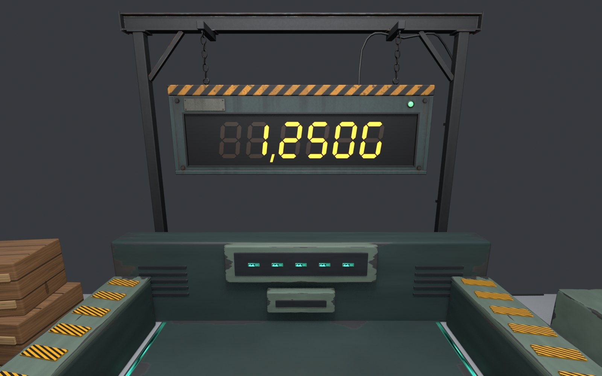
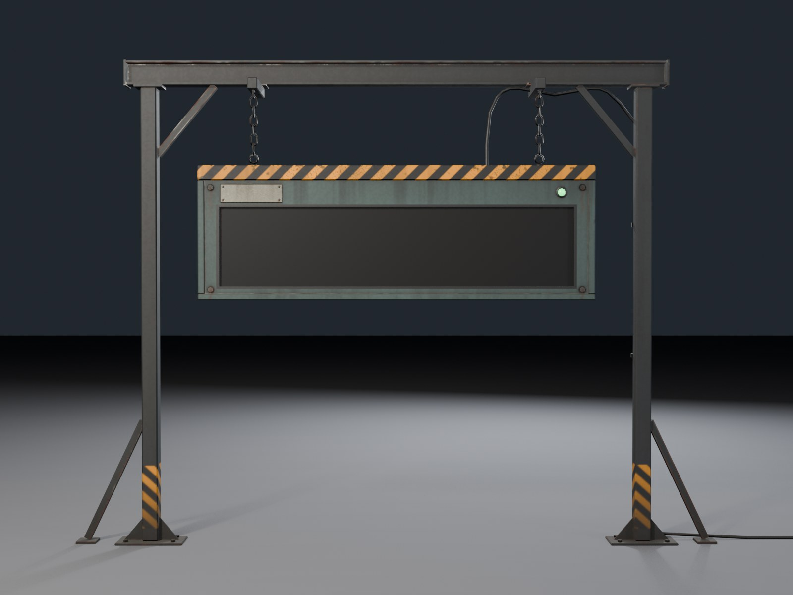

# 納品場所の表示板（合計額）＝ 発掘隊の電光掲示板




発掘隊が遺跡に持ち込んだ、頑丈な電光掲示板です。くすんだ青緑の塗装鉄の箱を、納品場所の機械の後ろに立てた足場から 2 本の鎖で吊っています（見た目の案 A。仕様は `.claude/loops/20261107-th-cargo-board.md`）。
外部の素材・生成サービスは使わず、形もテクスチャも `build_board.py` で作っています（2026-11-07）。

| 項目 | 値 |
|---|---|
| 箱の外寸（幅×高さ×奥行） | **1.93 × 0.655 × 0.135 m**（上下の枠・左右の溝形材を含む）。本体は 1.90 × 0.59 × 0.12 m、角の面取り 12mm |
| 全体（足場・ケーブル込み） | 高さ 2.445 m。足場の幅 3.25 m（両脇の筋交いの足まで）、横棒 2.74 m。床のケーブルは右へ x −2.35 まで伸びる |
| 三角形 | **2,768** / 上限 3,000（Body 2,688 = 箱 1,066 ＋ 足場・鎖・ケーブル 1,622、Screen 2、Lamp 78） |
| 材質 | 3 つ: `TH_CargoBoard`（アトラス 1 枚）・`TH_CargoBoardScreen`（黒）・`TH_CargoBoardLamp`（ランプ） |
| テクスチャ | 1024×1024 が 2 枚（`textures/`） |
| 当たり判定 | なし（ビーム・お宝・亡霊の視線を止めない） |

数値の全部は `stats.json`、検査の結果は `verification.json`（全項目合格）。

## 部品の構成（Unity 側はこの名前で結線する）
```
CargoBoard_Root            （EMPTY。原点 = 床、2 本の柱の足元の中心）
├─ CargoBoard_Body         （箱・注意帯の上枠・下枠・左右の溝形材・札・ボルト・吊り金具・背面の配線箱/銘板/通気口/補強リブ、
│                            足場（柱 2・H 鋼の横棒・腕 2・方杖・筋交い・ベース板・アンカー）、鎖 2 本、電源ケーブル。材質 TH_CargoBoard）
├─ CargoBoard_Screen       （画面の凹みの底。四角 1 枚。原点 = 画面の中心。材質 TH_CargoBoardScreen）
├─ CargoBoard_Lamp         （通電ランプのレンズ。原点 = ランプの中心。材質 TH_CargoBoardLamp）
├─ CargoBoard_DigitsAnchor （EMPTY。数字の範囲の中心。画面の 4mm 手前）
└─ CargoBoard_LabelAnchor  （EMPTY。札の中心。札の表面の 1mm 手前）
```
すべてのノードは回転 0・拡大 1。Unity では正面 +Z（練習の列の方を向く）。

## 置き方と主な位置（Unity 座標、m）
- **モデルの原点を VenueRoot ローカル (0, 0, 0.09) に置く**（回転 0）。これで画面の中心が `ScoreBoardAnchor` (0, 1.5, 0.32) に来る。
  - 原点 → 画面の中心のオフセット: **(0, 1.5, 0.23)**。`ThStageBuilder` が `ScoreBoardAnchor` に合わせて置く場合は、アンカーの位置からこのオフセットを引いた所にルートを置く（または `CargoBoard_Screen` の位置がアンカーに来るように合わせる）。
- **画面**（`CargoBoard_Screen`）: 中心 (0, 1.5, 0.23)（VenueRoot では (0, 1.5, 0.32)）、大きさ **1.726 × 0.386**。凹みの深さ 20mm、周りの黒い縁 12mm。
- **数字の範囲**（`CargoBoard_DigitsAnchor`）: 中心 (0, 1.5, 0.234)（VenueRoot (0, 1.5, 0.324)）、大きさ **幅 1.60 × 高さ 0.30**、+Z 向き。5 桁＋千の位の「,」＋「G」をこの中に右詰めで収める。7 セグのメッシュは画面の 4mm 手前（このアンカーの面）に置く。
  - 確認画像の仮の 7 セグ（`render_board.py`）: 文字の高さ 0.27、幅 0.155、線の太さ 0.031、文字の間 0.05、「,」の分 0.045、7° 斜め。合計幅 1.225。参考にしてよい（決まりではない）。
- **札**（`CargoBoard_LabelAnchor`）: 中心 (0.705, 1.757, 0.257)（VenueRoot (0.705, 1.757, 0.347)）、札の大きさ **0.30 × 0.088**、文字を置ける範囲 0.26 × 0.058。札は明るいヘアラインの金属なので、TMP の「納品額」は暗い色（例: #1E1E1C 前後）にする。正面から見て左上。
- **通電ランプ**（`CargoBoard_Lamp`）: 中心 (−0.80, 1.762, 0.25)（VenueRoot (−0.80, 1.762, 0.34)）、レンズの半径 19mm・高さ 16mm。正面から見て右上。
- 鎖の吊り点: x = ±0.70、箱の上の目玉ボルト (±0.70, 1.93, 0.19) → 腕の下 (±0.70, 2.265, 0.19)。
- 足場の柱: x = ±1.25、z = 0（VenueRoot z = 0.09）、断面 80mm 角。ベース板 0.34 × 0.16（VenueRoot z 0.01〜0.17）。横棒は高さ 2.32〜2.44。

## 納品場所の機械・回収範囲・練習の列との位置関係（`verify_board.py` で確認）
| 確認 | 結果 |
|---|---|
| 柱・ベース板と納品場所の機械（`THStage_ExtractionBay`、z 0.18 から） | ベース板の奥の端 z 0.17。**隙間 10mm**、メッシュ同士の最小距離 **15.7mm**。三角形の交差 0 |
| 入口のキャンプ（`THStage_EntryCamp`：発電機・木箱・照明） | 交差 0、当たり判定の箱の中に頂点なし |
| 回収範囲 `CollectionVolume`（中心 (0, 0.49, 1.2)、2.3 × 0.92 × 1.56） | 中に頂点なし（表示板の箱は z 0.22〜0.36、機械の背板の上 0.715m より 0.52m 上） |
| 練習の立ち位置（z = 2.5） | モデルの一番手前（z 0.356）から **2.14m** |
| 会場の内側（z ≥ 0、\|x\| ≤ 2.5） | z 0.010〜0.356、\|x\| 最大 2.35（床のケーブルの端） |

- `stage_layout.json` は Unity→Blender を (X, −Z, Y) と書いており、モデルの FBX の軸（(−x, z, −y)）と x の向きが逆になる。表示板はほぼ左右対称だが、念のため両方の向きで全部を確かめた（どちらも合格）。
- 柱は機械の背板（z 0.18〜0.52）の後ろの 18cm の隙間に立つ。会場の端（z = 0）との間は 1cm。現実の腰壁の位置と合うかは実機で確かめる。

## Unity に取り込むとき
- **FBX の軸**: 敵（#67）と同じ。Blender の Z 上のまま書き出し（`axis_up='Z'`・`axis_forward='Y'`・`bake_space_transform` なし、書き出す間だけ Z 軸 180° 回す。`build_board.py` の `export()` / `turn_z180()`）。**取り込み設定で Bake Axis Conversion をオン**にすると、全ノードが回転 0・Y 上・正面 +Z で入る。ローカル座標 = `.blend` の (x, y, z) → Unity (−x, z, −y)（`stats.json` の `*_unity`）。
- Scale Factor 1、Normals = Import（面積で重みを付けたカスタム法線を書き出している）、Tangents = None（法線マップは使っていない）。材質は取り込まず、下の Unity 材質を割り当てる。
- `TH_CargoBoard`（URP Lit・不透明）:
  - Base Map: `textures/CargoBoard_BaseColor.png`（sRGB。汚れ・塗装の剥げ・錆・雨だれ・ボルトの錆の垂れ・上向きの面のほこり・注意帯の縞を焼き込み済み）
  - Metallic Map: `textures/CargoBoard_MetallicSmoothness.png`（**sRGB オフ**。R = 金属度、A = 滑らかさ）。Smoothness の出どころを Metallic Alpha にし、Smoothness の倍率は 1。
- `TH_CargoBoardScreen`: 単色の黒（Blender の値 (0.004, 0.0045, 0.0045)、ほぼ反射しない）。アンリットでもよい。7 セグの消灯色がうっすら見えるよう、黒は真っ黒より少し持ち上げてもよい。
- `TH_CargoBoardLamp`: 普段は緑（Blender の見本は発光 (0.12, 1.0, 0.25)）。`CargoBoardView` が色・明るさを塗る（納品のとき一瞬明るく）。
- 当たり判定を付けない。描画は Body・Screen・Lamp の 3 回（＋ Unity 側の 7 セグと TMP）。PICO で描画回数を減らしたいときは、Screen を Body と同じ材質にまとめてもよい（その場合は Screen の UV を黒い所に向ける必要がある。今の UV は 0〜1 の四角）。

## 作り方と確認
- 作る: `blender -b --factory-startup --python build_board.py`（`.blend` / `.fbx` / テクスチャ / `stats.json` を上書き。ベイク込みで約 10 秒）
- 検査: `blender -b --factory-startup --python verify_board.py`（FBX と blend を読み直し、部品と親子・回転 0・三角形・材質・箱の寸法・床の高さ・画面の中心とアンカー・ステージとの交差と隙間・テクスチャを確認。結果は `verification.json`。失敗なら終了コード 1）
- 確認画像: `blender -b --factory-startup --python render_board.py [-- nostage]`（`review/*.jpg` を上書き。ステージの画は `../Stage/Output/Stage_Review.blend` を読み込んで描く。保存はしない）
  - スタジオ: `front` / `three_quarter` / `back` / `detail_chain` / `detail_foot` / `detail_back` / `close_digits`（仮の 7 セグ「1,250G」）/ `bright_background`（明るいパススルーの会場を想定した灰色）
  - ステージ: `stage_practice_eye`（練習の列の真ん中、目の高さ 1.6m）/ `stage_practice_eye_digits`（同じ位置で仮の 7 セグ）/ `stage_practice_side_digits`（一番右の練習の位置）/ `stage_corridor_w_digits`（西の通路を戻ってくる所、約 5.5m）/ `stage_side_clearance`（横から。柱が機械の後ろに立つ）/ `stage_top_clearance`（真上から）
  - ステージの画には、入口の区画を照らす柔らかい照明を 1 つ足している（`Stage_Review.blend` は遺跡の中しか照らしていないため。会場の明るさの代わり）。
  - 仮の 7 セグは Unity のメッシュの代わりの見本。点灯は琥珀色の発光、消灯はごく暗い茶色。

### テクスチャの作り方
smart UV で展開（箱は足場の 1.5 倍の密度）→ Cycles で位置・法線・AO（0.35m と 0.045m）・角（ベベルノードの法線と面の法線の差）・部品の番号を浮動小数の画像にベイク → numpy で塗る:
塗装のまだら・細かい粒、くぼみの汚れ、縦の面の雨だれ（場所によって濃淡）、上の枠の下の黒ずみ、正面のボルトと札のリベットから垂れる錆、角の塗装の剥げ（下ほど多い。剥げた所は地金、大きい所は錆）、まばらな打痕、鎖・金具の錆、足場の足元の土、上向きの面のほこり、札の細かい擦り傷、真鍮の銘板のくすみ、注意帯（45° の黄黒、1 画素ほどぼかした境目、擦れた粒と引っかき傷）、柱の足元の注意帯（床から 8〜40cm）。

## 弱いところ・残した課題
- 箱の正面は平らな板で、画面の周りの縁（12mm）以外に凹凸がない。遠目では十分だが、1m 以内で見ると単調。
- 鎖の輪は断面が三角の低ポリゴン（6 輪 × 2 本）。近くでは角張って見える。
- 柱の注意帯は面ごとに縞の向きが変わり、角でつながらない（矢羽根のように見える）。
- 表示板の色は Blender の照明で決めた。PICO・URP の照明（パススルーの明るい会場）では、青緑が暗く沈む・注意帯が鮮やかすぎるなどの差が出うる。Unity で並べて確かめる。
- 柱のベース板と納品場所の機械の隙間は 1cm しかない（仮想の物同士なので体験には影響しないが、機械の位置を奥へずらすと重なる）。
- PICO での fps・見え方は未確認。
