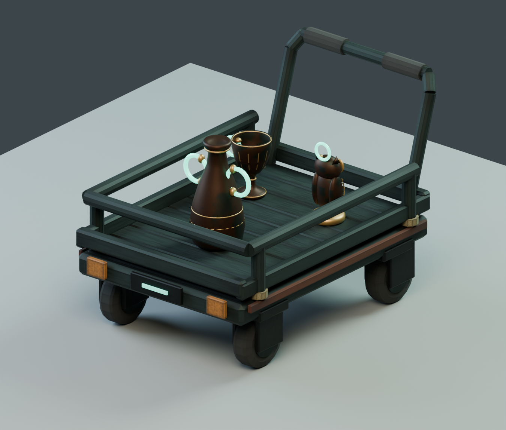

# Excavation Cart / 発掘用台車

**旧版・比較用です。現在の成果物は [Revision2](Revision2/README.md) を使用してください。** R.E.P.O.の資料調査に基づく箱型への再制作と、Unityでの積載金額表示を追加しています。以下は初版の記録です。

自作ステージと共通の暗い緑灰色の金属、錆色の縁、アンバー色のバンパーを使った小型台車。4輪・荷台・落下防止柵・押し手のシルエットで用途を伝え、金色のお宝が目立つ配色にした。R.E.P.O の素材・形状の転用、外部素材、有料生成は使用していない。

## 成果物と実測値

- `ExcavationCart.blend` / `ExcavationCart.fbx`: 台車本体のみ。原点は荷台中央の床面、単位 m。
- `Cart_Review.blend`: 照明・床・お宝3個を含む確認用シーン。ゲームに取り込まない。
- `empty.png` / `loaded.png`: Blender MCP の look で目視確認済み。
- `cart_stats.json` / `verification.json`: 計測結果。

| 項目 | 値 |
| :--- | :--- |
| 外寸（幅 × 奥行 × 高さ） | 0.766 × 1.153 × 0.779 m |
| 荷台上面 / 有効積載範囲 | 高さ 0.32 m / 幅 0.64 × 奥行 0.88 m |
| 三角形数 / メッシュ数 | 4,500 / 8 |
| マテリアル / 合計スロット | 2 / 9（実機 draw call 数ではない） |
| テクスチャ | ステージの自作 1024 × 128 アトラス3枚を共用、blend にパック・FBX に埋め込み |
| 車輪 | 半径 0.10 m、4輪を個別回転可能、後輪2輪はキャスター旋回軸あり |

## 会場・現行仕様との関係

5 × 11 m のステージを前提にした寸法。お宝込みで中央通路が最小 1.26 m の場所では、直進時の幾何学的な左右余裕は約 0.247 m。台車中心で回す際の保守的な旋回直径は 1.473 m なので、狭い区間でその場旋回はできない。通行人や手・身体の余裕を含む値ではなく、移動式として採用する場合は広い待避・旋回場所と運搬動線を設計し直す。

現行要件 U-4 の固定回収リフトを置き換えない。動く台車は将来案であり、今回の成果物はモデルと可動階層まで。ステージの高さ制約に合わせた低い押し手のため、使いやすさは実機検証が必要。実物台車の寸法は未提供で、実物への位置合わせも未検証。

積載例は Reviewed の amphora・cup・statuette（M 1個 + S 2個）。荷台への接地、範囲内への収まり、相互の平面バウンディングボックス非重複を確認した。L サイズ全種に対応する荷台ではない。落下防止柵の物理効果や積載量・重量制限は未実装。

## Unity へ渡す際の注意

Blender は X=幅、-Y=前、Z=上。FBX は -Z forward / Y up。安定した識別にはオブジェクト名の数値接尾辞ではなく `part_id` / `module_id` を使う。

- `Wheel_*`: Blender のローカル X 軸回転。`Caster_Rear*`: ローカル Z 軸旋回。Unity インポート後の軸変換を確認すること。
- `PushHandlePivot` の子に押し手と左右の `PushGrip_*` がある。握り位置は親の変形に追従する。
- JSON の Collider は荷台・柵の初期案だけ。脚・押し手・可動部を含めた最終的な衝突形状、Rigidbody、ハンド入力、同期、移動制御は未実装。
- Unity 側は共有 URP マテリアルへ割り当て、スムージング・金属／粗さ変換・発光を確認する。FBX の Blender シェーダーがそのまま URP に移るとは限らない。

## 再生成・検証

Blender MCP `execute_blender_code` で `build_cart.py` を実行する。既存シーンを残して独立シーンを作り、元のシーンと選択状態へ戻す。生成した `cart_builder.render('empty')` と `render('loaded')` で画像を保存する。続けて `verify_cart.py` を実行する。

FBX と blend の再読み込み、三角形数・寸法・UV・退化面なし・パック画像、4輪の軸と2キャスターの旋回、押し手の階層を検証済み。積載画像と空荷画像も目視確認済み。

Unity の Assets への取り込み、コンパイル、EditMode テスト、PICO の FPS、物理挙動、実物台車との照合は未実施。XR 性能の合否は実機計測後に判断する。
