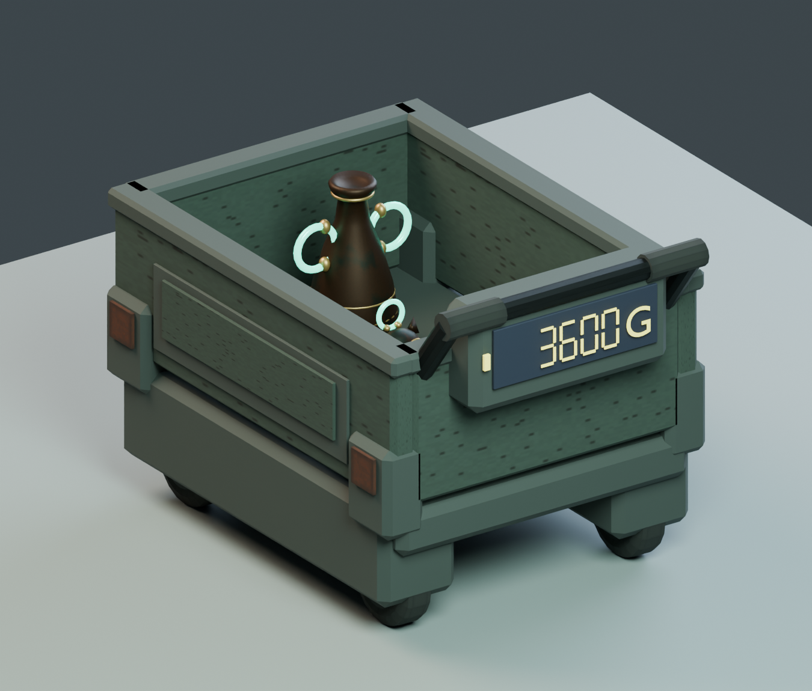
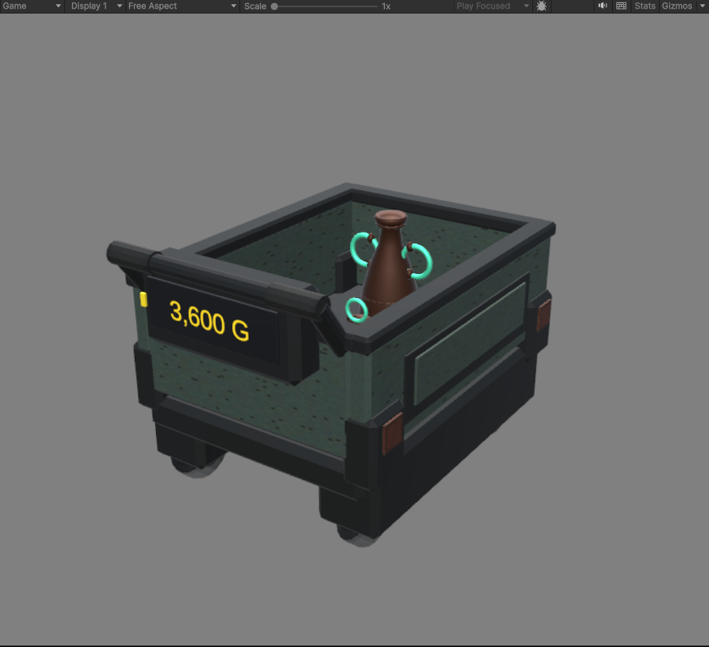

# Salvage Cart revision 2

[調査記録・変更根拠・金額仕様](../RESEARCH.md)

`ExcavationCart.blend` / `ExcavationCart.fbx` が改訂モデル。旧版は親フォルダに比較用として残している。`Cart_Review.blend` と画像の `3,600 G` は構図確認用の例示で、FBXに固定数字は含まれない。

Unity 成果物:

- `Assets/_Content/TreasureHaul/Prefabs/SalvageCart.prefab`: 現在積載額表示付き、固定／kinematic の台車。
- `Assets/_Content/TreasureHaul/Prototype/CartReview/CartValueReview.unity`: 既存のお宝3個（1600 + 800 + 1200 G）による独立した確認シーン。
- `CargoValuable`: 本編のお宝状態との接続口。積載判定点 `cargoPoint` を底付近に配置する。持つ・破損・消滅時には状態を更新する。
- `CartCargoCounter`: 台車のローカル BoxCollider 範囲内を判定して合算し、画面へ表示する。回収済みスコアは変更しない。

再生成: Blenderで `../build_cart_v2.py` を実行。FBXと塗装PNGを `Models/Cart/` にコピーし、UnityでRefresh後に `../assemble_unity.csx` をuLoopで実行するとPrefabと確認シーンを再構築する。この処理は確認シーンを上書きするため、手修正を残す場合は実行しないこと。ユーザーの開いている別シーンは保持する。

検証: FBX / blend再読み込み、寸法・UV・退化面・車輪軸検証済み。Unityコンパイル0エラー・0警告、EditMode 47/47成功。専用シーンのPlayModeで自動更新3600→2800、減額2320、持ち上げ1120、無効化0、復元3600と表示文字列を確認。移動、ハンド入力、本編ホスト同期、PICOの性能・視認性は未検証。
