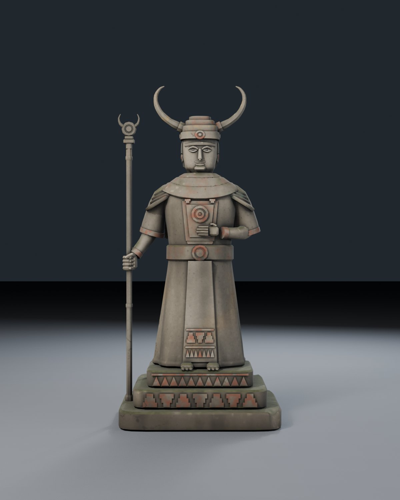
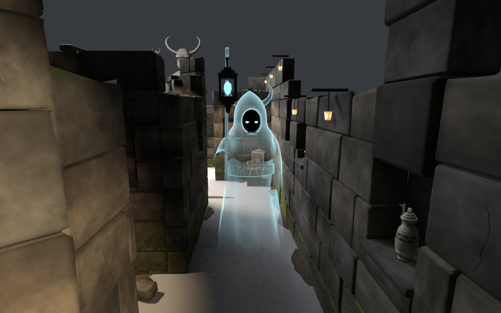

# 敵（番人の石像・遺跡の亡霊）




お宝・ステージと同じ架空の文明（仮の名前「階段の王国」）の 2 体です。模様は 4 つ（①階段、②同心円の目、③波と歯の帯、④角のある鳥＝角）。外部の素材・生成サービスは使わず、形もテクスチャも `build_enemies.py` で作っています（#67、2026-11-07）。

## 物語
- **番人の石像＝角冠の王**: この遺跡を築いた王の像。壁（2.4m）より高く、遺跡全体を見下ろしている。目が光って振り向いたら、動いてはいけない。
- **遺跡の亡霊＝墓守の霊**: 王に仕えた墓守。死んだ後も、竿の先に吊った灯りを手に、王の墓所の通路を見回っている。お宝は王への供え物なので、灯りに照らされると取り上げられる／墓所から追い出される。床の光の扇は墓守の灯りの光。
- 王と墓守は主従。墓守の頭巾の角は、王の冠の角と同じ意匠を小さくしたもの。

| モデル | 中身 | 寸法（幅×奥行×高さ） | 三角形 |
|---|---|---|---|
| `Statue/KingStatue` | 角冠の王。階段状の台座・杖・胸に当てた手・胸当て・背中の 2 段の外套 | 1.72 × 1.50 × **3.59** m | **13,834** / 上限 15,000（体 8,950 / 頭 4,548 / 目 168×2） |
| `Phantom/GraveKeeper` | 墓守の霊。角のある頭巾・顔は闇に目だけ・竿の吊り灯り | 0.74 × 1.19 × 1.99 m | **3,608**（体 2,730 / 闇 126 / 目 80×2 / 灯りの枠 556 / 芯 36） |

数値の全部は `stats.json`、検査の結果は `verification.json`。

## 部品の構成（Unity 側はこの名前で結線する）

### 石像 `KingStatue.fbx`
```
KingStatue_Root            （EMPTY。原点 = 台座の底の中心、床）
├─ KingStatue_Body         （台座・衣・腕・手・杖。材質 TH_Statue）
└─ KingStatue_HeadPivot    （EMPTY。首の回転の中心 = Unity (0, 2.59, 0.01)）
   └─ KingStatue_Head      （頭・髪・冠・角・後ろの飾り板。原点 = HeadPivot。材質 TH_Statue）
      ├─ KingStatue_Eye_L  （原点 = 目の中心。材質 TH_StatueEye）
      └─ KingStatue_Eye_R
```
- 頭は `KingStatue_HeadPivot` を上向きの軸で回す。0°・±45°・±90°・135°・180° で、頭（角・冠・髪・目を含む）が体に当たらないことを `verify_enemies.py` が三角形の交差で確かめている（`Statue/review/head_turn_000/090/180.jpg`）。首の継ぎ目は 3 段の襟（内径 14.6cm、首 13.2cm）で隠れる。
- 目の中心の高さ 2.886m（Unity (±0.072, 2.886, 0.17)）。L/R は**像から見た**左右（L = Blender +X = Unity −X）。
- `TH_StatueEye` は普段は暗い石の色（Blender では BaseColor (0.045, 0.042, 0.038)、Emission 黒）。光らせるのは #68 のコード（`_BaseColor` と `_EmissionColor` を上げる。`Statue/review/eyes_lit.jpg` は色だけ変えた見本）。
- `TH_Statue`: 体と頭で 1 枚のアトラスを共有（2048×2048、`Statue/textures/`）。
  - `KingStatue_BaseColor.png`（sRGB。AO・汚れ・苔・ひび・欠け・帯の褪せた赤い顔料を焼き込み済み）
  - `KingStatue_Roughness.png`（Non-Color）と、Unity 用に詰めた `KingStatue_MetallicSmoothness.png`（R=金属度 0、A=1−粗さ、sRGB オフ）。URP Lit の Metallic Map にこれを入れ、Smoothness の出どころを Metallic の Alpha にする。
  - 透明・法線マップは使っていない。
- **当たり判定**（BoxCollider 6 個。Unity 座標、m。床〜2.1m）:

| 名前 | 中心 | 大きさ |
|---|---|---|
| Collider_Plinth1 | (0.000, 0.100, 0.001) | (1.682, 0.200, 1.500) |
| Collider_Plinth2 | (0.000, 0.300, 0.007) | (1.399, 0.200, 1.253) |
| Collider_Plinth3 | (0.000, 0.490, 0.006) | (1.118, 0.180, 1.011) |
| Collider_RobeLower | (0.009, 0.940, 0.039) | (1.008, 0.720, 0.939) |
| Collider_RobeUpper | (−0.019, 1.700, −0.012) | (1.276, 0.800, 0.707) |
| Collider_Staff | (0.740, 1.150, 0.071) | (0.188, 1.900, 0.173) |

  （値は `stats.json` の `colliders` が正。モデルを作り直すと少し変わる）

### 亡霊 `GraveKeeper.fbx`
```
GraveKeeper_Root               （EMPTY。原点 = 床（裾の真下））
├─ GraveKeeper_Body            （頭巾・衣・袖・竿の 1 メッシュ。材質 TH_PhantomBody＝半透明）
├─ GraveKeeper_Void            （頭巾の奥の闇。不透明の暗い面。材質 TH_PhantomVoid）
├─ GraveKeeper_Eye_L / _R      （原点 = 目の中心、高さ 1.50m。材質 TH_PhantomEye）
└─ GraveKeeper_LanternPivot    （EMPTY。竿の先の吊り点 = Unity (0.24, 1.96, 0.80)）
   ├─ GraveKeeper_LanternFrame （古びた青銅の枠。不透明。原点 = 吊り点。材質 TH_PhantomLantern）
   └─ GraveKeeper_LanternGlow  （光る芯。原点 = 吊り点。材質 TH_PhantomEye）
```
- 目の中心はちょうど 1.50m（`ThPhantomParams.eyeHeight` の初期値）、Unity (±0.043, 1.50, 0.11)。
- 灯りの芯の中心は前方 0.80m・高さ 1.77m（吊り点から 0.19m 下）。揺らすときは `LanternPivot` を左右の軸（ローカル X）で回す。
- **注意**: 光る芯（`LanternGlow`）は `PhantomView._glows`（色だけ塗る。高さは変えない）に入れる。`_eyes` に入れると、`Configure` が目の高さに合わせて動かしてしまう。芯の原点は吊り点にあり、位置は 0 のままが正しい。
- `TH_PhantomBody` の想定（Unity 側 `TIB/TreasureHaul/PhantomGhost`）: 光を受けない半透明。縁ほど明るく不透明（フレネル）、オブジェクト空間の高さで裾を消す（0.15m で 0、0.70m で最大）、**頂点色 A を掛ける**、深度の先行描画で自分の重なりを 1 層にする。
  - 頂点色 `Col`（面の角ごと、byte）: **A = 不透明度の掛け率**。普段 1、袖の先（最後の約 45%）・頭巾のケープの縁・竿の後ろ端で 0 へ落ちる（裾のぎざぎざの縁は 0.45）。**RGB = 折り目の陰（任意）**: 開いた所 1、ひだの奥・袖の付け根 約 0.45〜0.6、胸の階段の帯は少し明るい。Unity のシェーダー（`PhantomGhost`）は `_VertexColorShade`（0〜1、初期値 0.6）で色に掛けるので、布の折り目が形で出る（実装済み。0 にすれば A だけ）。
  - Blender の `.blend` の `TH_PhantomBody` には、同じ考え方の見本ノード（Eevee。フレネル＋高さで消える＋頂点 A＋Transparency Overlap オフ）が入っている。確認画像はこれで描いた。
- `TH_PhantomVoid` はほぼ黒（0.006, 0.009, 0.012）の不透明・光を受けない想定。`TH_PhantomEye` は単色の発光（`PhantomView` が `_BaseColor` を塗る。普段 (0.2, 0.7, 0.9)、見つかった時は赤）。
- `TH_PhantomLantern`: `Phantom/textures/GraveKeeper_Lantern_BaseColor.png`（256×8 のグラデーション。UV の u = 頂点ごとの陰で、くぼみの緑青〜暗い青銅〜すれた縁）と `GraveKeeper_Lantern_MetallicSmoothness.png`。
- 当たり判定は持たない（今どおり）。

## Unity に取り込むとき
- **FBX の軸**（2026-11-07 に、書き出しの案を全部 Unity 6.3 に取り込んで確かめて決めた）: Blender の Z 上のまま書く（`axis_up='Z'`・`axis_forward='Y'`・`bake_space_transform` なし）。ただし書き出す間だけモデルを Z 軸で 180° 回す（`build_enemies.py` の `export()` / `turn_z180`。節点の位置の x・y の符号を反転し、メッシュを各自の原点まわりに回す。書き出したあとで戻すので、`.blend` は正面 −Y のまま）。1m = 1。
- **取り込み設定で Bake Axis Conversion をオンにする**: 全ノード（ルートを含む）が回転 0・Y 上・正面 +Z になり、メッシュの頂点も Y 上。ローカル座標は「回した後の Blender」の (x′, y′, z′) → Unity の (x′, z′, y′)（= 元の `.blend` の (x, y, z) → (−x, z, −y)。`build_enemies.py` の `to_unity()` と同じ）。`stats.json` の `*_unity` の値はこの座標。入れ子の EMPTY（吊り灯りの枠・芯）も `LanternPivot` の位置と重なる。ほかの案は使えなかった: `axis_forward='-Z'`・`axis_up='Y'`（お宝と同じ）は、Bake をオンにしても X 270° のルートと Z 上のメッシュのまま入る。`bake_space_transform=True` は入れ子の EMPTY の下のメッシュがずれる。`axis_forward='-Y'`・`axis_up='Z'` はルートに Y 180° が残り、正面が −Z になる。
- Scale Factor 1、Normals = Import（面積で重みを付けたカスタム法線を書き出している）、Tangents = None。材質は取り込まず、上の名前の Unity 材質を割り当てる。
- FBX を差し替えるときは同じパスに上書きする（guid を保つ）。

## 作り方と確認
- 作る: `blender -b --factory-startup --python build_enemies.py [-- statue|phantom]`（`.blend` / `.fbx` / テクスチャ / `stats.json` を上書き。石像はアトラスを Cycles でベイクするので約 1 分。GPU が無ければ CPU で動く）
- 検査: `blender -b --factory-startup --python verify_enemies.py`（FBX と blend を読み直し、高さ・三角形の上限・目の高さ・部品の名前と親子・首の原点・頭を回したときの交差・頂点 A・テクスチャの大きさを確認。結果は `verification.json`。失敗なら終了コード 1）
- 確認画像: `blender -b --factory-startup --python render_review.py [-- statue|phantom] [nostage]`（`Statue/review/*.jpg`・`Phantom/review/*.jpg` を上書き。ステージの画は `../Stage/Output/Stage_Review.blend` を読み込んで描く。保存はしない）
  - 石像: front / three_quarter / back / head_close / head_back / head_turn_000・090・180 / eyes_lit / scale_wall_person（壁 2.4m・人 1.7m）/ stage_hall_lookup / stage_corridor_over_wall / stage_entrance（石像は大広間の奥の壁の外、奥行 11.85m に仮置き）
  - 亡霊: front / three_quarter / side / back / face_close / alert_red / bright_background（パススルーの会場を想定した明るい灰色）/ stage_corridor_w・_close（西の通路、目の高さ 1.65m）

### 石像の形（2026-11-07 の検収で直した点を含む）
- 正面: 3 段の襟、階段の縁の胸当て（2 枚重ね、中心に同心円の胸飾り、下の角に階段の飾り）、腹の段、腰帯と同心円の留め具、裾まで垂れる前掛け（波と歯・階段の帯の浮き彫り）。肩当ては広い下段と階段状の上段の 2 枚重ね。
- 背面: 肩から垂れる 2 段の外套（縁取りとひだ、裾は背中の中央で一番下がる丸み）、腰帯の背中に階段の留め具と同心円、背中の垂れ板に階段の柱・同心円・波と歯・階段の帯の浮き彫り（正面の帯と同じ模様）。
- 手: 胸に当てた左手は手の甲に厚み、指を揃えて先を少し曲げる。右手は杖に 4 本の指が回り、指の付け根の節と親指が杖の前に見える。
- 顔: 上唇は中央の小さな山で分かれた 2 つの膨らみ、下唇は厚く、間の線と口角が影になる。顎は広く角張らせ、まぶたの縁を厚くした（遠目でも目の位置が読める）。
- 後頭部: 細かい筋をやめ、太い房を刻んだ彫刻の髪を 3 段に重ね、首の上に三つ編み。

### 石像のテクスチャの作り方
smart UV で展開（頭は 1.6 倍の密度）→ Cycles で位置・法線・AO（0.45m と 0.06m）・凸凹（Pointiness）・部品の番号・欠けの印を浮動小数の画像にベイク → numpy で石を塗る（大きなまだら・粒・雨だれの筋・張り出しの下の黒い垂れ・風化の小穴・地面から約 1.1m までの土と湿り・上向きの面の汚れと苔（下半分ほど多い）・地衣類の斑点・まばらで長いひび・欠けの明るい地肌・帯の褪せた赤い顔料・襟・冠・胸当て・腰帯の古い顔料（赤土色とくすんだ青緑。くぼみに残る）・冠の金の名残・髪の房の溝）。ベイクに使った一時画像と床は保存しない。

## 弱いところ・残した課題
- 石像の衣の裾から腰までは、まだ円柱に近い（前後の垂れ板とひだで区切っている）。袖の付け根の形は単純。
- 顔と手は角張った低ポリゴンの様式のまま。近くで見ると硬さが残る。
- 亡霊の衣のひだはシルエットでは出るが、半透明で面の陰が弱いので、Unity 側の `TIB/TreasureHaul/PhantomGhost` で頂点色 RGB を色に掛けている（`_VertexColorShade` 0〜1、初期値 0.6。実装済み）ので、折り目が出る。明るい背景（パススルーの会場）では白っぽい水色が薄く見えるので、実機で色と不透明度の調整が要る（`bright_background.jpg`）。
- 石像の置き場所（#68）は未定。確認画像では奥の壁の外に仮置きした。PICO での見え方・fps は未確認。
