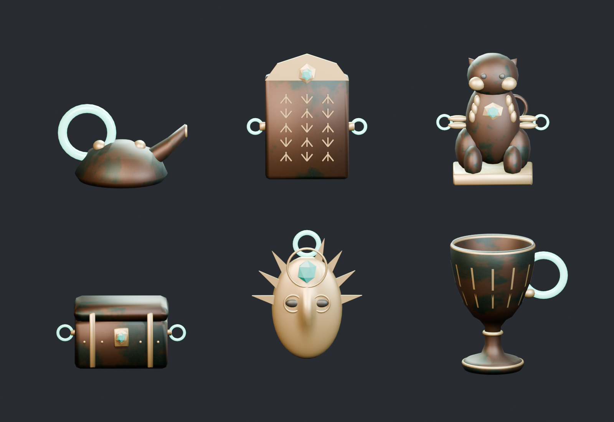

# お宝モデルレビュー・修正版（2026-10-18）

対象は `81739f6` の10種と柄違い（ベースのSモデルを含む）。修正版はこのディレクトリの `.blend` / `.fbx`。親ディレクトリの原本は比較・再生成用に保持。Unityへの配置はまだ行っていない。

## 評価と修正

| 観点 | 所見 | 修正・判断 |
| --- | --- | --- |
| 世界観 | 古代遺跡の発掘品というテーマ、青銅・金装飾の組合せは合う。実在の文明を忠実に再現するモデルではない | 共通材質と架空の幾何学文様を維持。守護像は依然デフォルメ調で、写実的な美術品水準とは評価しない |
| 一目でお宝と認識できるか | 杯・宝箱・金仮面は分かりやすい。石碑や像は背景の置物に見えやすい。元の箱の金帯は本体内部に埋もれていた | 箱の金帯を表面に出し宝石錠を追加。石碑に金の印章と宝石、守護像に胸飾りを追加。秘宝は太陽冠を幅広い放射状の輪郭に変更 |
| 発見時の高揚感 | 茶色い本体と細かな緑青だけでは価値が伝わりにくい | 金の輪郭・宝石の大きな色面を追加。秘宝は金の顔・冠・額の宝石で特別感を強調。発光リングは操作対象として維持。全種を金一色にせず識別性を保つ |
| 形状品質 | 石碑の棒が前後に貫通、ランプの注ぎ口が回転体の皿、冠・触角・耳・光条が片面、像の飾りや取付部が浮いていた | 石碑を浅い幾何学レリーフに変更。方向性のある注ぎ口に再建。片面装飾に厚みを付与。像の装飾と取付部を接続。重複頂点・退化面を除去 |
| 出力品質 | 元のFBX出力は全身を同じ柄に塗り替え、金・目・彫り込みを失っていた | 本体の青銅スロットだけ差し替え、金と暗部を保存。秘宝の柄違いは顔のみ変更。翡翠のMetallicを0へ修正 |
| XR負荷 | 三角形上限は元から満たすが、細かな部品が11〜35メッシュに分かれていた | 本体を結合し、同一材質スロットを統合。持ち手は個別制御できるよう分離。2〜3メッシュ、3〜6材質スロットに縮小 |

上段はランプ・石碑・守護像、下段は宝箱・秘宝・杯。拡大図は見やすいサイズに揃えたもので、実寸比較ではない。実寸比の全10種は [showcase.png](showcase.png)。

## 実測値

| モデル | 元の三角形 | 修正版の三角形 | メッシュ数（前→後） |
| --- | ---: | ---: | ---: |
| 仮面 | 4,684 | 4,684 | 11→2 |
| 杯 | 4,792 | 4,696 | 19→2 |
| 小像 | 4,664 | 4,600 | 35→2 |
| スカラベ | 2,442 | 2,456 | 14→2 |
| ランプ | 3,144 | 3,020 | 15→2 |
| 壺 | 4,128 | 4,064 | 12→3 |
| 石碑 | 1,610 | 2,104 | 11→3 |
| 守護像 | 4,686 | 4,740 | 26→3 |
| 宝箱 | 2,468 | 2,508 | 16→3 |
| 秘宝の仮面 | 4,568 | 4,644 | 15→2 |

10種各1個でメッシュ数174→24。材質が複数あるため24ドローコールという意味ではない。最大モデルを23個置く保守的な計算では109,020 triで、お宝単体の5,000 tri上限、シーン30万 triの仮予算内。ただし背景・手・UI・影・ステレオ描画・物理の負荷は別であり、72fpsを保証しない（要件N-1）。形状認識のために追加した面も含む。

テクスチャは既存512pxの柄を再利用。FBXには画像を埋め込み、単体blendは使用画像をパック。Unity導入時は同じ画像・材質をモデルごとに複製せず共有し、端末用圧縮・MipMap・不透明URP材質を設定して評価する。FBXの材質変換だけでURPの見た目が一致するとは扱わない。

## 検証

- `verify_reviewed.py`: FBX全30個と単体blend全10個を再読込して合格。
- 三角形数・メッシュ数・寸法（1mm以内）、UV、退化三角形なし、金装飾維持、持ち手数と発光、翡翠の非金属設定、blend画像パックを確認。
- Blender MCP `look` で全体画像と修正後の拡大画像を目視確認。
- 杯と小像には元モデル由来の開いた境界が残る（FBX再読込で96 / 36辺）。装飾の見えない裏側を含み、密閉した物理形状ではない。描画メッシュをそのまま動的MeshColliderとして使わず、Unityで簡単な複合Colliderを作ること。
- Unityプロセスが起動していないためコンパイル・EditModeテストは未実施。Unityインポート、URP表示、コライダー、PICO実機72fpsは未検証。L・秘宝は企画上の候補で、現在のS/Mゲームルールへの割当てを変更していない。

## 初見評価が必要な点

「テンションが上がる」は制作者の画像確認だけでは合格にしない。PICOの明るいパススルー背景で0.5m / 1m / 2mから見せ、説明や値札を出す前に「運び出したい物はどれか」「何に見えるか」を確認する。特に石碑・守護像・小さなランプを優先する。金と緑青のコントラスト、宝石と発光リングの混同、手や他のお宝による遮蔽も見る。

## 再生成

元ショーケースを開いたBlenderで `review_treasures.py` の `run()` を実行し、その実行で作られた `TH_Reviewed_Showcase` シーンを `render_previews(scene)` に渡す。次に `verify_reviewed.py` を実行する。既存の開いているシーンと選択は復元し、保存を上書きしない。修正用の別シーンは比較用にBlender内に残る。繰り返し実行時は名前に連番が付く。
