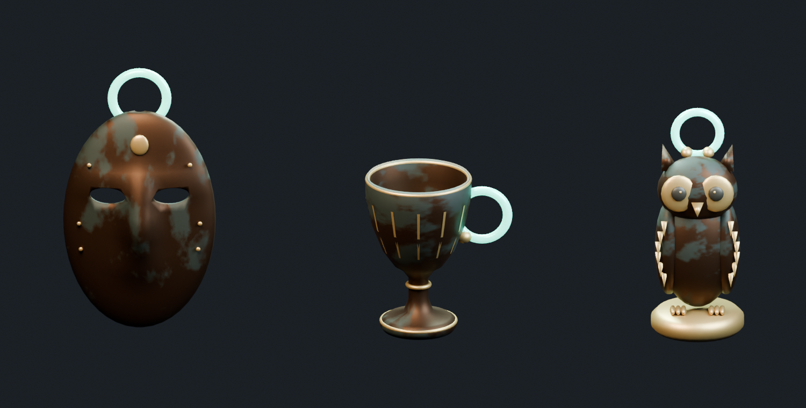

# Treasure Haul — お宝 S

Issue #46 のうち、仮面・杯・小像の3点。自作の鋳造青銅、控えめな緑青、金色の縁取り、ミント色の発光リング持ち手で統一した。人物・既存ブランド・既存作品の形状は参照していない。CC0候補調査と権利・費用・セキュリティ確認はリポジトリ直下の `THIRD_PARTY_NOTICES.md` を参照。

| ファイル | 形状 | tri（持ち手・装飾込み） | 幅 × 奥行 × 高さ（m） |
|---|---|---:|---|
| `mask.blend` / `mask.fbx` | 目穴、鼻の起伏、鋳造壁厚を持つ仮面 | 4,684 | 0.1968 × 0.0970 × 0.3452 |
| `cup.blend` / `cup.fbx` | 内壁・底・縁のある中空杯 | 4,792 | 0.1900 × 0.1380 × 0.2090 |
| `statuette.blend` / `statuette.fbx` | 羽根・足爪・台座付きのフクロウ小像 | 4,664 | 0.1200 × 0.1200 × 0.2925 |

3点を一緒に確認するシーンは、親フォルダの `TreasureHaul_S_Showcase.blend`。初期キューブを削除し、カメラと照明を設定して保存している。

## データ

- `.blend` は各1体を原点配置した独立scene入り。画像を内包しており、通常の Open で開ける。作業中ファイルへの追加は File > Append から対象Collectionを選ぶ。
- FBXは同じ原点・メートル寸法で、Y-up / -Z-forward。親Emptyの下に形状と発光持ち手を分離。全メッシュにUVがある。画像もFBXへ内包。
- `textures/` の512 × 512 PNGは自作の共通Base Color / Roughness / Metallic。数値マップはNon-Color。第三者テクスチャや生成APIは使用していない。
- `TH_S_Grip_Emission` は線形RGB `(0.04, 1.0, 0.65)`、強度 `2.5`。各1個の持ち手に割り当て。BlenderへFBXを再読み込みした際も色・強度が保持されることを確認済み。
- `stats.json` に制作時のtri数、寸法、UV、持ち手名。`verification.json` に保存済み `.blend` とFBXの再読込検査結果。

## 再生成と確認

Blender 5.1.2で `build_treasures.py` をPythonとして実行する。`__file__` をこのスクリプトの絶対パスに設定した `exec(compile(...))`、またはBlenderのPython実行機能を使用する。Object Mode、単位スケール1、`TH_S_Treasures` コレクションのない作業ファイルが前提。既存sceneをリセットせず専用Collectionを追加し、成果物のみをライブラリ書き出しする。既存の未保存ファイルを保存・上書きしない。同じCollectionがある場合は停止する。

続いて `verify_and_preview.py` を実行すると、保存済みscene・原点・内包画像、FBX再読込時のtri数・寸法・UV・発光色/強度を検査し、独立した一時sceneでプレビューをレンダリングする。一時的に追加した検査用オブジェクトのみ取り除く。既存オブジェクトの変換は保持する。制作・検査スクリプトはローカルBlender APIのみを使用する。

2026-10-18にBlender MCPの `look` でプレビューを目視し、3形状・目穴・杯の内側・発光持ち手を確認した。

## Unity側で残っている作業

ユーザー指定により `Assets/` への取り込みはしていない。Unityコンパイル・EditModeテスト・PICO実機検証は未実施。URPマテリアル、Emissionの有効化、必要に応じたBloom、Collider、つかみ位置・物理・破損設定は取り込み時に設定する。URPではRoughnessを `1 - Roughness` でSmoothnessへ変換し、必要に応じてMetallicテクスチャのAlphaへパックする。FBXのBlender再読込での保持はUnityでのマテリアル自動変換を保証しない。

小像は鋳造オブジェクトとして複数の重なった部品で構成し、杯の金色装飾は表面上の薄いポリゴン。単一の水密メッシュや破壊用断面メッシュではない。持ち手の実機での握りやすさは別途確認が必要。
