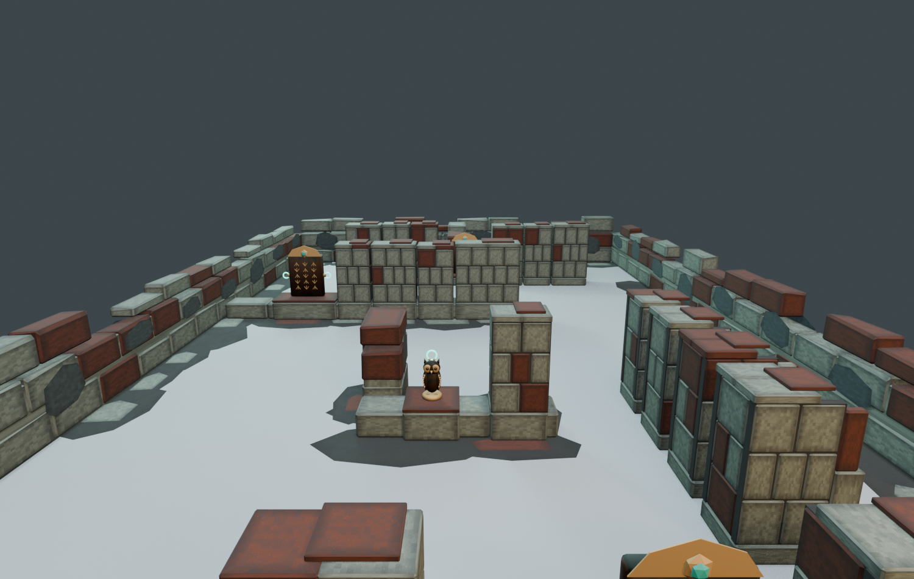

# Treasure Haul ステージの出力（旧 Revision7）— 隠し場所の作り直し

2026-10-19。`build_stage.py` の出力。このフォルダは作り直すたびに上書きする（以前は Revision7 というフォルダ名だった）。Revision6 の「隠したつもりの配置」を判定にかけたところ、隠せていたのは18か所中7か所だけだった（分析はコミット `d020226` の `Stage/Revision6/README.md` にある）。Revision7 ではこれを作り直し、画像と判定の両方で確認した。**Blender 上の成果物であり、Unity への取り込みと PICO 実機での確認はしていない。**

> **完成版ではない**: 見えているお宝5個（3・4・10・14・19）は高さ 0.12〜0.2m の平たい石板に載っているだけで、床置きに見える。下の「床に直置き 0」は「底が床から5cm未満」という甘い定義での数字。置き場所が格子状に並ぶ構成も残っている。

上の画像は練習の列に立った大人の目線（1.65m）。見えているお宝は、手掛かりとして置いた5個（石碑3・小像・杯）だけで、残り18個は石の祠の中にある。

| 画像 | 内容 |
| --- | --- |
| [eye.png](eye.png) / [eye_west.png](eye_west.png) | 入口から見た目線（中央・西寄り） |
| [top.png](top.png) / [overview.png](overview.png) | 真上・斜め上からの全体 |
| [peek_sheet.png](peek_sheet.png) | 隠し場所18か所を、それぞれ一番よく見える近くの位置から見た画像の一覧（判定で出た位置を使用。1枚ずつの画像は `render_search_views.py` で書き出せる） |
| [floorplan.svg](floorplan.svg) | 配置図と台車の経路 |

## 配置の考え方
- **すべて石の上**。床に直に置いたお宝は0個（判定で確認）。
- **祠（ほこら）は入口側を閉じ、反対側を開ける**。正面（入口側）と側面は石積みで閉じ、屋根の石は入口側だけを覆う。開いた側から回り込むと、立ったままでも中の光る持ち手が見える。
- 置き方は3種類。
  - 裏が開いた石の祠（14か所）: 手前・中央・奥の列と中央の遺構。奥の列は 0.35m 手前に出して、裏に人が通れる通路を作った。
  - 西の通路の壁龕（へきがん。4か所）: 西の壁沿いの通路に向けて開け、南側に崩れた控え壁を付けて、入口側の斜めからの視線を遮る。
  - 見えている石の上のお宝（5か所）: 入口から見える手掛かり。全部隠すと何を探せばいいかわからないため。
- 仮面と手鏡は、祠の奥の壁から出た釘に掛けた（壁掛け）。
- 石積みは灰色の切り石を主にし、ところどころ錆色の石を混ぜた（Revision6 の初期案にあった規則的な赤白の市松模様はやめた）。継ぎ目の奥には目地の芯を入れ、継ぎ目から中が見えないようにした。
- 高さはすべて 0.8m 未満（最大 0.791m）。現実の人や壁を隠さない（企画書 7.1）。

## 判定の結果（`search_visibility.json`）
`check_search_visibility.py` を Blender のバックグラウンドで実行し、ステージのメッシュと他のお宝に対して視線（レイ）を飛ばした。お宝本体の頂点と、光る持ち手の頂点の両方を的にした。視点は、半径 0.30m の人が練習エリアから歩いて行ける位置を 0.10m 間隔で取った（2,524点）。

| 項目 | Revision6 | **Revision7** |
| --- | ---: | ---: |
| 隠す意図の場所 | 18 | 18 |
| 入口（奥行1.9〜3.2m、目線1.45/1.65m）から隠れている ※1 | 13 | **18** |
| 隠れていて、かつ近くで見つけられる ※2 | 7 | **18** |
| 見つけられる（全23個） | 17 | **23** |
| しゃがまずに見つけられる ※3 | 14 | **23** |
| ビームで取れる ※4 | 17 | **23** |
| お宝のメッシュが石にめり込んでいる | 3 | **0** |
| 支え同士・壁との重なり ※5 | 7 | **0** |
| 床に直置き | 0 | 0 |

- ※1 入口のどの視点からも持ち手が1点も見えず、本体も10%以下しか見えない。Revision7 の18か所はすべて、本体0%・持ち手0%。
- ※2 お宝から 1.3m 以内の歩ける位置で、持ち手の30%以上が見える（目線 1.0〜1.65m）。
- ※3 ※2 を目線 1.45/1.65m だけで満たす。Revision7 は23個とも、立ったままで持ち手の100%が見える位置がある。
- ※4 1.3m 以内に立ち、腰〜胸の高さ（0.8〜1.2m）の手のひらから 1.5m 以内で、持ち手の25%以上に遮るものがない（企画書 5.2 のビーム）。
- ※5 高さ 0.16m の低い祭壇の土台の上に乗せた12か所は、意図した積み重ねなので数えていない（`contact.stacked_on_altar_foundation`）。

離れた場所（2m 以上）から見える割合（`far_viewpoints_seeing`）は、奥の列で 1〜4%、西の通路で 0%。そのエリアに入らないと見つからない。手前の列の祠は、裏を通った人には見える（約55〜70%）。

## 動線（`approach_checks.json`）
- 23個すべてに、半径 0.30m の人が歩いて近づける。
- 台車（半径 0.8m）は奥行 8.55m まで入れる。奥の列が 0.35m 手前に出たため、Revision5/6 の 8.9m より浅い。ただし台車の前の端から奥の列の正面までの隙間は 0.035m で、Revision6 と同じ（Revision5 は 0.023m）。判定は「奥行 8.9m 以上」から「台車の前の端が奥の列から 0.10m 以内」に改めた。旧判定の 8.9m は、奥の列が 9.9m にある前提の数字だったため。
- 西の通路は南端（入口の祭壇との間 0.6m）と北端から入れる。西の列と中央の遺構の間（0.58m）は人が通れない。

## 再読み込みでの検証（`verification.json`）
`verify_stage.py` で、全体の FBX と分割 FBX 33個、blend 2個を読み込み直した。三角形数、メッシュ数、UV、退化面なし、会場の範囲と高さ 0.8m 未満、マーカー位置（誤差1mm未満）、blend 内の画像のパックを確認し、すべて合格。

- ステージ: 27,533 tri / 33 meshes。仮に置いたお宝23個: 73,664 tri。合計 101,197 tri（台車のプレビューを含めると 105,629 tri）。要件 N-1 の仮予算 30万 tri 以内。

## 判定の限界
- Blender 内の形だけの判定。照明、パススルーの映像とのコントラスト、値札の UI、他の体験者による遮り、身長の違いは考えていない。
- 「見つけられる」はその位置から見える、という意味。実際に人が気づくかは第1検証（企画書 10.1）で確かめる。
- コライダーはまだ外接 Box（`collider_status` を参照）。Unity で使う前に、見た目に合わせて分ける必要がある。
- **Unity への取り込み、コンパイル、EditMode テスト、URP での表示、PICO での 72fps は未確認**。Unity のアセットは変更していない。

## 作り方
`Stage/` で実行する（詳しくは [../README.md](../README.md)）。
1. Blender MCP で `build_stage.py` を実行する（専用のシーンを作って書き出し、元のシーンに戻す）。
2. `blender -b Output/Stage_Review.blend --python check_search_visibility.py`
3. `blender -b --factory-startup --python check_context_paths.py`
4. `blender -b Output/Stage_Review.blend --python render_search_views.py -- Output eye eye_west top overview peek`
5. Blender MCP で `verify_stage.py` を実行する。

`build_stage.py` は、以前 `build_stage_v2.py`〜`v7.py` が鎖状に上書きしていた処理を1本にまとめたもの。まとめた後の出力が旧 Revision7 と一致することを確認した（`stage_layout.json` の全項目と、テクスチャの画素がすべて同じ）。

このファイルは Blender 5.1 で保存している（4.4 では開けない）。

## R.E.P.O. の調査と、素材を使っていないこと
隠し場所の考え方の参考に、R.E.P.O. で貴重品が出てくる場所の傾向を、前任のエージェントが調べた。出典は次の2つ。
- Dot Esports「R.E.P.O. valuables list」: https://dotesports.com/indies/news/r-e-p-o-valuables-list-price-and-all-effects 。収納、冷蔵庫、引き出し、ベッドの下、棚、家具の上を探す手掛かりとして挙げている。
- Vortex Gaming のタイムスタンプ付きプレイ動画の場所一覧: https://vortexgaming.io/en/postdetail/657603 。開けられる収納、トイレや小部屋、階段の裏、扉の裏、棚の上、高い所を挙げている。この記事は、MOD で出現場所を表示した動画をもとにしている。この動画を前任・本作業のどちらも通して見てはいない。

Treasure Haul に取り入れたのは「物の裏・中・陰を覗くと見つかる」という配置の考え方だけ。家具・部屋は使わず、古代遺跡の石の祠、壁龕、崩れた控え壁に置き換えた。R.E.P.O. のマップ、モデル、テクスチャ、音、名称、UI は使っていない。形と材質画像はすべて、このリポジトリのスクリプトでローカルに作った。外部の素材・サービスは追加していない（`THIRD_PARTY_NOTICES.md` への追記もなし）。
