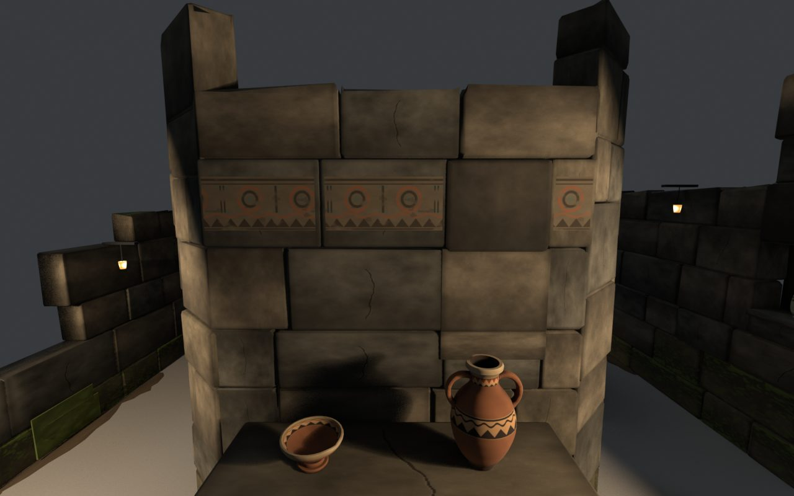

# Treasure Haul ステージの出力 — 発掘中の遺跡（B. 回廊）

2026-10-21。`../build_stage.py` の出力。作り直すたびに上書きする。**Blender 上の成果物であり、Unity への取り込みと PICO 実機での確認はしていない。**

| 画像 | 内容 |
| --- | --- |
| `01_entrance_eye.jpg` | 練習の列（奥行 2.5m、目の高さ 1.65m）から。正面は中央の塊と低い祭壇。左右に通路の入口 |
| `02_corridor_w.jpg` / `03_corridor_e.jpg` | 左右の通路を歩く目線。壁龕と、突き当たりの手掛かり |
| `04_front_room_door.jpg` / `05_front_room.jpg` | 前の部屋（扉は西側）。石棺と壁龕 4 つ（家具は石棺だけにして床を空けた） |
| `06_back_room_door.jpg` / `07_back_room.jpg` | 奥の部屋（扉は東側）。祭壇、木箱、石の棚（中央を空けた） |
| `08_cross_corridor.jpg` | 奥の横通路。角の木箱・パレットと、大広間の入口 |
| `09_hall.jpg` / `10_hall_bays.jpg` | 大広間の段のある祭壇と、仕切りの裏の小部屋（東） |
| `11_top.jpg` / `12_overview.jpg` | 真上（奥が上。Blender で真上から見ているので左右が Unity と逆）・斜め上 |
| `floorplan.svg` | 配置図（Unity の向き：X が右、入口が下）。置き場所・立ち位置・歩ける範囲 |

## 割り付け（実際の寸法。座標は Unity：X=幅、Z=奥行）
| 部分 | 寸法 |
| --- | --- |
| 入口の区画 | 奥行 0〜3.2。高い壁なし。搬出リフト（奥行 0.2〜2.0、幅 3m）、練習の 4 か所（X ±0.4・±1.2、奥行 2.5）、発電機・木箱・作業灯 |
| 外周の壁 | 中心 X ±2.38、厚さ 0.2（内面 ±2.28）。奥行 3.2〜11.0（入口側の端は崩れて低い）。奥の壁は中心 10.9 |
| 中央の塊 | 外面 X **±1.08**、奥行 3.9〜8.2、壁厚 0.2、4 隅を 0.3m 切り落とし。仕切りは奥行 6.05（厚さ 0.3） |
| 前の部屋 | 内側 X ±0.88 × 奥行 4.1〜5.9。扉：西面、奥行 4.7〜5.9（1.2m） |
| 奥の部屋 | 内側 X ±0.88 × 奥行 6.2〜8.0。扉：東面、奥行 **6.6〜7.8**（1.2m） |
| 左右の通路 | 壁と壁の間 1.20m（実測の最小幅 1.175m） |
| 奥の横通路 | 奥行 8.2〜9.4 |
| 大広間 | 仕切り：中心 奥行 9.5（厚さ 0.2）、X ±**1.05**〜±2.28、中央 2.1m が開口。奥行 9.6〜10.8 |

初期値から変えた点：
- **塊の外面 ±1.10 → ±1.08**：通路を 1.20m にして、石の凹凸（±1cm）と壁龕の縁（2.5cm）があっても、通れる幅 1.15m 以上を保つため。部屋は 2cm ずつ狭い。
- **奥の部屋の扉 6.8〜8.0 → 6.6〜7.8**：塊の角の切り落とし（奥行 7.9 から）と重なるため。
- **大広間の開口 ±1.0 → ±1.05、祭壇を幅 1.0m・奥行 0.62m に縮小**：仕切りの端と祭壇の角の間が 0.62m しかなく、横の小部屋に人が入れなかったため。
- 大広間の作業灯は三脚をやめ、奥の壁の上に留める型にした（床の邪魔を減らし、小部屋の入口を空けた）。

## 置き場所（34 か所）
`TreasureSlot_01`〜`34`（VenueRoot の子の EMPTY）。カスタムプロパティと `stage_layout.json` の markers に、`allowed_classes`・`host_type`・`surface_height_m`・`zone`・`hidden_intent`・`facing_unity_xz`（お宝の正面を向ける方向）・`rotation_blender_z`・`max_item_size_m`（入る大きさ：幅・奥行・高さ）・`host_module` がある。

| 区分 | 数 |
| --- | --- |
| 区分 | S 23 / S・M 5 / M 6（M が置けるのは 11 か所） |
| ゾーン | 塊の正面 2、前の部屋 5、奥の部屋 6、西通路 3、東通路 2、横通路 6、大広間 10 |
| 置き方 | 壁龕 15、祭壇 8、木箱 3、棚 3、石棺（石棺・納骨箱）2、パレット 2、台座 1 |
| 隠す意図 | 17（両部屋と大広間の小部屋）。見える手掛かり 17（塊の正面・通路・横通路・大広間の祭壇）。半々はユーザーの決定 |

- **`max_item_size_m` を確かめてから置くこと。** 例：大広間の祭壇の段（奥行 0.19m）には供物の鉢（0.22m）が入らない。木箱に日輪盤（幅 0.45m）は入らない。
- **選び方の決まり（`stage_layout.json` の `slots.selection_rule` と `neighbour_rule_m`）：** 同じ種類のお宝を、水平距離 1.5m 未満の置き場所に並べない。
- プレビュー（`Stage_Review.blend` のみ）：シード 2311 で S 14・M 9 を置いた。奥の M ほど高いお宝にし、上の決まりで同じ種類が隣り合わないようにした（大広間の祭壇は日輪盤と大釜）。

## 判定の結果
| 項目 | 結果 |
| --- | --- |
| 三角形 | ステージ 82,789（14 モジュール、材質 1）。プレビューのお宝 23 個と合わせて 143,821 |
| 会場の範囲 | すべての頂点が X ±2.50、奥行 0〜11.0、高さ 0〜2.42 に収まる |
| 1.15m 幅で回れるか | 入口→両通路→横通路→大広間、両部屋の扉まで、すべて可（半径 0.575m の円で判定） |
| 実測の通れる幅 | 西通路 1.175m、東通路 1.192m、前の部屋の扉 1.198m、奥の部屋の扉 1.188m（壁の凹凸を含め、高さ 0.1〜1.8m で光線を当てて測った） |
| 置き場所への接近 | 34 / 34。会場の縁から 0.7m 以上内側に立ち、水平 1.2m 以内、手のひらから 1.5m 以内で、壁にさえぎられない |
| 隠れ具合（置いた 23 個） | 隠す意図の 12 個はすべて入口から見えない（見えても 10% 以下）。手掛かりのうち 7 個は入口から見える |
| 見つけられる・取れる | 23 / 23 が立ったまま近くで見え、23 / 23 がビームで取れる |
| めり込み・床置き・浮き | 0・0・0 |
| 宙に浮いた石 | 0（壁の石 420 個を確認） |
| 暗さ | いちばん暗いのは奥の部屋の棚の下段（上が開いている割合 0.11）。仕切りの上に灯りを足した。明るい石の内張りは石棺と納骨箱の中だけ。置き場所ごとの近接画像で、23 個とも見えることを確かめた |

`collider_status`：壁は扉・壁龕の部分で分けた箱（`beam_blocking=True`、高さ付き）。家具は外形の箱（`beam_blocking=False`）。壁龕の縁（`NicheLip`）も入れてある。

## 見た目と負荷
- 材質は共有アトラス 1 枚（`textures/Stage_Atlas_{BaseColor,Metallic,Roughness,Emission}.png`、1024×1024、128px のセル）。光るのは作業灯のレンズと画面だけ（Emission 画像のその 2 タイル以外は黒）。
- 見本と同じ暗めの廃墟：石はくすんだ暗い色で、汚れは下に溜まる。最下段は湿った石と苔、露出した上面の一部も苔。外周と奥の壁は上端の崩れと抜けた石を増やした（塊の壁は、覗き穴にならないよう抜けた石なし）。部屋と大広間の壁際に小さな瓦礫（通路には置かない）。
- 壁画は、1 段の切り石の面に直接描いた顔料として作った（壁面から 1.2mm、石の継ぎ目で切れ、ところどころ剥げている）。文様は階段・同心円・波と歯の帯の幾何学文様だけ。
- 壁龕の裏は、壁と同じ段割りの石でふさいだ（明るい板に見えないように）。
- プレビューの照明は環境光を落とし（世界 0.09、太陽 0.22）、作業灯のスポットと電球（点光源、`Light_Bulb_*`）で光だまりを作った。
- 灯りの位置は `Light_*`（role `light_anchor`）のマーカーにある。Unity では暖色のスポットライトを置く想定（プレビューの照明は Blender だけのもの）。
- 床は作らない（会場の床をパススルーで見せる）。壁際に土の帯だけ置いた（高さ 3mm、コライダー・影なし）。天井なし。

## 判定の限界と未確認
- Blender 内の形と光線の判定。パススルーの映像との対比、値札、他の体験者による遮り、身長の違いは考えていない。
- **Unity への取り込み、コンパイル、URP での見え方、PICO での 72fps は未確認**。Unity の X 軸の符号（左右）も取り込み時に確かめること。
- Unity では Metallic と Roughness を「R=金属度・A=滑らかさ」の 1 枚に変換する必要がある。Normals は「Import」（カスタム法線を使っている）。

## 残っている古いファイル（削除が必要）
次は旧版の出力で、もう作られない。削除はガードレールに止められたため残している：`eye.png`、`eye_west.png`、`overview.png`、`peek_sheet.png`、`top.png`、`textures/Stage_BaseColor.png`、`textures/Stage_Metallic.png`、`textures/Stage_Roughness.png`。
