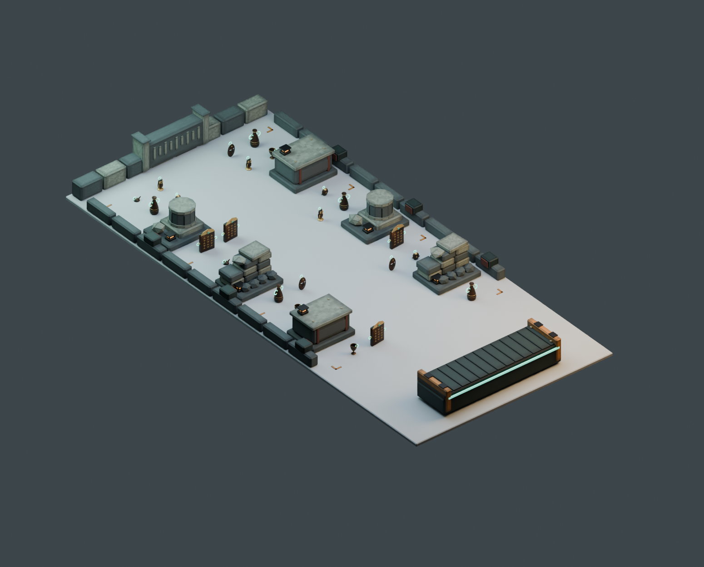

# Treasure Haul — 発掘収蔵区画 / 5m × 11m

> **最新版は [Revision7](Revision7/README.md)**（2026-10-19。隠し場所18か所を判定と画像で確認した版）。このページは2026-10-18の初版の記録で、下の数値は初版のもの。

2026-10-18制作。Treasure Haul専用ステージの初版3Dモデル。前作の `StageProps.blend` 等とは独立している。Unityシーンへの配置・ゲームロジックへの接続は未実施。

## デザイン

古代遺跡の発掘隊という企画に、「放棄された収蔵区画」「錆びた搬出設備」「冷たい石と小さな作業灯」を合わせた。R.E.P.O.の[開発元による公式紹介](https://store.steampowered.com/app/3241660/REPO/)からは、不穏な場所へ入り、貴重品を慎重に搬出する雰囲気を参考にした。固有のマップ・ロボット・ロゴ・素材は使わず、形状と材質画像はローカルで自作した。

会場の床や仲間を見せるMRが前提なので、天井・視界を塞ぐ壁・歩行エリアの不透明な床は含めていない。暗い石、錆、低い物陰で雰囲気を出す。プレビューの灰色の床・照明・暗い背景は確認用で、実機のパススルー映像を再現したものではない。

既存のお宝は青銅・金・宝石の色を保ち、背景は低彩度の灰緑へ抑えた。収蔵箱にはお宝と同じ発光する持ち手を付けず、拾う対象と背景を見分ける。搬出リフトは幅広い発光帯と下向きの記号で目的地を示す。金額表示そのものはUnity UIで実装する。

[目線の高さの画像](eye.png) / [搬出リフトの拡大](lift.png) / [真上からの画像](top.png) / [寸法入り配置図](floorplan.svg)

## 会場と配置

| 項目 | 寸法・配置 |
| --- | --- |
| 会場 | 幅5m × 奥行11m。入口辺の幅中央・床面を原点 |
| 論理座標 | Unity: X=幅、Y=高さ、Z=奥行。Blender: `(X, -奥行, 高さ)` |
| 搬出リフト | 幅3m、奥行約0.96m。中心は奥行0.8m。天板は約0.52m、側端のガードは約0.65m |
| 練習4点 | X=-1.2 / -0.4 / 0.4 / 1.2m、奥行2.4m。荷台中心から約1.65〜2m。色と記号はマーカー情報として格納 |
| 探索区画 | 左右X=±1.6m、奥行4.1 / 6.35 / 8.6mの6か所。崩れ壁・柱の残骸・収蔵箱を交互に配置 |
| 中央動線 | 固定障害物の間で幅2.1m。全候補に半径0.27mのお宝範囲を置いた場合も幅1.26mを確保 |
| 配置候補 | 28点。床上、近・中・遠の距離帯情報を付与。4人用はここからS14個・M9個を選択する想定 |
| お宝の境界余白 | 半径0.27mの外周から会場端まで最小0.73m。荷台前・練習エリアにも配置しない |
| 障害物の最大高さ | 実測0.7775m。F-SAFE-2の仮上限0.8m未満 |

**警告壁の発動距離は今回の調査では確定できていない。** 配置設計では0.4m＋要件P-5の余白0.3mを仮定した。この0.4mはランタイムの確定値ではない。Unity導入時に実際のWarningWall設定と照合すること。発動距離が0.43mを超える場合は、現在の最小余白0.73mでは不足するので候補点を再配置する。`stage_layout.json` はオーサリング用の引き渡しデータで、既存のパラメータ管理に別のランタイム設定源を追加するものではない。

プレビューは最大4人のコア構成（S14個＋M9個）。Lと秘宝は配置していない。練習点と候補点はEmptyであり、自動スポーン・参加人数対応・色分けUIを実装したものではない。

## 成果物

| ファイル | 用途 |
| --- | --- |
| `ExcavationDepot_5x11.blend` | ステージ単体。使用する画像をパック済み |
| `ExcavationDepot_5x11.fbx` | Unity向けのステージ一式。モデル、VenueRoot、配置・練習・回収・表示位置のマーカー。プレビュー床・お宝・ライト・カメラは含まない |
| `modules/*.fbx` | 搬出リフト、探索区画6個、外周遺構、奥のレリーフ、床の測量印の計10モジュール。組み上がった位置座標を維持 |
| `Stage_Review.blend` | 修正版のお宝23個、確認用床・照明・カメラを含むレビュー用シーン |
| `textures/Stage_*.png` | 自作の共通BaseColor / Metallic / Roughness。各1024×128px |
| `stage_layout.json` | 会場寸法、34個のマーカー、距離帯、配置検証用の外接Box、モデル計測値、仮配置モデル一覧 |
| `floorplan.svg` | 編集可能な寸法入り配置図 |
| `verification.json` | FBX・blend再読み込みと配置検証の実測結果 |

## 検証結果と限界

- ステージ単体: **8,064 tri / 10 meshes / 20 material slots**。4種類の共有材質。メッシュ数と実際のドローコール数は異なる。
- 仮配置のお宝23個: 84,084 tri。合計 **92,148 tri**。要件N-1のシーン30万 tri仮予算内。ただし手・UI・演出等の予算は別に必要。
- 全体FBX＋分割FBX10個、blend2個を再読み込みして検証合格。三角形数、実寸範囲、高さ、UV、退化面なし、マーカー位置（誤差1mm未満）、blend内の画像パックを確認。
- 28候補点の半径0.27mの円が境界余白・障害物の外接Box・互いに重ならないことを確認。中央から各候補点まで、半径0.3mの人の簡易モデルが通れる経路を全28点で確認。練習4点の余裕も確認。
- 入口寄りの高さ1.65mから各候補点の高さ0.15mへ視線を飛ばす簡易チェックで、28点中7点が遺構に隠れる。実際の持ち手の見え方はモデル・身長・立ち位置で変わるので、隠れるお宝数や探索の面白さを保証する値ではない。
- 俯瞰・真上・目線・荷台拡大をBlender MCP `look` で確認した。
- **Unityは起動していないため、インポート、コンパイル、EditMode、URP表示、PICOの72fpsは未検証**。この段階の成果物は3Dモデルと配置設計である。

## Unityへの引き渡し

1. `Assets/` へ導入するときはUnity Editor APIを使い、`AssetDatabase.Refresh()` を実行する。シーン・Prefab・Material・metaをテキストで生成しない。
2. Environmentの `VenueRoot` と揃え、入口端・荷台・奥の候補点の3か所で向きと実寸を確認する。FBXは `-Z Forward / Y Up` で書き出しているが、Unity importer後の向きは実機未確認。JSONのUnity論理座標を基準とする。
3. FBXの共有表面材質をURP向けに設定する。BaseColorはsRGB、MetallicとRoughnessはLinear。URPのSmoothnessは `1 - Roughness` なので、MetallicのR・SmoothnessのAに詰めたマップへ変換する。発光材質は別に保持し、材質・画像をモデルごとに複製しない。
4. JSONの `colliders` は**配置検証用の保守的な外接Box**。そのまま本番Colliderにすると瓦礫の空隙にも当たるため、台座・壁・柱・箱の実体に沿う複数のBox/Capsule等へ分割する。現在のFBXには実行可能なUnity Colliderは入っていない。
5. `anchor_id` カスタムプロパティでマーカーを識別する（Blender上で繰り返し生成すると表示名に連番が付く）。候補点をTreasureSpawner、練習4点を練習進行、CollectionVolumeを回収Triggerへ接続する。ScoreBoardAnchorは非物理のUI位置。床は既存の床ColliderとShadow Catcher・パススルーを使う。
6. 実際の警告距離と会場の出入口・スタッフ立ち位置に照らして再配置する。4人でのすれ違い、両手M運搬、会場照明下の視認性、72fpsを実機で確認する。静的な円の経路検証だけで人同士の安全性を認定しない。

## 再生成

既設Blenderで `build_stage.py` を実行する。新しい専用シーンを追加し、元の作業シーン・選択を復元する。既存ファイルの保存や既存オブジェクトの削除はしない。成果物の出力先はこのフォルダ。`run()` の戻り値に対して `render('overview')` / `render('top')` / `render('eye')` / `render('lift')` を実行するとプレビューを再生成できる。最後に `verify_stage.py` を実行する。

有料生成機能・外部素材・追加パッケージは不使用。既設Blenderと無料MCPのローカルモデリングだけを使用し、[THIRD_PARTY_NOTICES.md](../../../THIRD_PARTY_NOTICES.md)に記録した。
