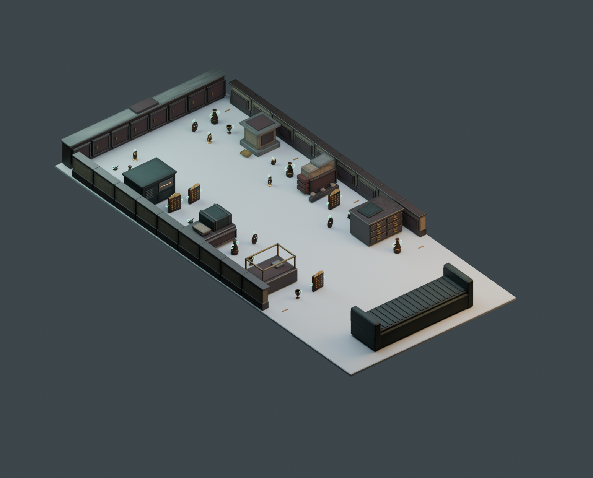

# ステージ改修版 — 放置された古物収蔵区画

最新は [Revision3](../Revision3/README.md)。この版は中央が直線的で提出場所も高い台だったため、迷路構成と低床回収区画に作り直した。以下は比較用の記録。

2026-10-19。今回はモデルのみ。Unityシーン、ゲーム動作、お宝や台車のモデルは変更していない。元のステージは親フォルダーに比較用として残す。

[目線での確認](eye.png) / [回収設備](lift.png) / [平面](top.png) / [寸法付き配置図](floorplan.svg)

## 参照とレビュー

資料は [R.E.P.O.公式Steamページ](https://store.steampowered.com/app/3241660/REPO/) のスクリーンショット。特に [古い内装と家具が見える画像](https://shared.akamai.steamstatic.com/store_item_assets/steam/apps/3241660/ss_af7d8d6302d543d89019bad49ea853a970bb82de.1920x1080.jpg) と回収設備の掲載画像を観察した。以下は画像からのデザイン上の解釈であり、開発者の設計意図を断定するものではない。

| 観点 | 初版の問題 | 改修 |
| --- | --- | --- |
| 世界観 | 石壁・柱・箱の反復が強く、用途のある建物より障害物コースに見えた | 木製引き出し、空の展示ケース、展示台、収納ベンチ、壊れた腰壁、設備盤の6種類に変更 |
| 資料との対応 | 「古代遺跡」の解釈に偏り、古びた内装と工業的設備の対比が弱かった | 暗い木、くすんだ赤い内張り、漆喰、古い真鍮、灰緑の回収機械を組み合わせた |
| お宝の主役性 | 背景と探索対象の役割が曖昧 | 空の展示面・ラベル枠で収蔵区画の用途を示し、背景は低彩度。お宝の金・模様・発光持ち手が目立つよう調整 |
| 質感と形 | 同じ箱形の繰り返しが目立った | 引き出しの段差、把手、額縁状の腰壁、欠けた漆喰と露出レンガ、機械の通気口を追加 |
| MRへの適応 | 本作の暗い閉鎖空間をそのまま導入できない | 5×11mと低い障害物を維持。天井・高い壁・不透明な歩行床は書き出さない |

R.E.P.O.の固有マップやアセットの再現ではない。古い収蔵空間と無骨な回収機械の組み合わせを、自作のお宝・台車と会場条件に合わせた。実際のパススルーでは会場が見えるため、原作の閉塞感や暗さまで再現したとは言えない。

## 寸法・XR負荷

| 項目 | 検証値 |
| --- | --- |
| 会場 | 幅5m × 奥行11m、全頂点が範囲内 |
| ステージ三角形数 | 11,948（初版8,064） |
| メッシュ / マテリアルスロット合計 | 10 / 15（初版10 / 20） |
| お宝23個を含む三角形数 | 96,032 |
| 最大高さ | 約0.780m、仮上限0.8m未満 |
| 固定障害物間の中央幅 | 2.10m。お宝の配置範囲を含めると1.26m |
| 配置候補 / 練習点 | 28 / 4 |
| お宝外周から会場境界の最小余裕 | 0.73m |
| 接近経路 | 半径0.30mの代理円で28点すべて通過 |
| 共通アトラス | 1024×128、BaseColor / Metallic / Roughness |

透明ガラスを使わず、展示ケースはガラスが外れた枠として制作。家具ごとに結合し、細部のメッシュ分割を抑えた。三角形数は増えたがスロット数は減っている。スロット数は実際のドローコール数ではなく、XR性能の合格判定には実機計測が必要。

入口側の高さ1.65mから床上0.15mを見る遮蔽検査では、28候補中6点が固定物に隠れる。少し進んで見つける余地がある一方、全候補への経路は確保。複数人のすれ違い・手の到達性・実機フレームレートは未検証。

境界余裕は警告壁0.4m＋余裕0.3mを仮定したもの。実際のWarningWall設定との照合はUnity導入時に必要。プレビューの灰色床・照明・暗い背景は確認用で、MR実機の見え方ではない。

## 成果物と検証

- `ExcavationDepot_5x11.blend` / `.fbx`: ステージのみ。既存の受け渡しファイル名を維持。
- `Stage_Review.blend`: お宝23個と確認用床・照明・カメラを含むレビュー用。
- `modules/*.fbx`: 10モジュール。
- `stage_layout.json`: 配置点、保守的な衝突範囲、寸法、ポリゴン数。Unityランタイム設定ではない。
- `verification.json`: 全体と10モジュールのFBX再読み込み、2つのblend、UV・退化面・会場範囲・高さ・配置クリアランスの検証結果。

再生成は親フォルダーの `build_stage_v2.py`、検証は `verify_stage_v2.py` をBlenderで実行。既存シーンを残して別シーンを作り、実行後に元のシーンと選択を復元する。生成済み画像をBlender MCP `look` で全景・目線・回収設備の3方向から確認済み。

Unityへの取り込み、コンパイル、EditMode、PICO実機のFPS測定は今回未実施。
