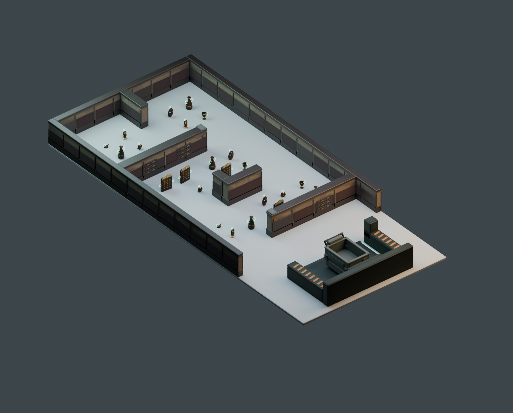

# 迷路状の収蔵区画と低床の回収場所

2026-10-19。最新のステージモデル。前版は資料の内装だけを参考にし、探索経路と提出場所の理解が不足していたため、配置構造から作り直した。今回のユーザー指示「全体を迷路っぽくする」を反映。モデルのみで、Unityのシーン・回収判定・台車移動は変更していない。

追加調整：「もう少しだけ迷路感」に合わせ、中央の小さな展示台を幅1.20mのL字間仕切りへ変更。壁の内側にくぼみを作り、左右で異なる回り込みになるようにした。台車の旋回余地を残すため、奥の横壁を20cm奥へ移動。奥の小区画の仕切りも20cm短くした。手前の横壁は回収区画での取り回しを確保するため元の位置を維持。

[平面画像](top.png) / [寸法と経路の図](floorplan.svg) / [目線](eye.png) / [提出場所と既存台車](lift.png)

## 調査した資料と反映

| 資料 | 確認した内容 | 今回の判断 |
| --- | --- | --- |
| [R.E.P.O.公式Steam](https://store.steampowered.com/app/3241660/REPO/)・[回収場所が写った公式掲載画像](https://shared.akamai.steamstatic.com/store_item_assets/steam/apps/3241660/ss_cd332c2299810a65c6aee61c04750197a919692a.1920x1080.jpg) | 床に近い受け入れ面、周囲の機械、側面の操作盤、明るい回収表示が見える。外観は画像を実際に見て判断 | 高さ約0.5mの横長台を廃し、正面から台車を入れられる回収床・側面設備・操作盤へ変更 |
| [The Escapist: How to Extract Items in R.E.P.O.](https://www.escapistmagazine.com/how-to-extract-items-in-repo/)（2025-03-17掲載） | 台車を回収範囲へ入れること、回収地点を探すためのマップ利用と操作を説明 | 台車の外形に合わせた開口と奥行きを設ける。記事の地点数や進行条件を本作の仕様には転用しない |
| [Dot Esports: All maps in R.E.P.O.](https://dotesports.com/indies/news/all-maps-in-r-e-p-o)（2025-05-18掲載） | ランダムな部屋構成、屋敷の狭い廊下、研究施設の大きな部屋をつなぐ廊下、美術館の開放的な構成などを説明 | R.E.P.O.全体を一律の狭い迷路とは扱わず、部屋・曲がり角・経路選択を今回の迷路構成に取り入れる |

上記記事は掲載時点の説明。最新の全マップや全仕様を網羅した調査ではない。ゲーム本編を操作した、動画を通して視聴した、元モデルを解析したとは主張しない。公式画像は観察用で、成果物には転載・取り込みしていない。

前版の問題は、中央が一直線に開き、背景の家具を替えただけで探索の構造を変えていなかったこと。また、提出場所を「高い台」と解釈して、台車ごと受け入れる床の関係を落としていた。今回は双方を改修した。

## 迷路の構成

入口の回収・練習区画から、右側の開口を通って中間区画へ進む。中央のL字間仕切りの左右に分岐し、どちらも再び合流する。次は左側の開口から奥へ進み、短い間仕切りで分かれた2つの収蔵区画を探索する。中央を直進して奥まで到達する通路はない。

幅5mの会場で台車の旋回余地を取るため、短い迷路に限定した。高い壁で現在位置を見失わせる構成ではなく、低い間仕切りで運搬経路を選ぶ構成。仮想壁で人の移動を強制する機能は未実装で、人は現実には壁を通り抜けられる。運搬物の壁との衝突・運搬時の回り込みはUnity導入時の確認事項。

既存要件の5×11m、片端の回収地点1か所、4人用の練習区画、F-SAFE-2の高さ0.8m未満を維持。企画書の直線的な配置例と前版の中央通路は、このモデル案では採用しない。ランダム迷路生成は実装していない。

## 提出場所

受け入れ床は幅2.30m × 奥行1.56m、高さ0.024m。正面の開いた範囲へ既存台車を直進で入れられる。左右の設備、奥の表示面、側面のボタンで「回収場所」を区別する。回収設備全体の横幅は約3m、会場の入口側に固定。

初回の寸法検査では台車と奥の設備の干渉を検出し、受け入れ床と駐車位置を修正した。台車は幅0.816m、全長1.204m。ハンドルが入口側になる向きでレビューに置いている。プレビューの台車は別アセットの再利用で、ステージFBXには含まれない。

操作盤のボタン・表示は形状のみ。押して回収する仕様、金額表示、台車内のお宝の一括回収は今回実装していない。既存の「誰も持っていないお宝を回収範囲で回収する」ロジックを勝手に変更していない。提出場所の回収ボリューム変更はモデルの引き渡し情報であり、Unityの既存設定には未反映。

## 計測と検証

| 項目 | 結果 |
| --- | --- |
| 会場寸法 | 5×11m、ステージの全頂点が範囲内 |
| ステージ | 11,272三角形 / 10メッシュ / マテリアルスロット合計13 |
| お宝23個込み | 95,356三角形 |
| レビュー用台車も含む | 99,788三角形（床・照明等は除外） |
| 固定物の最大高さ | 0.7775m |
| 左右の開口幅 | 各1.70m |
| 配置候補 / 練習点 | 28点 / 4点 |
| お宝外周の最小境界余裕 | 0.73m |
| 人の接近経路 | 半径0.30m、28点へ到達 |
| 台車の迷路内経路 | 半径0.80mの円（台車の旋回外形＋余裕）で6地点へ到達 |
| 中央の環状経路 | L字間仕切りの手前側・奥側の両方で左右を接続できることを確認 |
| 台車の入庫 | 外形矩形＋0.03mの余裕を直線移動し、61点で固定物との非干渉を確認 |
| 保存形式 | 全体FBX＋10モジュール、単体blendとレビュー用blendを再読み込み済み |

ナビゲーション検査は0.05m刻み、斜めの角抜けを認めない。検査結果は `verification.json`、通過経路は `navigation_paths.json`。配置候補間の離隔、UV、退化面、配置マーカーのFBX往復、テクスチャの同梱も確認。Blender MCP `look` で全景・平面・目線・提出場所を確認済み。

入口側の目線1.65mから床上0.15mを見た遮蔽検査では28候補中14点が隠れる（調整前11点）。ただし低い壁越しに会場全体や他の人は見える。R.E.P.O.の暗い室内や閉塞感をそのまま再現したものではない。

検査は固定物に対する静的な寸法検査。置かれたお宝で通路が塞がる場合、複数人のすれ違い、手で押す際の体の位置、床の段差を越える物理挙動、実機FPSは未検証。三角形数だけでXR性能合格とは扱わない。WarningWall距離0.4m＋追加余裕0.3mの仮定は、Unity導入時に実際の設定と照合する必要がある。

## 成果物

- `ExcavationDepot_5x11.blend` / `.fbx`: ステージ本体。受け渡しファイル名を維持。
- `Stage_Review.blend`: お宝23個と既存台車、確認用床・カメラ・照明付き。
- `modules/`: 10個のFBX。
- `textures/`: ローカル自作の共有アトラス3枚、1024×128。
- `stage_layout.json`: 配置・仮の衝突範囲・提出場所の引き渡し情報。

再生成: 親の `build_stage_v3.py`。検証: `verify_stage_v3.py`。既存シーンを残し、別シーンで作業後に元のシーンと選択を復元する。外部素材・有料生成なし。Unityへの取り込み、コンパイル、EditMode、PICO計測は今回の対象外で未実施。
