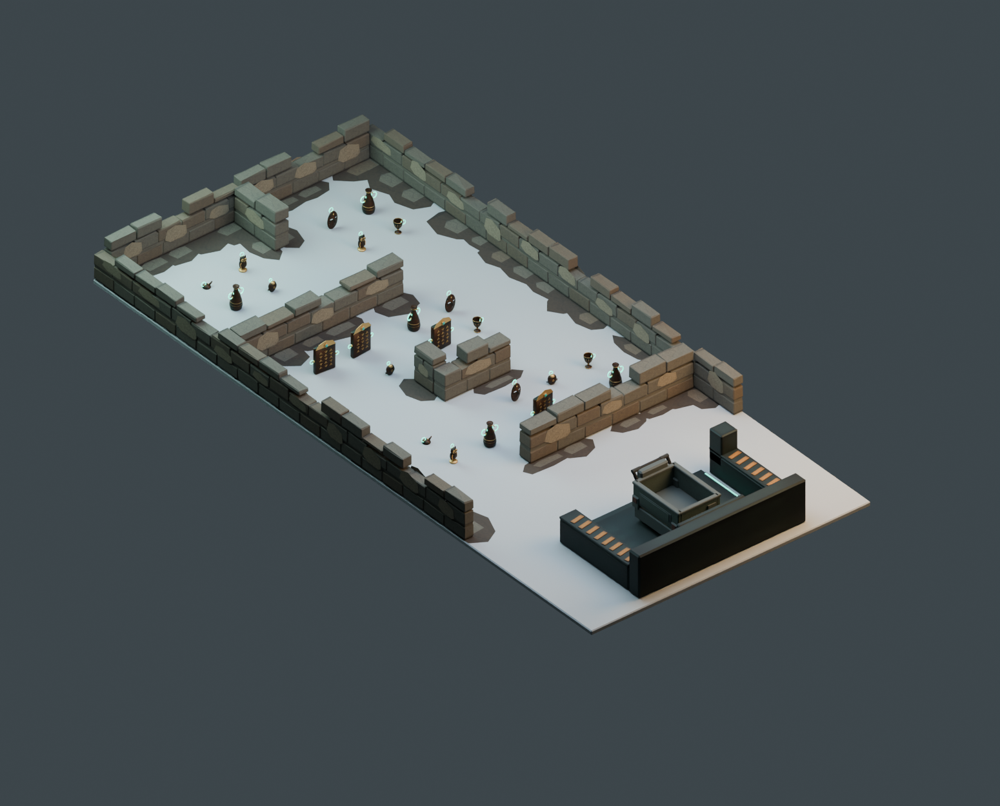

# 遺跡の風化と床際を改修したステージ

2026-10-19。最新のモデル。迷路と回収設備の配置を維持し、「床とのつながりが弱い」「遺跡にしてはきれいすぎる」という指摘を反映した。Unityへの組み込みは今回の対象外。

[目線での見え方](eye.png) / [平面](top.png) / [回収場所](lift.png) / [配置図](floorplan.svg)

## 変更

- 木製パネルと引き出しを撤去し、段をずらした石積みと欠けた石へ変更。
- 上段の一部を欠落させ、高さ・角の削れ方をばらつかせた。整った連続笠木をなくした。
- 漆喰を不規則な輪郭の残存部分として配置。石には細かい色むら・細いひび・根元の暗さを自作アトラスで加えた。
- 壁際に土の広がりと割れた敷石の薄い面を追加。通路全面を覆う床は作らず、現実の床が見える部分を残した。
- 回収設備は後から持ち込まれた機械として維持。古い石積みと機械を対比させた。

最初の生成では目地が暗すぎ、模様もブロック状に見えたため、目地と石の色差を抑え、模様を細かく調整した。薄い床装飾の面の高さをわずかにずらし、重なりの描画問題を修正した。

## MR・寸法・負荷

5×11m、開口幅1.70m、中央L字の両側を通れる迷路を維持。ステージ10,885三角形、10メッシュ、マテリアルスロット合計13。お宝23個込み94,969三角形、確認用台車込み99,401三角形。固定物の最大高さは0.76m。

床際の土・敷石は最大4mm未満の視覚装飾。立体的な瓦礫を運搬経路に追加していない。`THStage_RuinGroundFragments` にはColliderを付けず、影の投影も無効にすること。Blender上では無効化済みだが、UnityのRenderer設定は導入時にEditor APIで設定する必要がある。FBXのカスタム属性に指示を保存している。

土・敷石は小さな不透明ポリゴンで、透明の床を多重に重ねる構成ではない。石・土・漆喰は同じ1024×128アトラスを共有。床装飾の全体面積の単純合計は重複部分を含むため、実際に床を覆う面積ではない（検証JSONに記録）。

画像の広い灰色の床は比較用の確認床で、ステージFBXには含まれない。実機ではこの部分に会場の床が見える。現実の床が白い場合などの没入感、色のなじみ、接地感はPICO実機で未検証。照明を暗くするだけで見栄えを整えることはせず、前版と同じ確認用照明・床・カメラで比較した。

## 検証

- 全体と10モジュールのFBX再読み込み、単体・レビュー用blend、UV、退化面、5×11m内の頂点、高さを確認。
- お宝候補28点への接近経路、半径0.80mの台車旋回外形による6地点への到達、中央の手前側・奥側の両方の経路、台車の直進入庫を確認。
- 床装飾の高さと、Collider不要・影投影不要の引き渡し属性を確認。
- Blender MCP `look` で全景・目線画像を確認。

検証は固定物に対する寸法検査。人のすれ違い、通路上のお宝、手で押す際の操作、実機FPSを保証するものではない。Unityコンパイル・EditMode・PICO実機確認は未実施。配置マーカー・仮の衝突範囲はUnityランタイムへ未反映。

## ファイルと制作方法

`ExcavationDepot_5x11.blend` / `.fbx` が本体、`Stage_Review.blend` はお宝23個・台車・確認床・照明付き。`modules/` は10モジュール、`stage_layout.json` は配置情報、`verification.json` と `navigation_paths.json` は検証結果。

再生成は親の `build_stage_v4.py`、検証は `verify_stage_v4.py`。以前の版は比較用に保存。元のBlenderシーンと選択を保持し、別シーンで作業する。

形状・テクスチャはローカルの自作のみ。外部素材、R.E.P.O.のアセット、有料生成は不使用。R.E.P.O.の探索経路と回収場所についての調査は [Revision3の記録](../Revision3/README.md) を継承し、今回はユーザーの遺跡・風化の指示に基づくオリジナルの美術調整。
