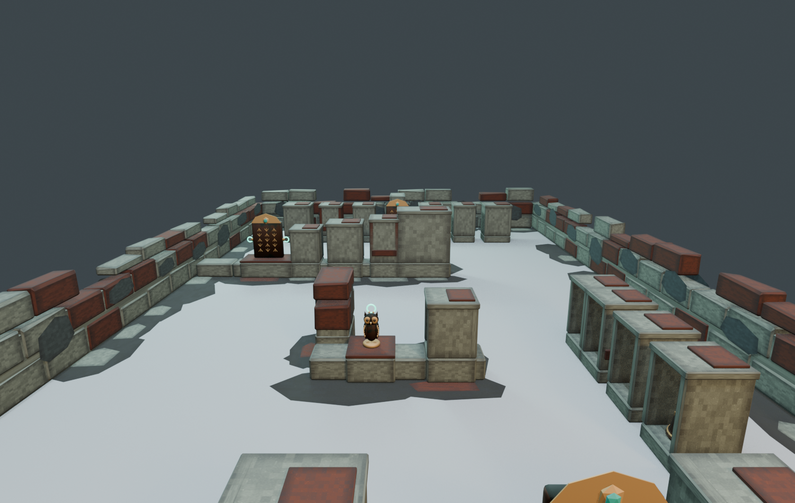

# Treasure Haul ステージ Revision6 — 試作（Revision7 で作り直し）

`build_stage_v6.py` の出力。お宝23個（S 14、M 9）を置き、うち18か所を屋根付きの石の祠で隠すつもりで作った試作。2026-10-19 に判定と目視で確認したところ、隠す目的を果たしていなかった。**[Revision7](../Revision7/README.md) を使うこと。** このフォルダの出力は比較のために残してあり、上書きしていない（追加したのは `eye.png`、`top.png`、`search_visibility.json`、この README だけ）。

## 測った結果（`search_visibility.json`。方法は Revision7 と同じ）
| 項目 | 結果 |
| --- | ---: |
| 入口から隠れている | 13 / 18 |
| 隠れていて、かつ近くで見つけられる | **7 / 18** |
| 見つけられる / ビームで取れる | 17 / 23 |
| お宝のメッシュが石にめり込んでいる | 3 |
| 支え同士・壁との重なり | 7 |

## わかった問題
- **奥の列（11〜17）は回収できない**。祠の開いた側が奥の外周壁を向いていて、壁との隙間 0.75m に人が入れない（左右の端も約 0.6m で通れない）。入口からは隠れているが、近づいても見えず、取れない。
- **西の列（20〜23）は丸見え**。開いた側が中央の通路、つまり入口から見える側を向いていた（入口から持ち手が最大 100% 見える）。目線の画像の右側で、祠の中のランプまで見えている。
- **18（杯）** は東向きに開けたため、入口から本体の 16% が見えた。
- **めり込み**: 13（硬貨の小箱）が祠の正面の石に、18 の杯の持ち手が東の側壁に入り込んでいた。原因はモデルの原点が外形の中心にないこと。14 の石碑は奥の仕切り壁に、22/23 の支えは互いに重なっていた。
- 祠はどれも同じ形の箱で、遺跡というより箱が並んでいるように見えた。
- 前の判定（`check_context_paths.py`）の「近づける」は、お宝から 0.65m 以内に人が立てるかしか見ていない。そのため、開いた側に回れない奥の列も合格になっていた。
