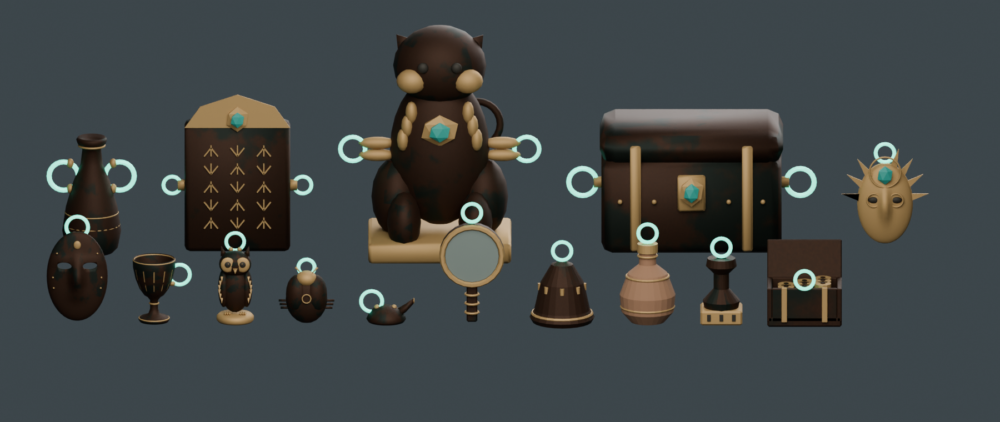

# お宝 15 種

| 区分 | モデル | 三角形数 |
| --- | --- | --- |
| S（片手） | mask / cup / statuette / scarab_amulet / ceremonial_lamp | 4,684 / 4,696 / 4,600 / 2,456 / 3,020 |
| S（片手） | hand_mirror / votive_bell / perfume_jar / stamp_seal / coin_casket | 1,668 / 1,932 / 1,868 / 848 / 4,384 |
| M（両手） | amphora / inscribed_stele | 4,064 / 2,104 |
| L（2人。追加要素） | guardian_statue / relic_chest | 4,740 / 2,508 |
| 秘宝（追加要素） | sun_mask_secret | 4,644 |

- どれも 5,000 tri 以下。光る持ち手は S と秘宝が1つ、M と L が2つ。画像はすべて `.blend` にパックしている。
- **`.blend` が正本**。形や材質を直すときは `.blend` を直接編集し、FBX を書き出し直してから `stats.json` を更新する。
- 確認: `verify_treasures.py`（Blender MCP。FBX と blend を読み込み直し、三角形数・寸法・UV・持ち手の数を `stats.json` と照合）、`render_treasures.py`（`blender -b --factory-startup --python render_treasures.py` で `lineup.png` を書き出す）。どちらも `BlenderAssets/TreasureHaul/` にある。

## これまでの経緯
もとは4段階の生成の流れでできていた。`S/build_treasures.py`（S 3種）→ `build_more_treasures.py`（7種＋文様違い）→ `review_treasures.py`（形の修正。`Reviewed/`）→ `build_context_review.py`（風化させた版と S 5種の追加。このフォルダ）。途中の段の `review_treasures.py` は、ライブの Blender に読み込まれた材質を前提にしていて、最初から作り直すことができなかった。そのため 2026-10-20 に、最終段の `.blend` を正本にして、途中の段の出力とスクリプトを作業ツリーから削除した（コミット `e880f0b` 以前の履歴に残っている）。このとき、文様違い（朱と金、翡翠）の FBX も一緒に外した。今の 15 種には文様違いがない。
