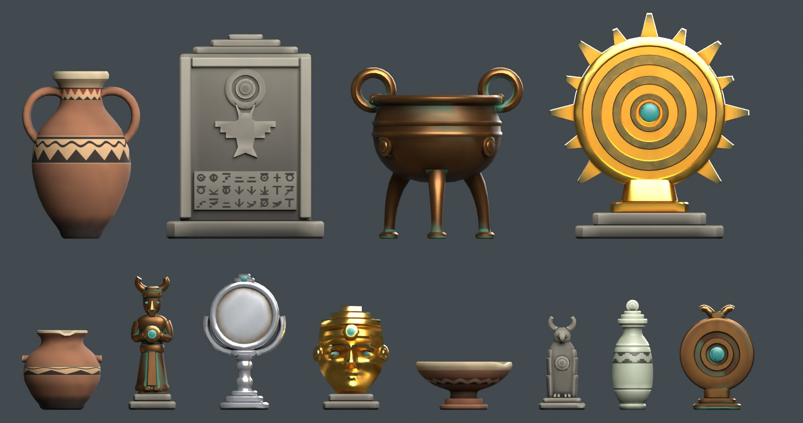

# お宝（コア 12 種）

架空の古代文明（仮の名前「階段の王国」）の出土品です。2026-10-21 にユーザーと合意した方針で作りました（`../Stage/RESEARCH.md`）。

- **真面目な考古学風**。一目で何かわかる形で、**素材で値段の見当がつく**（土器 < 石 < 青銅 < 銀 < 金）。
- 値段は、種類ごとの帯の中で、配置するときにランダムに決める。
- **光る持ち手はない**。お宝の全体がビームの的になる。
- 文明の模様は 4 つ：①階段、②同心円の目、③波と歯の帯、④角のある鳥。実在の文明の図像は使わない。

| 区分 | モデル | お宝 | 素材 | 値段の帯 | 三角形 |
|---|---|---|---|---|---|
| S | `clay_pot` | 土の小壺 | 土器 | 100〜200G | 1,688 |
| S | `clay_offering_bowl` | 供物の鉢 | 土器 | 100〜200G | 1,856 |
| S | `stone_beast` | 角のある鳥の立像 | 石 | 100〜200G | 2,986 |
| S | `stone_unguent_jar` | 香油壺 | 石 | 200G | 2,492 |
| S | `bronze_amulet_disc` | 護符盤 | 青銅 | 200G | 2,504 |
| S | `bronze_figure` | 立像 | 青銅 | 200〜300G | 2,980 |
| S | `silver_mirror` | 手鏡 | 銀 | 300G | 2,944 |
| S | `gold_mask` | 小さな仮面 | 金 | 300G | 2,872 |
| M | `clay_amphora` | 大壺 | 土器 | 400〜500G | 3,664 |
| M | `stone_stele` | 石碑 | 石 | 500〜600G | 1,512 |
| M | `bronze_tripod_cauldron` | 三脚の大釜 | 青銅 | 600G | 3,728 |
| M | `gilded_sun_disc` | 日輪盤 | 金彩 | 700〜800G | 2,868 |

寸法・値段の帯・Aim ゾーンの数は `stats.json` にある。

## 仕様
- **単位・向き：** メートル。正面は -Y（Blender）。原点は底面の中心で、底は z=0。
- **構成：** `<name>_Root`（EMPTY）の下に `<name>_Body`（MESH 1 個）と `Aim_*`（EMPTY）。
  - Root のカスタムプロパティ：`treasure_class`、`material_tier`、`value_band_g`。
- **Aim ゾーン（ビームが当たってよい範囲）：** S は `_Aim_Body` が 1 つ、M は `_Aim_Left` と `_Aim_Right`。中心と大きさは、カスタムプロパティ `aim_center_xyz` と `aim_size_xyz`。
- **見た目と描画の負荷：**
  - 陰影は滑らかで、角度が約 35〜40° を超える辺だけを硬い辺にしている。面積で重みを付けた法線（カスタム法線）を使う。
  - 三角形の上限は S 3,000 / M 4,000。
  - 材質は共有アトラス 1 枚（`textures/Treasure_Atlas_{BaseColor,Metallic,Roughness}.png`、1024×256、128px のタイルが 8 列 × 2 段。空きはタイル 15 の 1 枚）。
  - 透明・Emission・頂点色・法線マップは使わない。

## 作り方と確認
- 作る：`blender -b --factory-startup --python build_treasures.py [-- model ...]`（`.blend` / `.fbx` / アトラス / `stats.json` を上書きする）
- 確認：`blender -b --factory-startup --python ../verify_treasures.py`（12 種の FBX と blend を読み込み直し、三角形数・寸法・UV・底・材質 1 つ・Emission なし・Aim ゾーンを確認する。結果は `verification.json`）
- 一覧画像：`blender -b --factory-startup --python ../render_treasures.py`

## Unity に取り込むとき（未実施）
- モデルの Normals は「Import」にする（カスタム法線を使っているため）。
- アトラスの Metallic と Roughness は別々の画像になっている。URP Lit 用に「R=金属度・A=滑らかさ」の 1 枚へ変換が必要。
- 手鏡（`silver_mirror`）は奥行きが浅く、約 12° 傾くと倒れる。

## これまでの経緯
- 以前の 15 種（持ち手付き。フクロウ・猫のような像など、おもちゃっぽい形）は、2026-10-21 に作り直したときに作業ツリーから消した。必要なら、コミット `de833ed` 以前の履歴から取り出す。
- モデリングは Opus 5.5 のサブエージェントが担当し、画像での検収と差し戻しを経て合格させた。石の小獣像は、伏せた姿が威厳を出しにくかったため、翼を閉じた柱状の立像に題材を変えた。
