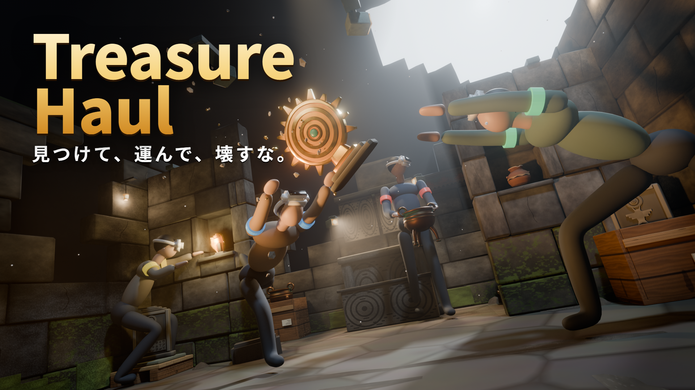

# Treasure Haul キービジュアル

## 3D 版（作業中・2026-10-23）
ステージとお宝の実モデルを Blender（Cycles）で配置して描いた。**人物は仮置き**（撮影写真か、人のモデルに差し替える予定）。

**狙い:** キャッチコピーの 3 つの動詞を 1 枚に入れる。
- **見つけて**: 黄（左）が壁龕をのぞき込み、光る黄金の仮面に手を伸ばす。
- **運んで**: 赤（中央奥）が大釜を両手で抱えて運びながら、騒ぎに振り向く。
- **壊すな**: 青（中央左）が石につまずき、黄金の日輪盤が手から宙へ飛んで破片が散る。緑（右手前）が素手で飛び込んで受け止める。

低いカメラ・広角・傾けた画面で勢いを出す。背景は現実の会場ではなく、**天井の崩れた地下神殿の大空洞**（世界観を優先。崩れた穴から冷たい光が差し込み、下は作業灯の暖色）。

経緯（Git の履歴に残っている）:
1. 1 回目: 通路の奥に祭壇、全員が立っている構図。わかりやすいがワクワクしない。
2. 2 回目: 低いカメラの事件の瞬間。ただし、ビームで受け止める描写・展示会場すぎる背景・緑以外の人の行動がわかりにくい、の 3 点を直すことになった。

| ファイル | 内容 |
| --- | --- |
| `render/kv_3d_full.png` | 3840×2160。遺跡＋空洞＋仮の人物（霧・光のにじみ・周辺減光の仕上げ込み） |
| `render/kv_3d_plate.png` | 同じ構図で人物と赤が運ぶ大釜なし（撮影した人物を合成する土台。飛ぶ日輪盤・破片・黄金の仮面は残す） |
| `keyvisual_title.png` / `keyvisual_title@2x.png` | タイトル「Treasure Haul」とキャッチコピーを左上に入れた版（1920×1080 / 3840×2160） |
| `scene/KeyVisual_Scene.blend` | シーン。`BlenderAssets/TreasureHaul/Stage/Output/Stage_Review.blend` を元にした（テクスチャは元の場所を相対パスで参照） |
| `scene/kv_people.py` / `scene/kv_action_people.py` | 仮の人物の作り方と、この構図のポーズ・日輪盤・仮面の配置（Blender 内で実行すると作り直す） |
| `scene/render_layers.py` | 上の 2 枚を書き出す（`blender -b scene/KeyVisual_Scene.blend --python scene/render_layers.py`。1 枚 約 4 分） |
| `title.html` / `render_title.sh` | タイトル入りの版。`sh render_title.sh` で Edge のヘッドレスで PNG にする |

### 構図とステージの関係
- 実際のステージは入口の正面に「中央の塊」（前と奥の部屋）がある。キービジュアルでは**中央の塊（外殻・仕切り・正面の祭壇・両部屋の家具とお宝）だけを非表示**にし、奥の横通路から大広間の入口の前を舞台にした。外周の壁・大広間の仕切り・祭壇・壁龕・家具はステージのとおり。
- 黄がのぞく壁龕は置き場所 24（黄金の仮面を置いた）。日輪盤は宙に浮かせ、大広間の祭壇の大釜は赤に持たせた。
- 壁の上は岩の空洞（`KV_Cavern`。岩のドームに穴を開け、穴の外に光る面と強いスポット）。展示会場の仮置き（`KV_Venue`）は非表示にして残してある。床は石と土の色にした。

### カメラ（Blender の座標。奥行は -Y）
- 位置 (-0.75, -6.4, 0.38)。(0.25, -10.4, 1.55) を見上げる（約 16°）。画面を 11° 傾ける。焦点距離 18mm（センサー幅 36mm、水平画角 約 90°）。

### 照明
- 崩れた天井の穴から冷たい光の柱（スポット＋薄い霧）。右上からの冷色のスポット、左下の床の作業灯からの暖色。
- 日輪盤に反射用の暖色の光と小さな点光源。壁龕の黄金の仮面に暖色の点光源（黄の顔を照らす）。奥の大広間の祭壇の真上から暖色（赤を逆光で浮かせる）。
- 仕上げ（合成ノード `KV_Comp`）: 深度で奥を少しかすませる、光のにじみ（Bloom）、周辺減光。色調は AgX - Punchy。

### 人物の撮影の目安（写真で差し替えるとき）
カメラ: **高さ 約 40cm、約 16° 見上げ、35mm 判で 18mm 相当**（撮った後で画面を 11° 傾ける）。人物の位置は腰の位置で、「カメラの向きに前へ何 m、左右へ何 m」。全員ヘッドセット着用、コントローラーなし。目はヘッドセットで隠れるので、**口を大きく開ける・体全体で動く**のが大事。

| 人 | 位置 | ポーズ | 主な光 |
| --- | --- | --- | --- |
| 緑 | 前へ 1.6m、右へ 1.5m | 左（日輪盤）へ向かって飛び込む。前の膝を曲げ、後ろ脚を伸ばし、両腕を前へ伸ばして手を開く。上体は大きく前へ倒す | 右上から冷色、左下から暖色 |
| 青 | 前へ 2.9m、左へ 0.8m | 石につまずいて前のめりに倒れかける。片足が後ろに跳ね上がり、両手を前上へ伸ばして飛んでいく日輪盤を追う | 上から冷色、下から暖色 |
| 赤 | 前へ 3.7m、右へ 0.6m | 大釜（直径 約 40cm）を腰の高さで両手で抱えて歩きながら、顔だけ左（騒ぎ）へ向ける | 後ろから暖色の逆光 |
| 黄 | 前へ 3.2m、左へ 2.2m | 壁龕（高さ 1m）の前にしゃがみ、のぞき込んで片手を中へ伸ばす。顔は横向き（黄金の仮面の光で照らされる） | 前（壁龕）から暖色 |

日輪盤（前へ 1.7m、高さ 1.24m）と仮面は 3D で描くので撮影には要らない。撮影は単色の背景か、同じ明るさの屋内で。実在の人物の写真は本人の同意があるものだけを使う。

