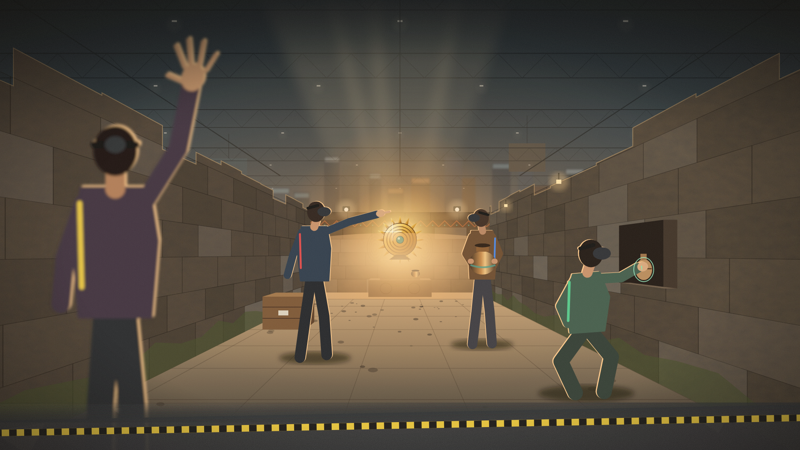

# Treasure Haul キービジュアル（案 1）

2026-10-22。16:9。すべてコードで描いた図（外部の素材・生成 AI は使っていない）。



| ファイル | 内容 |
| --- | --- |
| `keyvisual.png` | 1920×1080 |
| `keyvisual@2x.png` | 3840×2160（印刷・大型モニター用） |
| `keyvisual.svg` | 元のベクター。Illustrator 等で開いて手直しできる |
| `keyvisual_layout_guide.png` | タイトル・キャッチコピー・クレジットを置く余白の目安 |
| `build_keyvisual.py` / `render.mjs` / `guide.mjs` | 生成スクリプト |

## 描いたこと
- **中央の主役**: 遺跡の奥の祭壇に置かれた黄金の円盤（ステージの大広間の祭壇と同じ構成）。作業灯と、天井のない遺跡に上から差す光で照らす。
- **現実の空間だとわかること**: 高さ 2.4m の壁の上に、**本物の展示会場**（屋根のトラス、吊り照明、隣のブースの看板、垂れ幕）が見える。手前の床は遺跡の石畳から会場のカーペットと黄色と黒の境界テープへ変わる。仮想の遺跡が現実の会場に重なっている MR であることを、説明なしで伝える。
- **4 人の体験者**（全員ヘッドセット、コントローラーなし）:
  - 手前左（黄）: 背中向きで手を高く上げ、仲間に「こっち！」と合図する
  - 中央左（赤）: 黄金の円盤を指さし、見つけたことを伝える
  - 中央右（青）: 青銅の壺を両手で抱えて運んでいる（M のお宝）
  - 右（緑）: しゃがんで壁龕の壺に手を向け、手のひらからの短いビームで光る輪郭を見つけた瞬間
  - 色の線は企画書の「1 人 1 色（赤・青・緑・黄）」に合わせた
- **避けたこと**: 一人称の画面、HUD、値札などの画面表示、過剰な発光、他作品の模倣。

## 余白
上部中央（会場の天井の部分）を明るさを抑えた余白にしてある。タイトルとキャッチコピーはここに置く想定（`keyvisual_layout_guide.png`）。右下はクレジット・ロゴ用。

## 作り直し方
```sh
cd Design/KeyVisual
python3 build_keyvisual.py                     # keyvisual.svg を作る
PLAYWRIGHT_MODULE=$(npm root -g)/playwright node render.mjs      # keyvisual.png
PLAYWRIGHT_MODULE=$(npm root -g)/playwright node render.mjs 2    # keyvisual@2x.png
PLAYWRIGHT_MODULE=$(npm root -g)/playwright node guide.mjs       # 余白の目安
```
カメラ（`CAM_Y`・`F`）、人物の位置（`P(x, 0, z)`）、色はスクリプトの先頭と各ブロックで変えられる。

## 限界
- 手描き相当のベクター（フラットな人物シルエットと逆光の縁取り）。商業ゲームの宣伝用の厚塗りイラストの水準ではない。
- 本番用に仕上げる場合は、この構図を下絵にしてイラストレーターに描いてもらうか、実際の体験者を会場（または似た空間）で撮影し、ステージの 3D を重ねて合成するのがよい（実写なら「現実の人がその世界にいる」がいっそう伝わる）。
