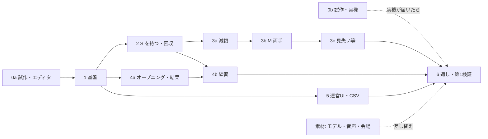

# 設計書: Treasure Haul（仮）

> 版: 第8版（2026-10-18。基盤 #37 の実装で決めたことを反映: `ThResync` を端末の状況報告にする、運営PCの起動値 hostEpoch、ClientNo の入れ替わりへの対応、引数の形、パラメータの追加と組み合わせの検査）。第7版で、エディタでの試作 S-2〜S-4 の結果を反映（持っているお宝の位置は RPC で送る方式に変更）／元: `TREASURE_HAUL_REQUIREMENTS.md` 第7版（要件 ID はこれを指す）
> 【要検証】＝試作（11章）で確かめてから確定する。U-xx＝未確定事項（要件定義書 U章＋本書 U章）。

---

## 1. 方針

- **進行の権限は運営PCの「ホスト」**。NetSync サーバーは運営PC上で動かし、中継だけを行う。ホストが状態・時間・参加端末・合計額・お宝の状態表（4.2）を持ち、端末は従う（F-FLOW-3〜5）。
- **お宝の物理は判定役の端末だけ**が動かす（今の持ち主、いなければ最後の持ち主）。他の端末は kinematic にして、受け取った位置へ補間する。ホストは物理を計算しない。
- **配置は同期しない**: 共通シード＋参加人数から、ホストと全端末が同じ配置・値段を計算する。
- **古いメッセージを捨てる**: すべてのメッセージの先頭に RoundId を付ける。RoundId は「開始」時の Unix ミリ秒で、前の回の RoundId 以下なら前の値 +1 にする（同じ秒に中断→開始しても重ならず、必ず増える。運営PCの再起動をまたいで増えるのは、運営PCの時計が巻き戻らないことが前提。待機中は回が無いので 0）。すべての `Th*` の引数は `[0]` = RoundId、`[1]` = 中身の JSON（`ThMessages`）。お宝のメッセージには加えて世代番号（ホストがお宝の持ち主・状態を変えるたびに +1）を、つかむ申請には申請ID（端末ごとの通し番号）を付ける。ホストの受け付け条件は 6.1。端末は古い世代を捨て、自分の知るより新しい世代は採用する。
- **RPC は取りこぼす前提で作る**: NetSync の RPC は、1端末あたりの送信数の上限（既定 30回/秒）を超えると捨てられ、送信待ちがあふれても捨てられる（パッケージのコードで確認済み）。重要な状態は、ホストが定期的に送る状態表（6.2）で必ず追いつけるようにする。
- **座標**: 同期する位置・配置候補点・納品場所・境界はすべて Environment シーンの `VenueRoot` のローカル座標で扱う。位置合わせ（U-1）は `VenueRoot` の合わせ方だけを差し替える。
- ゲームのロジック（状態遷移・配置・減額計算・集計・パラメータ）は純粋な C# クラスにし、EditMode テストで確かめる。

---

## 2. 構成

| 場所 | 主なクラス | 役割 |
| :--- | :--- | :--- |
| 運営PC（OperatorClient＋Environment） | `SessionHost` | 進行、参加端末、合計額、お宝の状態表 |
| | `DeviceRegistry` | 端末一覧（DeviceId が主キー）、見学・位置合わせ確認 |
| | `ParamsProvider` / `RoundLogger` / `OperatorView` | パラメータ配布、CSV、運営UI |
| 端末（UserClient＋Environment） | `SessionClient` | ホストの状態に追従、時間合わせ |
| | `TreasureSpawner` | 配置（純粋ロジック。ホストも使う） |
| | `HandGrabber` ×2 / `Treasure` | ビーム・つかむ・持つ／状態・減額・回収判定 |
| Core（`System/XR/`） | `HandGripTracker` | 握る・開くの判定（新規。4.4） |
| | 各 View | 値札・表示板・案内・結果 |

- 名前空間 `STYLY.TIB_Template.TreasureHaul`。運営PCは NetSync のクライアントとして参加し（ステルス、アバターなし）、端末はホストにならない。
- 運営PCも Environment を読み込む。描画は不要だが、配置候補点・納品場所の範囲・床のコライダーを使う（5章の強制で置く処理）。

---

## 3. 進行（F-FLOW / F-TUT）

### 3.1 状態

`RoundState`: `Waiting → Opening → Tutorial → Playing → Result → Waiting`

| 遷移 | きっかけ（ホスト） |
| :--- | :--- |
| Waiting → Opening | 「開始」（F-OPS-3 の条件）。RoundId・シード・ゲーム設定・パラメータ版を配る |
| Opening → Tutorial | 〔オープニング〕経過。参加端末に練習の色を割り当てて配る（3.4） |
| Tutorial → Playing | 〔練習〕経過（保留中は止め、〔保留の上限〕で解除）、または「本編開始」（練習中ならいつでも）。参加端末を確定して配る |
| Playing → Result | 〔本編〕経過、または目標額のみモード*で到達 |
| → Waiting | 〔結果〕経過、または「中断」（確認あり）。全端末でお宝・表示・合計を消す（F-FLOW-6） |

### 3.2 時間合わせと取りこぼし
- ホストは状態が変わるたびに `ThState`（状態の通し番号、状態、残り秒、シード、参加端末、ゲーム設定、パラメータ版、練習の色の割り当て）を送る。以後〔Heartbeat 間隔〕ごとに `ThHeartbeat`（状態の通し番号、残り秒、合計額、保留中か）を送る。#42 で `ThState` に保留中か（`held`）・目標額（`target`。本編の参加端末が確定した Playing 以降）・結果（`result`。Result のときだけ。回収額・目標額・クリアか。Result に入った最初の `ThState` で確定）を足した。目標額と結果はホストが決める（F-FLOW-5）。
- **保留**（F-TUT-6、#42）: Tutorial 中だけ。保留の間は練習の経過時間が進まない。1回の練習で保留した時間の合計が〔保留の上限〕に達したら自動で解除し、残りの練習時間から数え直す。保留・解除のたびに状態の通し番号を +1 して `ThState` を送る。端末は保留中は残り秒を数えない。「本編開始」は Tutorial 中なら保留の有無にかかわらず即 Playing。保留の有無と合計はホストが持つ（CSV は #44）。お宝の状態は `ThItems`（6.2）で送る。
- 端末は残り秒から自分で数え、Heartbeat と〔時間を合わせるずれ〕以上ずれたら合わせる。通し番号が違えば `ThResync` を送り、ホストは `ThState` とパラメータを送り直す。
- **`ThResync` は端末の状況報告を兼ねる**（DeviceId、知っている RoundId・通し番号、持っているパラメータ版、次の回を待っているか）。ホストは端末の登録・パラメータ版・ClientNo の対応をこの報告から作る。端末が送るのは: NetSync の準備ができたとき、通し番号・回の不一致、パラメータ版の不一致・`ThParams` を採用した後、運営PCの起動値（hostEpoch）が変わったとき、自分の ClientNo が変わったとき、回の途中から入って「次の回を待つ」になったとき。〔再送間隔〕より短い間隔では送らない。ホストも同じ端末への `ThParams` の再送を〔再送間隔〕で抑える（版が合わない古いビルドの端末と無限に往復しないため）。
- **運営PCの起動値（hostEpoch）**: `ThState`・`ThHeartbeat` に運営PCアプリの起動時刻を載せる。運営PCだけを再起動すると、待機中は通し番号も回も同じなので、端末は報告し直すきっかけが無く、新しいホストの端末一覧が空のままになる（#37 の結合確認で発生）。端末は起動値が変わったら報告し直す。
- Heartbeat が〔運営PC切断の待ち〕届かない端末は、回を中止して Waiting に戻る（F-FLOW-8）。運営PCの再起動後は RoundId が変わるので、古い回の端末も Waiting に戻る。
- `ThState` は RPC で送る（NetSync のグローバル変数は使わない）。S-3 の結果: グローバル変数は後から接続した端末も読めるが、1024 文字を超えると保存されず、書いた直後は読めず（サーバー往復後に反映）、サーバーの再起動で消える。回の途中からの参加はしない（3.3）ので、利点が小さい。
- **サーバーとの切断は NetSync からは分からない**（S-3: サーバーが落ちても `IsReady` は true のまま）。そのため端末は `ThHeartbeat` の途絶で判断する（上の F-FLOW-8 の処理）。サーバーが戻ると1秒以内に自動で再接続するが、**ClientNo は入れ替わる**ので、端末の識別は DeviceId で行う（3.3）。停止中に送った RPC は再接続後にまとめて届くので、RoundId・世代で古い物を捨てる（1章）。

### 3.3 接続と参加端末（F-FLOW-4/7、F-OPS-1/4）
- 端末は起動後、NetSync の自動接続で運営PCとつながり、Waiting になる。切断後は自動で再接続する（S-3: サーバーの再起動後1秒以内）。
- 端末は DeviceId で識別する（ClientNo は再接続で変わるので、今の接続を引くためだけに使う）。DeviceId→端末番号の対応表は、運営PCだけの別ファイル（7章）。
- `DeviceRegistry` は、切断した端末を「位置合わせ未確認」に戻す。新しく登録された端末・再接続した端末は「未確認」で始まり、運営UIで確認するまで参加できない（#44）。パラメータ `operation.autoConfirmAlignment`（初期値 false）が true のときだけ、確認済みで始まる（エディタの ParrelSync 検証用）。
- 端末の登録は `ThResync`（状況報告）から行う。NetSync の接続イベントは、ステルスの運営PC（ParrelSync のクローンを含む）でも発火するので、登録には使わない（切断イベントは使う）。
- **ClientNo の入れ替わり**: サーバーの再起動では、接続・切断のイベントなしに端末どうしの ClientNo が入れ替わることがある。端末は自分の ClientNo が変わったら報告し直し、ホストは受け取ったメッセージごとに送り手の DeviceId を NetSync（`GetDeviceIdByClientNo`）で引き直して、対応表を付け替える。
- 参加端末＝接続中・位置合わせ確認済み・見学でない・パラメータ版が一致・次の回を待っていない、の端末。参加していない端末はお宝を表示するが持てない。「開始」時は版の一致を問わずに候補に入れ、オープニングの終わり（Opening→Tutorial）で版が一致していない端末を外す（7章）。
- **回の途中で再接続した端末**は、その回のお宝を表示せず、次の回を待つ（シードからの最初の配置を誤って表示しないため）。端末はこれを `ThResync` で報告し、ホストはその端末をその回の参加端末から外す（待機に戻ったら解除）。
- **端末の切断、または回の途中で「見学」「位置合わせ未確認」にした端末**（F-GRAB-8、F-OPS-4）: ホストはその端末のお宝を解放する。持っているお宝は `ThForceRest` でその場にそっと置き、片手予約は解除して `ThFreed` を送る。その端末が判定役だった置かれているお宝は、判定役をホストに移す。参加人数・目標額は変えない。
  - 見学・未確認の間は、その端末のつかむ申請を認めない。
  - 参加に戻したとき、その回の本編開始時の参加端末に入っていた端末は、その時点から再びつかめる【仮】。入っていなかった端末は次の回から。
- DeviceId は NetSync が持っている（`NetSyncManager.Instance.DeviceId`。他の端末のは `GetDeviceIdByClientNo` / `GetClientNoByDeviceId`。S-3 で確認）。Android では権限が取れなければ `SystemInfo.deviceUniqueIdentifier` を使う（パッケージの処理）。
- **手の認識状態と電池残量**（#44）: 端末が `ThStatus`（端末→ホスト、〔状況報告の間隔〕初期値 2 秒。`progress.statusInterval`）で送る。手は `HandGrabber` の追跡状態（追跡できていて手のひらが取れている手の数 0〜2）、電池は `SystemInfo.batteryLevel`（取れなければ -1。PICO で取れるかは実機で確認）。ホストは受け取った時刻と値を端末ごとに持ち、〔状況報告の間隔〕×3 を過ぎて届かない値・切断した端末の値は運営UIで「不明」にする。登録されていない送り手（ステルスの運営PC・クローン）の `ThStatus` は無視する。
- **運営UIからの見学・位置合わせ確認の切り替え**（#44）は `SessionHostCore.SetSpectator` / `SetAlignmentConfirmed`。見学・未確認にした端末は、切断と同じ処理（`ReleaseReservationsOf` / `ForceRestItemsOf`）でお宝を解放する。受け付けの判定は `HostMessageGate`（`IsEligible`）がそのまま行うので、見学・未確認の間のつかむ申請は捨てられる。参加端末の一覧（`Participants`）は変えないので、参加人数・目標額は変わらず、本編開始時の参加端末に入っていた端末だけが、参加に戻したときにすぐ再びつかめる。入っていなかった端末は次の回から。

### 3.4 練習（F-TUT）
- 練習用お宝の置き場所4か所（`ThTutorialSlot`。色番号 0〜3 を持つ）は Environment の `VenueRoot` の下に手で置く（納品場所の前 1m に横一列。#43）。`ThVenue` が色番号の順に `ThTreasureSetup.PracticeSlots` へ渡す。4つそろっていない・色番号が重なるときは練習用お宝を作らない。
- Tutorial に入るとき、ホストは参加端末を端末番号の小さい順に色番号 0〜3（＝`TutorialSlot`）へ割り当て、`ThState.tutorialColors`（`participants` と同じ順。割り当てのない端末は -1）で配る。端末番号の対応表（7章）に無い端末は、登録済みの後ろに DeviceId の文字列順（`PracticeColors` に `ThDeviceNumbers.Compare` を渡す。#44）。割り当ては DeviceId → 色番号でホストが回の間持ち、本編で参加端末が減っても残った端末の色は変えない。Waiting・新しい「開始」で消す。各端末は自分のビームと練習用お宝を割り当ての色にし、自分のお宝の上に「あなたの」と出す。
- **プレーヤーの色**（#43、2026-10-18 追加）: 割り当てた色は、その回の結果まで続く（本編でもビームとアバターは同じ色。R.E.P.O と同じく、プレーヤーを色で見分けられるようにする。企画書 1章。色の選び方や見た目は R.E.P.O に似せない）。待機中と、割り当てのない端末は既定の色。
  - 色と見た目は ScriptableObject `ThPlayerPalette` 1つで一括管理する。4枠それぞれに、名前・記号（●▲■★）・ビームの色・アバターの色（ビームと同じ系統）・練習用お宝の色、必要ならアバターのテクスチャの差し替えを持つ。既定の色も持つ。ビルドに入れる（運営PCのファイルで変えるパラメータ〔7章〕とは分ける）。
  - NetSync のアバター（STYLY のテンプレート）は**そのまま表示する**。他の人のアバター（`STYLY Default Avatar A 1`）の頭・手・体のメッシュを、その人の割り当ての色で塗る。DeviceId から `GetClientNoByDeviceId` で今の ClientNo を引き、その人のアバターを探す。塗るときは `MaterialPropertyBlock` を使い、共有のマテリアルを書き換えない。自分のアバター（`Avatar Local (Transparent)`）は見えないので塗らない。
  - STYLY のアバターのシェーダー（`Shader Graphs/Avatar`。透明で、縁が光る）には色の項目が無く、`MaterialPropertyBlock` だけでは塗れない（#43 で確認）。塗る間だけ、同じ計算を再現して色の項目を足した自作シェーダー `TIB/AvatarTint`（`TH_AvatarTint.mat`）に差し替え、色は `MaterialPropertyBlock` で入れる（不透明の Lit などに替えて見た目を変えない）。塗りを外すときは元のマテリアルに戻す。
  - 前の版のアバターで、体が頭について動かない不具合があった（学習メモ）。`A 1` では起きていない（#43 で確認。`netSyncAvatar` は設定済み）。
- 練習用お宝は、本編のお宝と同じつかむ手順・位置の同期（4.4、6章）を使い、全員に見える。ホストの状態表にも入れる（番号は本編のお宝と重ならない練習用の番号 100＋色番号。Tutorial の間だけの練習用の表で持ち、`ThItems` も練習用の表を送る。#43）。見た目はカタログの練習用プレハブを `MaterialPropertyBlock` でその色に塗り、上に記号（●▲■★）、自分のお宝にはさらに「あなたの」を出す。違いは3つだけ: ホストは割り当てられた端末にしかつかむのを認めない、減額しない、回収しても合計に入れない（F-TUT-3）。
- **練習の回収**（F-TUT-3/4）: Tutorial 中、ホストは練習用お宝の `ThCollect` だけを受け付ける（本編のお宝はまだない）。受け付け条件（6.1）を満たせば1回だけ受理し、そのお宝を回収済みにして、`ThCollected`（練習、合計額は変えない）を全員へ送る。同時に、割り当てられた端末の練習完了を確定し、記録する（8章）。全端末はそのお宝を消し、回収した本人の端末には「+150G！」を出す。端末からの練習完了の申告（旧 `ThTutorialDone`）は使わない。
- Playing に入ったら、練習用お宝をすべて消し（ホスト・端末とも練習用の表を捨て、本編の表を作る）、以後の練習用お宝のメッセージは捨てる。
- 練習中に持ち主が切断したときは、本編と同じく練習用お宝をその場にそっと置かせる（`ThForceRest`。他の端末で宙に止まって見えないように）。〔置く時間〕の後、範囲外ならつかめるに戻し、納品場所の範囲内なら回収として扱う（練習完了も記録する。#43）。
- 案内（F-TUT-3）・ヒント（F-TUT-5）・最後の一文（F-TUT-7）は端末のローカル処理。判断は純粋クラス（`PracticeGuide`・`PracticeHintJudge`）。ヒントは、Tutorial に入ってから〔ヒントまで〕一度も持てていない人の手の横に、XR Hands のサンプルの手のモデル（改変しない）を出し、「開く⇄握る」を DOTween で繰り返す。一度持てたら、その回は出さない。手のモデルは `Assets/Samples/XR Hands/1.7.3/HandVisualizer/Models/` を直接参照しているので、Inter BEE 用のプロジェクトへ移すときは XR Hands の「HandVisualizer」サンプルも取り込む（取り込まないとヒントの手が出ない）。

---

## 4. お宝

### 4.1 配置（F-ITEM-1/2）
- `TreasureSpawner`（純粋ロジック）が、シード＋参加人数＋P-5 の表＋配置候補点から配置と値段を出す。乱数は `System.Random(seed)`。
- 配置候補点は Environment に手で置き、納品場所からの距離帯を持たせる。縁の余白・納品場所の前には置かない。
- **お宝カタログ**（#38）: お宝の見た目は ScriptableObject `ThTreasureCatalog` 1つで一括管理する。1件＝種類（S／M、追加要素の L*・秘宝*）、表示名、プレハブ（モデルの MeshRenderer だけ。持ち手のメッシュは持たない。つかむ範囲の箱は `Treasure.Initialize` が `ModelBounds` から実行時に自動で作る: S は1つ、M は水平の長い軸で左右に分けた2つ。余白 0.02m。割り付けは `GrabZoneLayout`。ビームが当たっている間に光る輪郭は、モデルの各 MeshRenderer と同じメッシュを背面法（`TIB/TreasureHaul/AimOutline`）で描く子として自動で作る）、今回の展示で使うか。練習用お宝のプレハブもここに持つ。
  - `TreasureSpawner` は各枠の種類・値段を決めた後、同じ乱数で、その種類の「使う」お宝からプレハブを選ぶ（全端末で同じ見た目になる）。
  - カタログはビルドに入れる（運営PCのファイルで変えるパラメータ〔7章〕とは分ける）。ビルドの違いで選ばれる見た目がずれないよう、カタログの「使う」お宝の並びのハッシュを、パラメータ版と同じく端末とホストで照合する。
  - #46 で届いたモデルは、カタログに足すだけで使えるようにする。

### 4.2 状態

| 状態 | 判定役の端末の物理 | つかめる | 同期 |
| :--- | :--- | :---: | :--- |
| Resting（置かれている） | 止める | ○（納品場所の範囲内は×） | 入るとき `ThRest`（最終位置） |
| Locked（M の片手予約） | 止める（その場から動かさない） | 同じ人のもう一方の手だけ | `ThGrabbed`（予約） |
| Flying（手元へ飛ぶ途中） | 止める（補間） | × | 他の端末は `ThGrabbed` 後に持ち主の手へ〔飛ぶ時間〕で補間 |
| Held（持たれている） | 動かす（4.3） | × | 位置（`ThPoses`。6章） |
| Hovering（手を見失い待ち） | 止める | × | 位置（止まった位置。6章）。**持ち主の端末だけの状態**で、ホストの状態表は Held のまま（免除は `ThPoses` の `exempt`。#41） |
| Falling（落下中） | 重力あり | × | 位置（`ThPoses`。6章） |
| Placing（そっと置く途中） | 止める（真下の床・台へ〔置く時間〕で降ろす） | × | 持ち主の端末が置くとき: 位置を送り続け、終わりに `ThRest`（ホストは Held のまま）。持ち主の切断で運営PCが置かせるとき: `ThForceRest`（ホストも Placing） |
| Collected / Destroyed | 消す | ― | ― |

- **ホストの状態表**: お宝ごとに、状態（4.2 の表）、持ち主（予約を含む）と承認した申請ID、判定役、世代番号、元の価値、現在の価値、ぶつけた回数、値段公開済みか、回収済み・消滅か、置かれている位置、減額の免除中か（5章）、練習用か。
- ホストが「つかめる」に戻すのは、`ThRest` の受理、片手予約の解除、取りやめの受理、`ThForceRest` の完了のときだけ。戻したら世代を +1 して `ThFreed`（お宝、世代、位置）を全員へ送る。
- **世代を +1 するのは**、持ち主を認めたとき（`ThGrabbed`）、「つかめる」に戻したとき（`ThFreed`）、回収・消滅のとき（#38 で決定）。手を開いて落とした `ThRelease`（理由=落とした）では世代を変えず、ホストは持ち主を外して Falling にするだけ。`ThRelease` を取りこぼしても、判定役の `ThRest`・`ThCollect`（承認された世代）がそのまま受理される。
- 落下が〔止まったとみなす時間〕静止したら Resting（N-1）。
- **M の片手予約と両手持ち**: 手順は 4.4。両手で持った後に片手を離した・見失ったときは〔M の猶予〕を優先し（〔見失い待ち〕は使わない）、その場で止めずに残った手で持ち続ける（外れた瞬間の「残った手 → お宝」の相対を保つ）。猶予の間に、外れた手がもう一度握れば両手持ちに戻る（ビームの当て直しは要らない。#40 で決定）。猶予の間に残った手も外れたらすぐ Falling。猶予の間に両手に戻らなければ、離した場合は Falling、見失った場合は Placing（F-GRAB-4。Placing は #41 で作るので、#40 では見失いも Falling）。

### 4.3 持っている間の動き（F-GRAB-2/4/6/7）
- 重力なしの Rigidbody（interpolate、ContinuousSpeculative）。目標（片手は握った手の位置、M は両手の中点と両手を結ぶ向き）へ、位置は速度、向きは角速度で追従させる。速度の上限は〔追従速度の上限〕。
  - 何もない所では1物理ステップで追いつく（S-4: 遅れ 0。追従速度の上限 10m/s を超える速い動きだけ遅れる）。
  - **障害物に向かう速度の成分を切る**: 速度を決めた後、`Rigidbody.SweepTest` で障害物の手前で止まるように、障害物に向かう成分だけを切る（表面に沿う成分は残して滑らせる。角のために最大3回繰り返す）。S-4 の結果:
    - 速度だけで追従すると、押し付けたときに 2.5〜3.8cm めり込み、法線方向に 13〜17mm 揺れる（すり抜けはなし）。
    - 成分を切ると、箱の角ではめり込み 0・揺れ 1/3〜1/5 になる。壁では 1.3〜2.9cm 残る（主に回転による。`SweepTest` は回転を見ないため）。速い手（3m/s）で壁に当てると、小さな揺れの回数は増える。`SweepTest` は最初から重なっている相手を返さないので、いったんめり込むと効かない。
    - 【要検証】接触中は角速度を抑えると壁のめり込みが減るか。実機の手で 1〜3cm のめり込みが気になるか（#49）。
  - Fixed Timestep は今の 0.02秒のままにする。S-4 では 0.02 / 1/72 / 1/90 で一貫した差がなかった。実機の負荷（S-5）を見て見直す。
- **手の飛び**: 手の目標が1フレームで〔飛びの判定〕以上動いたら、目標を前の位置のまま止め、〔補正の無判定時間〕の間は「離れたら置く」と減額を止めて、目標へ戻す。
- 目標と〔離れたら置く距離〕以上離れたら Placing。
- お宝と `HandBone` レイヤーは、レイヤーの衝突表で当たらないようにする。
- **見失い**: `IsTracked` が〔見失いの猶予〕続けて false なら Hovering にし、〔見失い待ち〕待つ。手が戻ったときは、新しい握りの確定を待たず、**握りの強さが離す側のしきい値以上なら持ち続ける**（握りの判定を握っている状態へ戻す `GripStateMachine.Resume`。戻した後は〔補正の無判定時間〕）。手を開いていたら Placing（その場でそっと置く。減額しない）。戻った直後は指の関節が不安定なので、「開いていた」は離す側のしきい値未満が〔離す判定〕の間見え続けたときだけにする（#41）。
  - **手の飛び**の判定は、〔見失いの猶予〕より短い見失いの後に戻った最初のフレームも、見失う前の位置と比べる（#41）。
  - M（両手で持った後）: 片手が外れたら〔M の猶予〕。猶予の間に残った手も**見失った**ら Hovering（開いたならすぐ Falling）。M の Hovering は、**両手とも**見えて握りの強さが離す側のしきい値以上なら両手で持ち続け、どちらかが開いて戻るか〔見失い待ち〕が過ぎたら Placing（#41 で決定）。
  - 予約中（Locked）・持ち上げの申請中は、お宝が動いていない・飛ぶ途中の短い間なので Hovering にしない（予約は 4.4 の手順 4、持ち上げの申請中は取りやめ）。
- **降ろす先**（Placing）: お宝の位置から真下へ Raycast し、会場の物（床・納品場所・瓦礫）の上に置く（`Treasure`・`TreasureGrabZone`・`HandBone` のレイヤー、トリガー、アバターは除く。当たらなければ VenueRoot の床）。向きは Y 回転だけ残して立てる。お宝のプレハブは底が原点（`ThPlaceSolver`。#41）。

### 4.4 つかむ（F-GRAB-1/3/5）
- **ビーム**: 肩の推定位置（頭から〔肩のずらし量〕）→ 手のひらの方向へ SphereCast（半径〔吸い付き半径〕）【要検証 S-1】。
- **握る**: Core に `HandGripTracker` を新しく作る（`System/XR/`）。XR Hands の関節から、人差し指〜小指の曲がり具合の平均を「握りの強さ」0〜1 として出す。つかむ側・離す側の2つのしきい値（ヒステリシス）、離す判定の継続時間〔離す判定〕、解除の理由（見失い／手を開いた）を持つ。しきい値は【要検証 S-1】。`HandPinchTracker` は前作用にそのまま残す。XRI の NearFarInteractor は使わない（両手・見失い・同期を自前で扱うため）。
- **狙いの保持**: 握る動きで手のひらの向きが変わってビームが外れても、〔狙いの保持〕以内に当たっていたお宝のつかむ範囲を対象にする。
- **高い壁**: 壁レイヤー `ThWall` のコライダーは、太さなしの Raycast でビームの始点から壁までの距離を測り、それより遠いつかむ範囲の当たりを捨てる。ビームの線の終点も壁の点で止める（`HandGrabber`・`GrabTargetPicker`）。低い瓦礫は別レイヤーにしてビームを止めない。
  - 手のひらが壁の中、または肩の推定位置から手のひらまでの線が壁を横切る（壁の向こうへ腕を突き出した）ときは、そのフレームは対象なし・ビームなし。お宝ごとにも、ビームの始点からそのつかむ範囲のビーム上に一番近い点への線が壁に遮られたら対象にしない。
  - **ステージ側の決まり**: 壁のコライダーは厚さ 0.1m 以上にする。壁龕・祭壇など、お宝の置き場所は壁のコライダーの外に出す（凹みを抜かない単純な箱の壁の中にお宝を置かない）。
- **つかむ手順（S）**:
  1. 端末は新しい申請IDを振り、お宝を Flying にして手元へ動かし始め、`ThGrab`（お宝、申請ID、知っている世代、種類=S）をホストへ送る。
  2. ホストは受け付け条件（6.1）を満たせば先着で認め、世代を +1 して `ThGrabbed`（お宝、ClientNo、申請ID、世代、現在の価値）を全員へ送る。満たさなければ `ThGrabDenied`（お宝、ClientNo、申請ID）を送る。
  3. 端末は、**そのお宝への自分の最新の申請ID**と一致する `ThGrabbed` だけを自分への承認として Held にし、値段の公開・発見演出（F-ITEM-3/4）・位置の送信を始める。飛び終わっても承認が届かなければ、手元で止めて待つ（減額しない）。
  4. 否認された、〔承認の待ち上限〕を過ぎた、承認前に手を開いた、のいずれかなら元の位置へ戻して Resting にし、`ThRelease`（お宝、申請ID、理由=取りやめ）を送る。ホストは、その申請IDを認めていればロックを外して「つかめる」に戻す。まだ届いていない申請なら、その申請IDを取りやめ済みとして覚え、後から届いても認めない。
  5. 最新ではない申請IDへの `ThGrabbed` が自分に届いたら（取りやめ→再申請の後に古い承認が遅れて届いた場合）、その申請IDで `ThRelease`（取りやめ）を返す。ホストは、今の持ち主の申請IDと一致する取りやめだけを受理するので、新しい申請への承認は消えない。
- **つかむ手順（M）**: 片手予約 → 両手成立 → 移動開始。
  1. 1本目の手で片方のつかむ範囲（左右どちらか半分）を握ると、`ThGrab`（種類=M 予約）を送る。お宝は動かさない（Locked）。
  2. ホストは S と同じ条件で認め、`ThGrabbed`（予約。値段は載せない）を全員へ送る。以後、他の人はこのお宝をつかめない。予約は「持った」に数えず、値段も公開しない。
  3. 予約中に、もう一方の手で反対側のつかむ範囲を握ると、端末は Flying にして手元へ動かし始め、`ThLift`（お宝、申請ID、世代）を送る。ホストは持ち主・申請ID・世代が一致すれば Held にし、`ThLifted`（お宝、世代、現在の価値）を全員へ送る。端末はこれを受けて Held にし、値段の公開・発見演出を始める（ここが「持った」瞬間）。一致しなければ否認し、端末は S の 4 と同じく元に戻す。
  4. **予約の解除**: 予約中の手を開いた、予約中の手を〔見失い待ち〕の間見失った、のどちらかで `ThRelease`（理由=予約解除）を送る。ホストは持ち主・申請ID・世代が一致すれば「つかめる」に戻し、`ThFreed` を送る。端末の切断・見学への切り替えでは、ホストが自分で解除する（3.3）。〔見失い待ち〕の間に手が開いた状態（握りの強さが離す側のしきい値未満）で戻ったら、待たずに解除する（#40）。
  5. **メッセージ**（#40）: 予約の承認は `ThGrabbed` の `reserve = true`（`value = 0`）。`ThLift`（お宝、申請ID、世代）・`ThLifted`（お宝、ClientNo、申請ID、世代、価値）。`ThLift` の否認は `ThGrabDenied`。予約中の M は置かれているお宝と同じく、ぶつけられれば減額される。予約の承認より先に2本目の手が握ったら、端末が覚えておき、承認の瞬間に `ThLift` を送る。
- 左右の手で S を1つずつ持てる（`HandGrabber` は手ごとに独立）。

### 4.5 持ち方の切り替え（F-GRAB-9*）
- `HandGrabber` の「ビームの長さ」と「つかんだ後の目標の決め方」を差し替えられる形にしておく。

---

## 5. 減額と回収（F-DMG / F-SCORE）

- **衝突**（F-DMG-1〜3）: 判定役が `OnCollisionEnter` で、直前〔速さをならすフレーム数〕のお宝の速度の平均から衝撃の速さを出し、〔数える衝撃〕以上なら `ThDamage` を送る。
- **減額の免除はホストでも確かめる**（F-DMG-3）: 判定役は、自分のお宝が免除中（Flying・Placing・Hovering と、手の飛び・補正の後の〔補正の無判定時間〕）に入ったとき・出たときに、その状態を位置の送信と `ThItems` の元になる報告に載せ、ホストは状態表に持つ。免除の報告は `ThPoses` の各お宝の `exempt` で送る（#39 で手元へ飛ぶ途中、#41 で見失い待ち・そっと置く・〔補正の無判定時間〕を足した）。位置の送信より先に衝突の報告が届くと、ホストが免除を知らずに減額するので、判定役は自分のお宝の免除を `ThDamage` の `exemptA` にも載せる（障害物との衝突なら送らない。#41）。ホストは `ThDamage` に載っているお宝を**1つずつ別々に**判断し、免除中・練習用・回収済み・消滅済みのお宝には適用しない（もう一方には適用する）。
- **お宝同士**（F-DMG-6。R.E.P.O と同じ）: ぶつかった**両方を1回ずつ**数える。衝突を見つけた判定役は、相対速度（自分の速度−相手の速度。相手が他の端末で動いているお宝なら、受け取った位置から求めた補間速度）が〔数える衝撃〕以上なら、`ThDamage` に2つのお宝を載せてホストへ送る。相手のお宝の免除は自分では判断しない（ホストが判断する）。
- **再接触と、通信上の重複を分ける**:
  - **再接触**（同じ相手との2回目の衝突として数える条件）: 判定役がローカルで、同じ相手（コライダー）との接触が終わってから〔再減額の間隔〕たった後の接触だけを報告する。押し付け続けている間は報告しない。
  - **通信上の重複**（同じ1回の衝突を、両方の端末が報告すること）: ホストは、同じ組み合わせの報告が、直前の同じ組み合わせの報告（捨てたものを含む）から〔重複とみなす時間〕以内なら、同じ衝突として捨てる。
  - 置かれているお宝は kinematic なので、押されても動かないが減額はされる。
  - 他の人が持っているお宝とも当たる。持ち主の端末では相手を kinematic の代役として扱い、当たると止まって表面に沿って滑る。相手の位置は少し過去なので、片方の端末だけが衝突を見つけたり、相手の画面で少しめり込んで見えたりする（S-2: 相手の遅れが約 250ms のとき、正面衝突で最大 4.5〜9cm めり込んで見え、その後は両方の画面で接したまま止まった。RPC で送れば遅れは数十 ms に縮むので、めり込みも小さくなる見込み）。減額は、どちらの端末が見つけても、ホストが組み合わせで重複を除いて1回にする。
- **計算**: **ぶつけた回数はホストだけが数える**: 回数を +1 し、`DamageCalculator`（純粋）で `元の値段 × 減額率[回数]` を出して現在の価値から引き、`ThDamaged`（回数、減額の量、現在の価値、位置、消滅か、値段公開済みか、記録用の人＝そのときの持ち主・いなければ判定役・誰も持ったことがなければ -1）を全員へ送る。全員がヒビの段階と「-90G」の表示を更新する（F-DMG-4）。値段公開前のお宝は「-90G」を出さず値札も「？」のまま（#39 で決定）。3回目で0になり消滅（F-DMG-5。状態 Destroyed、世代 +1）。適用した減額の合計を回ごとに持つ（#42・#44 の材料）。持ち主が替わっても回数がずれない。
- **回収**（F-SCORE-1/4）: 判定役が、納品場所の範囲に入り誰も持っていない状態を見て `ThCollect` をホストへ送る。ホストは Playing 中の本編のお宝なら1回だけ数え（Tutorial 中の練習用お宝は 3.4）、**ホストの現在の価値**を合計に加え、`ThCollected`（合計額、価値、傷物か）を全員へ送る。納品場所の表示板には合計額だけを出す（F-SCORE-2、2026-10-18 変更）。目標額と目標達成の知らせは体験者の面に出す（9章、#42）。
- **持ち主の切断・見学への切り替え**（F-GRAB-8、3.3）: ホストは、その端末が持っているお宝（Held・Flying）と、判定役の落下中（Falling）のお宝を Placing にし、世代 +1・持ち主と判定役を外して `ThForceRest`（お宝、世代、**降ろす先**）を送る。降ろす先は、`ThPoses` で最後に受けた位置（無ければ置き位置）から、ホストが端末と同じ `ThPlaceSolver` で決める（ホストも Environment を読み込んでいる。端末どうしで降ろす先がずれないように、#41 で決定）。全端末は今の表示位置から降ろす先へ〔置く時間〕で降ろす。ホストは〔置く時間〕の後、Playing 中で納品場所の範囲内なら回収、それ以外は「つかめる」に戻す（`ThFreed`）。自分が持っているお宝の `ThForceRest` を受けた端末（一瞬切れて戻った持ち主）は、手から外す。

---

## 6. 同期メッセージ（NetSync）

- 状態の変化は RPC。既存の `Rpc` 列挙（Core）の**末尾**に `Th*` を足す（前作の `Gi*` の番号を変えない）。自分が送った RPC の戻りは ClientNo で捨てる（前作と同じ）。
- RPC はすべて全員宛て。特定の端末向けの内容は、引数に ClientNo を入れる。
- **持たれている間の位置は、端末ごとに1つの RPC（`ThPoses`）にまとめて送る**。判定役は、自分が動かしているお宝（Held・Hovering・Falling）の位置と向きを〔位置の送信間隔〕1/30秒ごとに1つの RPC に載せる。受け側は〔補間の遅れ〕だけ過去の時刻を、受け取った2つの位置の間で補間して描く（遅れて届いたら、短い間だけ先読みする）。
  - 全端末とホストは起動時に `ConfigureRpcLimit` で上限を〔RPC の上限〕60回/秒に上げる。1端末の RPC は、位置の 30回/秒 ＋ つかむ・置く・減額・回収（1秒に数回）で収まる。
  - `NetSyncObject` は使わない。S-2 の結果: 相手の画面で定常 200〜290ms 遅れ（送信頻度 30Hz 以上で約 200〜220ms）、**動き始めは約1秒遅れて、定常に戻るのに約8秒**かかる（内部の補間バッファによるもので、外から変える設定はない）。MR では仲間の本物の手が見えるので、手からお宝が大きく遅れて見える。手元へ飛んでくる動きも約1秒遅れて見える。RPC は片道 4〜12ms。
  - 参考（S-2）: `NetSyncObject.RequestOwnership` は先着の調停をしない（他人が持っていても奪える。同時の要求は後勝ち）。切り替えは約65ms。
  - 【要検証】会場の Wi-Fi で、4台が 30回/秒ずつ送っても、遅れと欠けが許容範囲か（#38 でエディタ、#49・#45 で実機）。
- **RPC の性質**（S-3。同じ Mac での実測）: 1端末 30回/秒を超えると捨てられる（`ConfigureRpcLimit` で上げられ、100回/秒でも欠損なし）。順番は保たれ、重複もない。自分の送った RPC は自分にも届く（ClientNo で捨てる）。片道 4〜12ms、往復の中央値 約15ms（相手のフレーム待ちを含む）。引数は JSON で 65,535 バイトを超えると**エラーなしで中身が空になる**ので、1回の RPC は 32KB までにする。

### 6.1 ホストの受け付け条件
すべて、RoundId が今の回で、送り手が今の参加端末（見学・未確認・切断中ではない）であることが前提。満たさないメッセージは捨てる。

| メッセージ | 受け付ける条件 |
| :--- | :--- |
| ThGrab | お宝が「つかめる」。その申請IDが取りやめ済みでない。練習用お宝は Tutorial 中かつ割り当てられた端末、本編のお宝は Playing 中 |
| ThLift | 送り手が予約の持ち主で、申請ID・世代が今の状態表と一致 |
| ThRelease | 送り手が今の持ち主で、申請ID・世代が一致（取りやめは 4.4 の 4・5） |
| ThRest / ThCollect / 免除の報告 | 送り手がそのお宝の判定役で、世代が一致。同じ世代の ThRest・ThCollect は1回だけ受理する（送り直しは捨てる） |
| ThDamage | Playing 中。送り手が、載っているお宝の少なくとも1つの判定役。その上でお宝ごとに免除と重複を判断する（5章） |

### 6.2 取りこぼしへの備え
- ホストは Tutorial・Playing の間、〔状態表の送信間隔〕ごとに `ThItems`（全お宝の 状態・持ち主・世代・現在の価値・ぶつけた回数・値段公開済みか・回収/消滅・置かれている位置）を送る。23個分で約1,000文字（S-3 で送れることを確認）。
- 端末は、自分の表示や状態が `ThItems` と食い違っていれば `ThItems` に合わせる（値札・ヒビ・つかめるか・置き位置・消す）。`ThGrabbed`・`ThLifted`・`ThDamaged`・`ThCollected`・`ThFreed`・`ThForceRest` を取りこぼしても、次の `ThItems` で追いつく。
- 判定役は、送った `ThRest`・`ThCollect` が `ThItems` に反映されるまで、〔再送間隔〕ごとに送り直す（ホストは同じ世代のものを1回だけ受理する）。
- `ThDamage` は送り直さない。取りこぼすと減額されないだけで、表示のずれや動けない状態は生まない。

| 名前 | 送り手 | 主な内容 |
| :--- | :--- | :--- |
| ThState / ThHeartbeat | ホスト | 3.2 |
| ThResync | 端末 | 状況報告兼再送要求（3.2） |
| ThStatus | 端末 | 手の認識の台数（0〜2）と電池残量（%）。〔状況報告の間隔〕ごと（3.3、#44） |
| ThParams | ホスト | パラメータ JSON と版（7章） |
| ThGrab / ThLift / ThRelease | 端末 | つかむ申請（申請ID・種類 S/M 予約）/ M の両手成立 / 置いた・落とした・取りやめ・予約解除（4.4） |
| ThGrabbed / ThGrabDenied / ThLifted / ThFreed | ホスト | 4.2、4.4 |
| ThPoses / ThRest / ThDamage / ThCollect | 判定役 | 6章（位置）、4.2、5章 |
| ThDamaged / ThCollected / ThForceRest / ThItems | ホスト | 5章、6.2 |

---

## 7. パラメータとゲーム設定（N-7 / N-8）

- **パラメータ**: P章の6グループをフィールドに持つ `[Serializable]` クラス `ThParams` を、ScriptableObject 1つ（組み込みの初期値）に入れる。各値に `[Range]` を付ける。
- **差し替え**: 運営PC の `persistentDataPath/treasure_haul_params.json`。ホストは起動時と、待機中の「再読み込み」で読み、`JsonUtility.FromJsonOverwrite` で初期値に重ねる（書いた項目だけ上書き）。`[Range]` 外の値は初期値に戻して運営PCに警告を出す。
- **組み合わせの検査**（N-7）: 個々の範囲に加えて、次を確かめる。満たさないグループは組み込みの初期値に戻し、運営PCに警告を出す。
  - 減額率3つの合計が 100%
  - 握りの「つかむ」しきい値 ＞「離す」しきい値
  - 各人数の出現数（S＋M）が、使える配置候補点の数以下（距離帯ごとの割り当てがあるなら帯ごとにも）
  - 価値の範囲の上下限が 100G 刻み
  - `TutorialSlot` の数 ≧ 最大参加人数（4）
  - Heartbeat 間隔 ＜ 運営PC切断の待ち（満たさないと全端末が回を中止し続ける）
  - 配置候補点・`TutorialSlot` の数は Environment から取る（取れない間は、その検査を飛ばす）。初期値に戻しても矛盾が残るとき（環境側の問題）は「初期値でも矛盾」と警告する
- **版**: 重ねた後の値を `JsonUtility.ToJson` した文字列のハッシュ先頭8桁。
- **配布**: 「開始」のたびに `ThState` に版を載せ、版が違う端末にはその場で `ThParams` を送り直す（N-7）。オープニング中に一致しなければ、その端末は参加端末に入れず、運営UIに「版の不一致で除外」と出す。
- **運営PCだけのファイル**: `treasure_haul_settings.json`（モード、追加要素、持ち方。`ThState` で配る）、`treasure_haul_devices.json`（DeviceId→端末番号。予備機も含めて会場で登録）。
  - `treasure_haul_devices.json` の形: `{ "devices": [ { "deviceId": "...", "number": 1 } ] }`。番号は手で編集する。0・載っていない端末は「未登録」で、一覧では登録済みの後ろに DeviceId の文字列順で並べる。練習の色の割り当て順も同じ並び（`ThDeviceNumbers.Compare`）。
  - 起動時と、待機中の「再読み込み」で読む。壊れた JSON は全端末を未登録として扱い、同じ番号の重複とともに運営UIの警告に出す。
  - 雛形は運営UIの「接続中の端末を書き出す」ボタンで作る（既存の行はそのまま残し、無い端末を number=0 で足す。既存のファイルが壊れているときは上書きしない）。
- 雛形の JSON は、組み込みの値を書き出すエディタメニューで作る。

---

## 8. 運営PC

- `OperatorView`: 端末一覧（F-OPS-1）、状態・残り時間・合計額（F-OPS-2）、開始／保留／本編開始／中断（F-OPS-3）、見学・位置合わせ確認（F-OPS-4）、パラメータ版・警告・再読み込み、ゲーム設定*（F-OPS-5）。
  - 端末一覧（#44）: 1 行 = 1 端末。列は 端末番号（未登録は「未登録」＋DeviceId の末尾 6 文字）／接続・切断／位置合わせ 確認済み・未確認／手（両手・片手・なし・不明）／電池（%。〔電池の警告〕以下は警告色、不明は「不明」）／練習完了（Tutorial〜Result の間だけ「練習 済」・「練習 未」）／見学・参加。行ごとに「見学にする／参加に戻す」と「位置合わせを確認／確認を外す」のボタン。端末番号の順に並べる。
  - 一覧の中身は `SessionHostCore.Devices`（`DeviceRowData` の配列。内容が変わったときだけ流れる）。行（`DeviceRowView`）はプレハブを使わず実行時にコードで作る。置き場所（`OperatorView._deviceListRoot`）が未設定なら `_devicesText` と同じキャンバスの下に自動で作る。
- `RoundLogger`: `persistentDataPath/logs/rounds_YYYYMMDD.csv`・`players_YYYYMMDD.csv`（F-OPS-7）。日付は運営PCのローカル日付で、回の開始時刻で決める。回が終わる（Result→Waiting）か中断したときに、`SessionHostCore.RoundFinished` で流れる `RoundRecord` を 1 回ぶん追記する（rounds に 1 行、players に参加端末ごとに 1 行）。1行ごとに書き込みを確定させる（開いて書いて閉じる）。ファイルが無い（または空）なら見出し行から書く。UTF-8（BOM 付き）、カンマ・改行・ダブルクォートを含む値はクォートする。書けなかったら運営UIの警告に出し、進行は止めない。
  - rounds の列: 開始時刻（ローカル ISO 8601）, RoundId, 終わり方（完了／中断）, 中断した状態, 人数, モード, 追加要素（有効なものを「|」でつなぐ）, 持ち方, パラメータ版, 保留の有無, 延長秒, 回収額, 目標額, 目標達成, 損害額。
  - players の列: RoundId, 端末番号, DeviceId, 色番号, 練習完了, 初めて持った, 初めて回収した（各「秒」は回の開始からの経過秒。無ければ空欄）, 回収した数, 回収額, 減額の回数, 減額の額。
  - 見出し・「完了」「中断」「はい」「いいえ」の文言は `ThTextTable`（`CsvRoundsHeader` ほか）。アセットに項目が無い間は `ThTextTable` に組み込んだ既定の文言を使う。
- 個人の記録は、**ホストが確定した出来事だけ**から作る（端末の申告は使わない）。
  - 初めて持った時刻: S は `ThGrabbed`、M は `ThLifted`（M の片手予約は含めない）
  - 減額の回数と額: ホストが適用した減額（`ThDamaged`）だけ。重複として捨てた報告、免除で適用しなかった分は含めない。確定した時点のそのお宝の持ち主（いなければ最後に持った人）に記録する
  - 回収: `ThCollected`。回収した人は最後に持った人（切断などで判定役が外れていても、最後に持ち主を認めた端末）
  - 練習完了: 練習用お宝の回収の確定（3.4）
  - 実装: `HostItemTable.Confirmed`（`HostItemEvent`: 持った・持ち上げた・減額・回収。DeviceId 付き）を `SessionHostCore` が本編の状態表にだけ付け、`RoundRecord`（純粋クラス）へ渡す。練習完了は `PracticeCollected`。再送への同じ返事・捨てた報告では出さない。
- ランキング*は U-7 が決まってから、Core の `LeaderboardTracker` を使えるか判断する（今は個人スコアを集計する作り）。

---

## 9. 表示・後片付け

- 値札・減額表示・発見演出・表示板・案内（F-FLOW-2、F-ITEM-5、F-DMG-4）・結果は View ごとに分け、Treasure / Session の状態（R3）を購読するだけにする。
- 表示板（納品場所の上）は、その回の本編の合計額だけを出す（文言 `BoardTotalFormat`「{0:N0}G」）。練習〜結果の間だけ表示する（#38）。
- `ScreenFader` は使わない（F-SAFE-3）。
- **体験者の面**（#42）: 待機の一文・持ち方の一文・クレジット、オープニングの字幕、本編の「残り m:ss ／ 目標 N G」と「目標達成！」、結果を、頭について来る小さな面（XRI の `LazyFollow`、視界の正面やや下、半透明の背景と文字だけ）に出す。判断は純粋クラス `ThPanelPresenter`、見た目と音は `ThPlayerPanel`（UserClient シーン）。練習中と、回の途中から入って次の回を待っている間は何も出さない。目標達成は、目標額未満を見た後に初めて届いた瞬間だけ（途中参加・再接続で後から知った場合は出さない）。納品場所を光らせる案内（旧 F-SCORE-3）はしない（2026-10-21）。
- 回の終わり（Result→Waiting、中断）で、お宝・View・Tween・R3 の購読を回ごとに破棄する（N-2）。

### 9.1 見た目・音・文言の一括管理（2026-10-18 追加）
- **数値**（時間・しきい値・金額など）は `ThParams`（7章）。運営PCのファイルで、ビルドし直さずに変えられる。
- **アセット**（見た目・音・文言）は ScriptableObject で管理し、ビルドに入れる。まとめ役 `ThContentSet`（1つ）が次の一覧を参照し、`SessionHost` / `SessionClient` はこれ1つを持つ。

| 一覧 | 中身 | 作る Issue |
| :--- | :--- | :--- |
| `ThTextTable`（文言） | ID ごとの文言（書式つき可。例「+{0:N0}G！」）。体験者向けと運営UI | 器と、運営UI・企画書にある文言は #37。残りの文言は #38〜#43 で、決めてから足す |
| `ThAudioCatalog`（音） | ID ごとの音（複数ならランダム）、音量、その場所から鳴らすか、入手元（`THIRD_PARTY_NOTICES.md` の名前） | 器は #37。中身は #38・#39・#42・#47 |
| `ThFxCatalog`（演出） | ID ごとのプレハブ（パーティクル等）とマテリアル（お宝の輪郭、ビームの線、発見の光、ヒビの段階、砕ける、納品場所の光） | 器は #37。中身は #38・#39・#42 |
| `ThTreasureCatalog`（お宝） | 4.1 | #38 |
| `ThPlayerPalette`（プレーヤーの色） | 3.4 | #43（`Settings/ThPlayerPalette.asset`） |

- ID は列挙（`ThTextId` / `ThSoundId` / `ThFxId`）。**末尾にだけ足す**（シリアライズは数値なので、途中に入れると既存の割り当てがずれる）。各一覧は重複・欠けを `Validate()` で確かめ、EditMode テストにする。
- 文言は企画書・要件定義書にある物だけを入れる。決まっていない文言（練習の「運ぶ」「回収」の案内、結果画面など）は、各 Issue でユーザーに確認してから足す。
- **文字化け対策**: 日本語フォント（Noto Sans JP の SDF）は Static（入れた文字しか表示できない）で、#37 の時点で「宝・額・傷・損」が入っていなかった。文言の一覧の全文字が表示できるかを EditMode テストで確かめる。足りない文字は、エディタメニューで元のフォントから小さな予備のフォント（本体のフォールバック）に入れる。文言を足したら、このメニューを実行してテストを通す。

---

## 10. 既存コードの扱い

| 既存 | 扱い |
| :--- | :--- |
| `GameSession`（Core） | 使わない。前作用に残す |
| `HandPinchTracker`（Core） | 使わない（前作用にそのまま残す）。握る判定は新規の `HandGripTracker`（4.4） |
| `Rpc` / `RpcManager` / `VariableManager`（Core） | 使う。`Rpc` の末尾に `Th*` を足す |
| `UserClient`（Core） | 使う。システムメニュー・スリープの抑止（N-4）を `#if UNITY_ANDROID` で囲んで足す。PICO 本体の安全境界は STYLY 側の設定なので触らない。起動時の `Recenter()` は位置合わせ（U-1）が決まったら見直す |
| `OperatorClient` / `ScoreMonitorView` / `StageScoreMonitorView` | 使わない（開始はホスト、表示板は新規） |
| `VRArea` / `WarningWall` | 会場寸法で作り直し、`VenueRoot` の子に置く（F-SAFE-1） |

---

## 11. 試作で確かめること

実機（PICO）は10月中に使えるようになる見込み。それまでは**エディタで確かめられる S-2・S-3・S-4 を先に行い（#36）**、実機が要る S-1・S-5 は届いてから行う（#49）。握りのしきい値など S-1・S-5 で決める値は P章のパラメータなので、仮の値で実装を進め、実機で調整する（N-7）。

| ID | 内容 | 場所 | 決まること |
| :--- | :--- | :--- | :--- |
| S-1 | PICO 実機で、ビーム（肩推定→手のひら）と握る判定が安定するか（握りのしきい値、握る瞬間の狙いのずれ、〔狙いの保持〕）。初めての人が持てるか。見失いから戻ったときの握りの強さ | 実機（#49）。それまではシミュレーターの手で仮の値 | 4.3、4.4 |
| S-2 | 持たれているお宝の位置を `NetSyncObject` で4台に送って、見た目と負荷が保てるか。持ち主の切り替えをホストの承認に合わせられるか。持たれているお宝同士の衝突が、両方の端末で破綻なく見えるか | エディタ（ParrelSync。#36 済み） | **結果**: `NetSyncObject` は遅れが大きいので使わず、RPC にまとめて送る（6章）。衝突の見え方は 5章 |
| S-3 | RPC の上限（既定 30回/秒、超えると捨てる）と送信待ちのあふれ、大きさの上限（`ThItems` が収まるか）、順番、往復時間、自動再接続、グローバル変数、DeviceId 等を誰が書くか | エディタ（ParrelSync。#36 済み） | **結果**: 3.2・3.3・6章に反映（上限 30回/秒→60回/秒に上げる、32KB まで、切断は Heartbeat で判断、ClientNo は入れ替わる、DeviceId は NetSync から） |
| S-4 | 速度追従で、障害物に沿って滑る・遅れない・ガタつかないが両立するか（Fixed Timestep） | エディタ（#36 済み） | **結果**: 障害物に向かう成分を切る方式を採用、Fixed Timestep は 0.02秒のまま（4.3） |
| S-5 | 4人・23個で【仮】72fps が出るか | 実機（#49）。それまではポリゴン数などの上限を守っているかだけ見る | N-1（処理の重さの上限を確定） |

---

## 12. テスト

- **EditMode**: ホストの状態遷移、時間合わせ、RoundId が必ず増えること、配置の決定性、減額計算（回数と額）、つかむ手順（S: 承認・否認・取りやめ・遅れた承認・取りやめ→再申請→古い承認の到着、M: 予約・両手成立・予約解除・予約中の切断）、受け付け条件（6.1）、世代番号による破棄、免除中のお宝への減額の不適用、通信上の重複の排除と再接触の区別、`ThItems` による復旧、回収の二重計上なし、練習の回収、見学への切り替えでの解放、パラメータの上書き・不正値・組み合わせ・版、個人の記録（確定した出来事だけ）、CSV、`HandGripTracker` のしきい値と離す判定の継続時間。
- **エディタ**（実機が使えるまでは、ここで通しの確認をする）:
  - **シミュレートした手**: XR Interaction Toolkit 3.3.1 のサンプル「XR Interaction Simulator」を取り込み、キーボード・マウスで手を動かし、手の形（グー・パー）を切り替える。手の関節は実機と同じ XR Hands の仕組みで届くので、`HandGripTracker`・ビーム・M の両手持ちをそのまま確かめられる。
  - **手の不安定さの注入**: `DebugHandInput`（エディタのみ）で、手の位置のぶれ・一瞬の飛び・見失いをわざと起こし、F-GRAB-6/7・F-DMG-3 を確かめる。
  - **通信の不安定さの注入**: 複数台は ParrelSync（端末4台＋運営PC）。RPC をわざと捨てる・遅らせる仕組み（エディタのみ）で、`ThItems` で追いつくこと（6.2）と、切断・再接続を確かめる。
  - エディタでは確かめられないこと: 本物の手での握りのしきい値と狙いのずれ、PICO での処理の重さ、パススルーでの見え方、位置合わせ、会場の Wi-Fi、初めての人の遊び方（#49・#45 で実機で確かめる）。
- **連続稼働**（要件定義書 4章）: ホストの「自動進行」で、エディタの60回連続と、実機の8時間試験の2つを行う。
- **実機**: 要件定義書 4章の受け入れ基準。

---

## 13. 実装の順番（各行を dev-loop 1回＝1 PR＝1 Issue）

進み具合は `TODO.md`（今どこか）と GitHub Issue（各行の詳細）で管理する。3D モデル（U-3）とナレーション（U-5）は仮の素材で進め、届いたら差し替える。

| 順 | 内容 | 着手の条件 | 目安 |
| :--- | :--- | :--- | :--- |
| 0a | 試作（エディタ）S-2・S-3・S-4、シミュレーターの取り込み | ― | 10/18〜19 |
| 0b | 試作（実機）S-1・S-5、握りのしきい値などの調整 | 実機の入手（10月中の見込み） | 実機が届いてから1〜2日 |
| 1 | パラメータ・ゲーム設定、`Rpc` 追加、ホストと端末の状態遷移、運営UIの最小（開始・中断） | 0a | 10/20〜21 |
| 2 | 配置、S を持つ・置く・回収（`HandGripTracker`・ビーム・同期）、表示板 | 1 | 10/22〜23 |
| 3a | 減額と表示（3回で壊れる） | 2 | 10/24 |
| 3b | M（Locked・両手） | 3a | 10/25 |
| 3c | 見失い・手の飛び・そっと置く・持ち主の切断 | 3b | 10/26 |
| 4a | オープニング、保留・本編開始、結果 | 1 | 10/24〜26（2・3 と並行） |
| 4b | 練習（固定位置・色分け） | 2、4a | 10/27〜28 |
| 5 | 運営UIの残り（端末一覧・見学・位置合わせ確認）、記録 CSV | 1（CSV の個人の減額欄は 3a） | 10/27〜29（並行） |
| 6 | 連続稼働・実機での通し → 第1検証開始 | すべて（0b を含む） | 目標 10/30〜31。実機が遅れたら11月初めにずらす（エディタの60回連続は先に行う） |
| 素材 | 3D モデル、ナレーション音声、会場レイアウト（Environment） | ― | 10/18〜28（並行） |

### 並行して進めるときの決まり
- 並行する作業は worktree で分ける。着手前に、他の作業から呼ばれるクラス名・メソッドの形（API）を Issue 本文に書いて固定する。
- 3a → 3b → 3c は同じクラス（`Treasure`・`HandGrabber`）を触るので順番に進める。
- 同じシーン・プレハブを2つの作業で同時に触らない（Environment は「素材」と 4b、UserClient は 2 と 4a が触る。後から着手する方は、先の PR がマージされてから触る）。
- Unity エディタは1つなので、コンパイル・テストは1つずつ行う。マージは依存の向き（図の左から）に行う。

---

## T. 要件との対応

| 要件 | 節 | 要件 | 節 |
| :--- | :--- | :--- | :--- |
| F-FLOW-1〜8 | 3.1〜3.3 | F-DMG-1〜6 | 4.3、5 |
| F-TUT-1〜7 | 3.1、3.4、9 | F-SCORE-1〜5 | 5、9 |
| F-GRAB-1〜8 | 4.2〜4.4、5 | F-OPS-1〜7 | 3.3、7、8 |
| F-GRAB-9* | 4.5 | F-SAFE-1〜3 | 9、10、Environment の作り（障害物の高さ） |
| F-ITEM-1〜5 | 4.1、4.4、9 | N-1〜8 | 4.2、7、9、10、12 |

---

## P. 本書で増えたパラメータ（要件定義書 P章に足す）

| グループ | 項目 | 初期値 |
| :--- | :--- | :--- |
| P-1 進行 | Heartbeat 間隔 / 時間を合わせるずれ | 1秒 / 0.25秒 |
| P-1 進行 | 状態表の送信間隔 / 再送間隔 | 【仮】1秒 / 【仮】0.5秒 |
| P-3 持ち方 | 肩のずらし量 / 吸い付き半径 | 【要検証】下 0.15m・左右 0.18m / 【要検証】0.05m |
| P-3 持ち方 | 追従速度の上限 / 見失いの猶予 / 置く時間 / 承認の待ち上限 | 【要検証】10m/s / 0.1秒 / 0.3秒 / 1秒 |
| P-3 持ち方 | 位置の送信間隔（`ThPoses`） / 補間の遅れ | 1/30秒（30回/秒） / 【仮】0.05秒 |
| P-1 進行 | RPC の上限（`ConfigureRpcLimit`） | 60回/秒 |
| P-4 お宝・減額 | 速さをならすフレーム数 / 止まったとみなす時間 | 3 / 0.2秒 |
| P-4 お宝・減額 | 重複とみなす時間 | 【仮】0.3秒 |
| P-3 持ち方 | 握りの「つかむ」しきい値 / 「離す」しきい値 | 【要検証】0.7 / 0.4（#36 の観測: 開いた手 0.03〜0.19、握った手 0.98〜1.00。#49 で調整） |
| P-6 運営 | 「中断」の確認の待ち | 3秒 |

---

## U. 本書で増えた未確定事項

なし。

- 決まったもの（第4版）: U-13 練習用お宝は全員に見える／U-14 見失いから手を開いて戻ったらそっと置く（4.3）／U-15 お宝同士は R.E.P.O と同じく、持たれていても当たり、両方を数える（5章）／U-16 練習用お宝は納品場所の前の固定位置（3.4）／U-17 M の片手は〔M の猶予〕を優先（4.2）。
