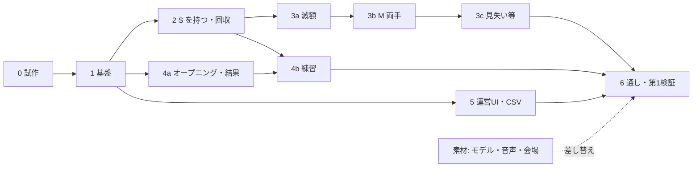

# 設計書: Treasure Haul（仮）

> 版: 第4版（2026-10-18）／元: `TREASURE_HAUL_REQUIREMENTS.md` 第6版（要件 ID はこれを指す）
> 【要検証】＝試作（11章）で確かめてから確定する。U-xx＝未確定事項（要件定義書 U章＋本書 U章）。

---

## 1. 方針

- **進行の権限は運営PCの「ホスト」**。NetSync サーバーは運営PC上で動かし、中継だけを行う。ホストが状態・時間・参加端末・合計額・お宝の状態表（4.2）を持ち、端末は従う（F-FLOW-3〜5）。
- **お宝の物理は判定役の端末だけ**が動かす（今の持ち主、いなければ最後の持ち主）。他の端末は kinematic にして、受け取った位置へ補間する。ホストは物理を計算しない。
- **配置は同期しない**: 共通シード＋参加人数から、ホストと全端末が同じ配置・値段を計算する。
- **古いメッセージを捨てる**: すべてのメッセージの先頭に RoundId（回の番号。Unix 秒で、運営PCの再起動をまたいでも重ならない）、お宝のメッセージには加えて世代番号（ホストがつかむのを認めるたびに +1）を付ける。古いものは捨て、自分の知るより新しい世代は採用する。
- **座標**: 同期する位置・配置候補点・荷台・境界はすべて Environment シーンの `VenueRoot` のローカル座標で扱う。位置合わせ（U-1）は `VenueRoot` の合わせ方だけを差し替える。
- ゲームのロジック（状態遷移・配置・減額計算・集計・パラメータ）は純粋な C# クラスにし、EditMode テストで確かめる。

---

## 2. 構成

| 場所 | 主なクラス | 役割 |
| :--- | :--- | :--- |
| 運営PC（OperatorClient＋Environment） | `SessionHost` | 進行、参加端末、合計額、お宝の状態表 |
| | `DeviceRegistry` | 端末一覧（DeviceId が主キー）、見学・位置合わせ確認 |
| | `ParamsProvider` / `RoundLogger` / `OperatorView` | パラメータ配布、CSV、運営UI |
| 端末（UserClient＋Environment） | `SessionClient` | ホストの状態に追従、時間合わせ |
| | `TreasureSpawner` | 配置（純粋ロジック。ホストも使う） |
| | `HandGrabber` ×2 / `Treasure` | ビーム・つかむ・持つ／状態・減額・回収判定 |
| Core（`System/XR/`） | `HandGripTracker` | 握る・開くの判定（新規。4.4） |
| | 各 View | 値札・表示板・案内・結果 |

- 名前空間 `STYLY.TIB_Template.TreasureHaul`。運営PCは NetSync のクライアントとして参加し（ステルス、アバターなし）、端末はホストにならない。
- 運営PCも Environment を読み込む。描画は不要だが、配置候補点・荷台の範囲・床のコライダーを使う（5章の強制で置く処理）。

---

## 3. 進行（F-FLOW / F-TUT）

### 3.1 状態

`RoundState`: `Waiting → Opening → Tutorial → Playing → Result → Waiting`

| 遷移 | きっかけ（ホスト） |
| :--- | :--- |
| Waiting → Opening | 「開始」（F-OPS-3 の条件）。RoundId・シード・ゲーム設定・パラメータ版を配る |
| Opening → Tutorial | 〔オープニング〕経過。参加端末に練習の色を割り当てて配る（3.4） |
| Tutorial → Playing | 〔練習〕経過（保留中は止め、〔保留の上限〕で解除）、または「本編開始」（練習中ならいつでも）。参加端末を確定して配る |
| Playing → Result | 〔本編〕経過、または目標額のみモード*で到達 |
| → Waiting | 〔結果〕経過、または「中断」（確認あり）。全端末でお宝・表示・合計を消す（F-FLOW-6） |

### 3.2 時間合わせと取りこぼし
- ホストは状態が変わるたびに `ThState`（状態の通し番号、状態、残り秒、シード、参加端末、ゲーム設定、パラメータ版、練習の色の割り当て）を送る。以後〔Heartbeat 間隔〕ごとに `ThHeartbeat`（状態の通し番号、残り秒、合計額、回収・消滅済みお宝のビット列）を送る。
- 端末は残り秒から自分で数え、Heartbeat と〔時間を合わせるずれ〕以上ずれたら合わせる。通し番号が違えば `ThResync` を送り、ホストは `ThState` とパラメータを送り直す。回収済みのビット列で、`ThCollected` の取りこぼしも直す。
- Heartbeat が〔運営PC切断の待ち〕届かない端末は、回を中止して Waiting に戻る（F-FLOW-8）。運営PCの再起動後は RoundId が変わるので、古い回の端末も Waiting に戻る。
- 【要検証 S-3】`ThState` の内容を NetSync のグローバル変数（サーバーが保持し、後から接続した端末も読める）に置く方式と比べる。そちらを採れば `ThResync` と通し番号は要らない。

### 3.3 接続と参加端末（F-FLOW-4/7、F-OPS-1/4）
- 端末は起動後、NetSync の自動接続で運営PCとつながり、Waiting になる。切断後の自動再接続【要確認 S-3】。
- 端末は DeviceId で識別する（ClientNo は再接続で変わるので、今の接続を引くためだけに使う）。DeviceId→端末番号の対応表は、運営PCだけの別ファイル（7章）。
- `DeviceRegistry` は、切断した端末を「位置合わせ未確認」に戻す。
- 参加端末＝接続中・位置合わせ確認済み・見学でない・パラメータ版が一致、の端末。参加していない端末はお宝を表示するが持てない。
- **回の途中で再接続した端末**は、その回のお宝を表示せず、次の回を待つ（シードからの最初の配置を誤って表示しないため）。
- バッテリーは既存のユーザー変数 `BatteryLevel`（NetSync が送る）。DeviceId・手の認識状態を誰が書くかは【要確認 S-3】。本作で書くなら `TreasureHaul` の起動処理で書く。

### 3.4 練習（F-TUT）
- 練習用お宝の置き場所4か所（`TutorialSlot`。色と記号つき）は Environment に手で置く。
- Tutorial に入るとき、ホストは参加端末を端末番号の小さい順に `TutorialSlot` 1〜4 へ割り当て、`ThState` で配る。各端末は自分のビームと練習用お宝を割り当ての色にし、自分のお宝の上に「あなたの」と出す。
- 練習用お宝は、本編のお宝と同じつかむ手順・位置の同期（4.4、6章）を使い、全員に見える。違いは3つだけ: ホストは割り当てられた端末にしかつかむのを認めない、減額しない、回収しても合計に入れない（F-TUT-3）。本編開始で消す。
- 練習完了は、練習用お宝の回収で `ThTutorialDone` をホストへ送る。ヒント（F-TUT-5）と最後の一文（F-TUT-7）は端末のローカル処理。

---

## 4. お宝

### 4.1 配置（F-ITEM-1/2）
- `TreasureSpawner`（純粋ロジック）が、シード＋参加人数＋P-5 の表＋配置候補点から配置と値段を出す。乱数は `System.Random(seed)`。
- 配置候補点は Environment に手で置き、荷台からの距離帯を持たせる。縁の余白・荷台の前には置かない。

### 4.2 状態

| 状態 | 判定役の端末の物理 | つかめる | 同期 |
| :--- | :--- | :---: | :--- |
| Resting（置かれている） | 止める | ○（荷台の範囲内は×） | 入るとき `ThRest`（最終位置） |
| Locked（M を片手でつかみ中） | 止める（その場） | 同じ人のもう一方の手だけ | `ThGrabbed` |
| Flying（手元へ飛ぶ途中） | 止める（補間） | × | 他の端末は `ThGrabbed` 後に持ち主の手へ〔飛ぶ時間〕で補間 |
| Held（持たれている） | 動かす（4.3） | × | `ThPose` |
| Hovering（手を見失い待ち） | 止める | × | `ThPose`（止まった位置） |
| Falling（落下中） | 重力あり | × | `ThPose` |
| Placing（そっと置く途中） | 止める（真下の床・台へ〔置く時間〕で降ろす） | × | 終わりに `ThRest` |
| Collected / Destroyed | 消す | ― | ― |

- **ホストの状態表**: お宝ごとに、状態（つかめる／つかめない）、判定役、世代番号、元の価値、現在の価値、ぶつけた回数、値段公開済みか、傷物か、回収済みか。ホストは `ThRest` と `ThForceRest` を受けたときだけ「つかめる」にする。
- 落下が〔止まったとみなす時間〕静止したら Resting（N-1）。
- **M の片手**（Locked）: 1本目の手で握るとホストへ `ThGrab` を送ってロックする。手を開けばロックを解く（`ThRelease`）。両手がそろうと Flying → Held。両手で持った後に片手を離した・見失ったときは〔M の猶予〕を優先し（〔見失い待ち〕は使わない）、その場で止めずに残った手で持ち続ける。猶予の間に両手に戻らなければ、離した場合は Falling、見失った場合は Placing（F-GRAB-4）。

### 4.3 持っている間の動き（F-GRAB-2/4/6/7）
- 重力なしの Rigidbody（interpolate、ContinuousSpeculative）。目標（片手は握った手の位置、M は両手の中点と両手を結ぶ向き）へ、位置は速度、向きは角速度で追従させる。速度の上限は〔追従速度の上限〕。
  - 何もない所では1物理ステップで追いつく。障害物に当たると止まり、表面に沿って滑る。Fixed Timestep を表示レートに合わせるかは【要検証 S-4】。
- **手の飛び**: 手の目標が1フレームで〔飛びの判定〕以上動いたら、目標を前の位置のまま止め、〔補正の無判定時間〕の間は「離れたら置く」と減額を止めて、目標へ戻す。
- 目標と〔離れたら置く距離〕以上離れたら Placing。
- お宝と `HandBone` レイヤーは、レイヤーの衝突表で当たらないようにする。
- **見失い**: `IsTracked` が〔見失いの猶予〕続けて false なら Hovering にし、〔見失い待ち〕待つ。手が戻ったときは、新しい握りの確定を待たず、**握りの強さが離す側のしきい値以上なら持ち続ける**。手を開いていたら Placing（その場でそっと置く。減額しない）。

### 4.4 つかむ（F-GRAB-1/3/5）
- **ビーム**: 肩の推定位置（頭から〔肩のずらし量〕）→ 手のひらの方向へ SphereCast（半径〔吸い付き半径〕）【要検証 S-1】。
- **握る**: Core に `HandGripTracker` を新しく作る（`System/XR/`）。XR Hands の関節から、人差し指〜小指の曲がり具合の平均を「握りの強さ」0〜1 として出す。つかむ側・離す側の2つのしきい値（ヒステリシス）、離す判定の継続時間〔離す判定〕、解除の理由（見失い／手を開いた）を持つ。しきい値は【要検証 S-1】。`HandPinchTracker` は前作用にそのまま残す。XRI の NearFarInteractor は使わない（両手・見失い・同期を自前で扱うため）。
- **狙いの保持**: 握る動きで手のひらの向きが変わってビームが外れても、〔狙いの保持〕以内に当たっていた持ち手を対象にする。
- **つかむ手順**:
  1. 端末はお宝を Flying にして手元へ動かし始め、`ThGrab` をホストへ送る。
  2. ホストは「つかめる」なら先着で認め、世代番号を +1 して `ThGrabbed`（ClientNo、世代番号、現在の価値）を全員へ送る。認めないときは `ThGrabDenied`（ClientNo）を全員へ送る。
  3. 端末は `ThGrabbed` を受けて Held にし、値段の公開・発見演出（F-ITEM-3/4）・`ThPose` を始める。飛び終わっても承認が届かなければ、手元で止めて待つ（減額しない）。
  4. 否認された、〔承認の待ち上限〕を過ぎた、承認前に手を開いた、のいずれかなら元の位置へ戻して Resting にし、`ThRelease`（取りやめ）を送る。ホストは承認済みならロックを外す。取りやめた後に自分宛ての `ThGrabbed` が届いたら、すぐ `ThRelease` を返す。
- 左右の手で S を1つずつ持てる（`HandGrabber` は手ごとに独立）。

### 4.5 持ち方の切り替え（F-GRAB-9*）
- `HandGrabber` の「ビームの長さ」と「つかんだ後の目標の決め方」を差し替えられる形にしておく。

---

## 5. 減額と回収（F-DMG / F-SCORE）

- **衝突**（F-DMG-1〜3）: 判定役が `OnCollisionEnter` で、直前〔速さをならすフレーム数〕のお宝の速度の平均から衝撃の速さを出し、〔数える衝撃〕以上なら1回と数える。Flying・Placing 中と、手の飛び・補正の後の〔補正の無判定時間〕は数えない。同じ相手（コライダー）とは、最後に離れてから〔再減額の間隔〕たつまで数えない。
- **お宝同士**（F-DMG-6。R.E.P.O と同じ）: ぶつかった**両方を1回ずつ**数える。衝突を見つけた判定役が、相対速度（自分の速度−相手の速度。相手が他の端末で動いているお宝なら `ThPose` から求めた補間速度）が〔数える衝撃〕以上なら、`ThDamage` に2つのお宝を載せてホストへ送る。ホストは同じ組み合わせを〔再減額の間隔〕の間は1回だけ数える（両方の端末から届いても二重に数えない）。
  - 置かれているお宝は kinematic なので、押されても動かないが減額はされる。
  - 他の人が持っているお宝とも当たる。持ち主の端末では相手を kinematic の代役として扱い、当たると止まって表面に沿って滑る。端末ごとの位置のずれで、片方の端末だけが衝突を見つけることがある【要検証 S-2】。
- **計算**: 判定役は `ThDamage`（位置）をホストへ送る。**ぶつけた回数はホストだけが数える**: 回数を +1 し、`DamageCalculator`（純粋）で `元の値段 × 減額率[回数]` を出して現在の価値から引き、`ThDamaged`（回数、減額の量、現在の価値、位置）を全員へ送る。全員がヒビの段階と「-90G」の表示を更新する（F-DMG-4）。3回目で0になり消滅（F-DMG-5）。持ち主が替わっても回数がずれない。
- **回収**（F-SCORE-1/4）: 判定役が、荷台の範囲に入り誰も持っていない状態を見て `ThCollect` をホストへ送る。ホストは Playing 中なら1回だけ数え、**ホストの現在の価値**を合計に加え、`ThCollected`（合計額、価値、傷物か）を全員へ送る。目標額に達したら全員へ知らせる。
- **持ち主の切断**（F-GRAB-8）: ホストは、その端末が判定役のお宝に `ThForceRest`（最後に受けた位置、世代番号 +1）を送る。全端末とホストが同じ手順で Placing → Resting にする。降りた位置が荷台の範囲内なら、ホストが回収する。自分が持っているお宝の `ThForceRest` を受けた端末（一瞬切れて戻った持ち主）は、手から外す。

---

## 6. 同期メッセージ（NetSync）

- 状態の変化は RPC。既存の `Rpc` 列挙（Core）の**末尾**に `Th*` を足す（前作の `Gi*` の番号を変えない）。自分が送った RPC の戻りは ClientNo で捨てる（前作と同じ）。
- RPC はすべて全員宛て。特定の端末向けの内容は、引数に ClientNo を入れる。
- 持たれている間の位置は、判定役が〔位置の送信間隔〕ごとに `ThPose` を送り、他の端末は補間する【要検証 S-2】。

| 名前 | 送り手 | 主な内容 |
| :--- | :--- | :--- |
| ThState / ThHeartbeat | ホスト | 3.2 |
| ThResync / ThTutorialDone | 端末 | 3.2 / 3.4 |
| ThParams | ホスト | パラメータ JSON と版（7章） |
| ThGrab / ThRelease | 端末 | つかむ申請 / 置いた・落とした・取りやめ、位置、速度 |
| ThGrabbed / ThGrabDenied | ホスト | 4.4 |
| ThPose / ThRest / ThDamage / ThCollect | 判定役 | 4.2、5章 |
| ThDamaged / ThCollected / ThForceRest | ホスト | 5章 |

---

## 7. パラメータとゲーム設定（N-7 / N-8）

- **パラメータ**: P章の6グループをフィールドに持つ `[Serializable]` クラス `ThParams` を、ScriptableObject 1つ（組み込みの初期値）に入れる。各値に `[Range]` を付ける。
- **差し替え**: 運営PC の `persistentDataPath/treasure_haul_params.json`。ホストは起動時と、待機中の「再読み込み」で読み、`JsonUtility.FromJsonOverwrite` で初期値に重ねる（書いた項目だけ上書き）。`[Range]` 外の値は初期値に戻して運営PCに警告を出す。
- **版**: 重ねた後の値を `JsonUtility.ToJson` した文字列のハッシュ先頭8桁。
- **配布**: 「開始」のたびに `ThState` に版を載せ、版が違う端末にはその場で `ThParams` を送り直す（N-7）。オープニング中に一致しなければ、その端末は参加端末に入れず、運営UIに「版の不一致で除外」と出す。
- **運営PCだけのファイル**: `treasure_haul_settings.json`（モード、追加要素、持ち方。`ThState` で配る）、`treasure_haul_devices.json`（DeviceId→端末番号。予備機も含めて会場で登録）。
- 雛形の JSON は、組み込みの値を書き出すエディタメニューで作る。

---

## 8. 運営PC

- `OperatorView`: 端末一覧（F-OPS-1）、状態・残り時間・合計額（F-OPS-2）、開始／保留／本編開始／中断（F-OPS-3）、見学・位置合わせ確認（F-OPS-4）、パラメータ版・警告・再読み込み、ゲーム設定*（F-OPS-5）。
- `RoundLogger`: `rounds_YYYYMMDD.csv`・`players_YYYYMMDD.csv`（F-OPS-7）。個人の時刻・回数は、ホストが `ThGrabbed`・`ThCollected`・`ThDamage`・`ThTutorialDone` から集計する。1行ごとに書き込みを確定させる。
- ランキング*は U-7 が決まってから、Core の `LeaderboardTracker` を使えるか判断する（今は個人スコアを集計する作り）。

---

## 9. 表示・後片付け

- 値札・減額表示・発見演出・表示板・案内（F-FLOW-2、F-ITEM-5、F-DMG-4、F-SCORE-3）・結果は View ごとに分け、Treasure / Session の状態（R3）を購読するだけにする。
- `ScreenFader` は使わない（F-SAFE-3）。
- 回の終わり（Result→Waiting、中断）で、お宝・View・Tween・R3 の購読を回ごとに破棄する（N-2）。

---

## 10. 既存コードの扱い

| 既存 | 扱い |
| :--- | :--- |
| `GameSession`（Core） | 使わない。前作用に残す |
| `HandPinchTracker`（Core） | 使わない（前作用にそのまま残す）。握る判定は新規の `HandGripTracker`（4.4） |
| `Rpc` / `RpcManager` / `VariableManager`（Core） | 使う。`Rpc` の末尾に `Th*` を足す |
| `UserClient`（Core） | 使う。システムメニュー・スリープの抑止（N-4）を `#if UNITY_ANDROID` で囲んで足す。PICO 本体の安全境界は STYLY 側の設定なので触らない。起動時の `Recenter()` は位置合わせ（U-1）が決まったら見直す |
| `OperatorClient` / `ScoreMonitorView` / `StageScoreMonitorView` | 使わない（開始はホスト、表示板は新規） |
| `VRArea` / `WarningWall` | 会場寸法で作り直し、`VenueRoot` の子に置く（F-SAFE-1） |

---

## 11. 試作で確かめること（実装前、1〜2日）

| ID | 内容 | 決まること |
| :--- | :--- | :--- |
| S-1 | PICO 実機で、ビーム（肩推定→手のひら）と握る判定が安定するか（握りのしきい値、握る瞬間の狙いのずれ、〔狙いの保持〕）。初めての人が持てるか。見失いから戻ったときの握りの強さ | 4.3、4.4 |
| S-2 | 持たれているお宝の位置を〔位置の送信間隔〕で4台に送って、見た目と負荷が保てるか。持たれているお宝同士の衝突が、両方の端末で破綻なく見えるか | 6章、5章（お宝同士） |
| S-3 | RPC の大きさの上限・順番・取りこぼし・往復時間、自動再接続、グローバル変数、DeviceId 等を誰が書くか | 3.2、3.3、4.4 |
| S-4 | 速度追従で、障害物に沿って滑る・遅れない・ガタつかないが両立するか（Fixed Timestep） | 4.3 |
| S-5 | 4人・23個で【仮】72fps が出るか | N-1（処理の重さの上限を確定） |

---

## 12. テスト

- **EditMode**: ホストの状態遷移、時間合わせ、配置の決定性、減額計算（回数と額）、つかむ手順（承認・否認・取りやめ・遅れた承認）、世代番号による破棄、回収の二重計上なし、パラメータの上書き・不正値・版、CSV、`HandGripTracker` のしきい値と離す判定の継続時間。
- **エディタ**: 手の入力をキーボード・マウスで出す `DebugHandInput`（エディタのみ）で、PlayMode の通し確認。複数台は ParrelSync。
- **連続稼働**（要件定義書 4章）: ホストの「自動進行」（エディタ用）で60回。
- **実機**: 要件定義書 4章の受け入れ基準。

---

## 13. 実装の順番（各行を dev-loop 1回＝1 PR＝1 Issue）

進み具合は `TODO.md`（今どこか）と GitHub Issue（各行の詳細）で管理する。3D モデル（U-3）とナレーション（U-5）は仮の素材で進め、届いたら差し替える。

| 順 | 内容 | 着手の条件 | 目安 |
| :--- | :--- | :--- | :--- |
| 0 | 試作 S-1〜S-5 | ― | 10/18〜19 |
| 1 | パラメータ・ゲーム設定、`Rpc` 追加、ホストと端末の状態遷移、運営UIの最小（開始・中断） | 0 | 10/20〜21 |
| 2 | 配置、S を持つ・置く・回収（`HandGripTracker`・ビーム・同期）、表示板 | 1 | 10/22〜23 |
| 3a | 減額と表示（3回で壊れる） | 2 | 10/24 |
| 3b | M（Locked・両手） | 3a | 10/25 |
| 3c | 見失い・手の飛び・そっと置く・持ち主の切断 | 3b | 10/26 |
| 4a | オープニング、保留・本編開始、結果 | 1 | 10/24〜26（2・3 と並行） |
| 4b | 練習（固定位置・色分け） | 2、4a | 10/27〜28 |
| 5 | 運営UIの残り（端末一覧・見学・位置合わせ確認）、記録 CSV | 1（CSV の個人の減額欄は 3a） | 10/27〜29（並行） |
| 6 | 連続稼働・実機での通し → 第1検証開始 | すべて | 10/30〜31 |
| 素材 | 3D モデル、ナレーション音声、会場レイアウト（Environment） | ― | 10/18〜28（並行） |

### 並行して進めるときの決まり
- 並行する作業は worktree で分ける。着手前に、他の作業から呼ばれるクラス名・メソッドの形（API）を Issue 本文に書いて固定する。
- 3a → 3b → 3c は同じクラス（`Treasure`・`HandGrabber`）を触るので順番に進める。
- 同じシーン・プレハブを2つの作業で同時に触らない（Environment は「素材」と 4b、UserClient は 2 と 4a が触る。後から着手する方は、先の PR がマージされてから触る）。
- Unity エディタは1つなので、コンパイル・テストは1つずつ行う。マージは依存の向き（図の左から）に行う。

---

## T. 要件との対応

| 要件 | 節 | 要件 | 節 |
| :--- | :--- | :--- | :--- |
| F-FLOW-1〜8 | 3.1〜3.3 | F-DMG-1〜6 | 4.3、5 |
| F-TUT-1〜7 | 3.1、3.4、9 | F-SCORE-1〜5 | 5、9 |
| F-GRAB-1〜8 | 4.2〜4.4、5 | F-OPS-1〜7 | 3.3、7、8 |
| F-GRAB-9* | 4.5 | F-SAFE-1〜3 | 9、10、Environment の作り（障害物の高さ） |
| F-ITEM-1〜5 | 4.1、4.4、9 | N-1〜8 | 4.2、7、9、10、12 |

---

## P. 本書で増えたパラメータ（要件定義書 P章に足す）

| グループ | 項目 | 初期値 |
| :--- | :--- | :--- |
| P-1 進行 | Heartbeat 間隔 / 時間を合わせるずれ | 1秒 / 0.25秒 |
| P-3 持ち方 | 肩のずらし量 / 吸い付き半径 | 【要検証】下 0.15m・左右 0.18m / 【要検証】0.05m |
| P-3 持ち方 | 追従速度の上限 / 見失いの猶予 / 置く時間 / 承認の待ち上限 | 【要検証】10m/s / 0.1秒 / 0.3秒 / 1秒 |
| P-3 持ち方 | 位置の送信間隔 | 【要検証】0.066秒（15回/秒） |
| P-4 お宝・減額 | 速さをならすフレーム数 / 止まったとみなす時間 | 3 / 0.2秒 |

---

## U. 本書で増えた未確定事項

なし。

- 決まったもの（第4版）: U-13 練習用お宝は全員に見える／U-14 見失いから手を開いて戻ったらそっと置く（4.3）／U-15 お宝同士は R.E.P.O と同じく、持たれていても当たり、両方を数える（5章）／U-16 練習用お宝は荷台の前の固定位置（3.4）／U-17 M の片手は〔M の猶予〕を優先（4.2）。
