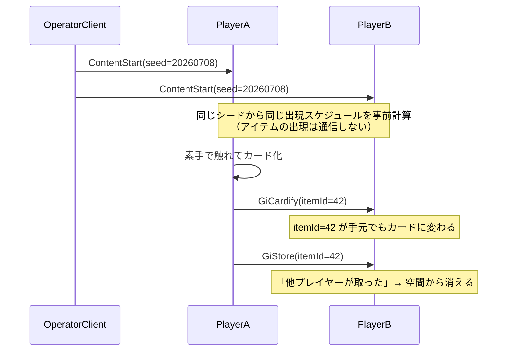
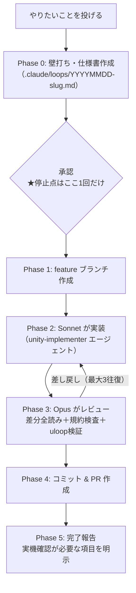

STYLY-NetSyncとClaude Codeを組み合わせて、ハンドトラッキング専用のマルチプレイMRゲームを1ヶ月で作った記録です。マルチプレイの同期実装と、Unityでのコンパイル・確認・修正という検証の往復、この2つのコストがどう下がったのかを中心に書きます。最後には、それでも人間の手に残った仕事についても正直に書きます。

## 作ったもの

<!-- TODO: 画像 — バインダーにカードを収納している実機プレイ動画のGIF -->

今回作ったのは**具現化ポーカー（仮）**、アニメ『HUNTER×HUNTER』の「グリードアイランド（G.I.）編」をモチーフにしたMR体験です。現実空間のアイテムに素手で触れるとカードになり、バインダーに収納するとスコアになります。カード化から1分以内にしまわないと消滅し、取り出して「ゲイン」すると元のアイテムに戻って効果が発動します（一度ゲインしたアイテムは二度とカード化できません）。ランクはD/C/B/A/S/SSの6段階で、バインダー内の組み合わせによってポーカーの「役」のようなボーナスが付きます。

ロケーションベースエンターテインメント（LBE）、つまり展示・体験用のアプリケーションで、有楽町のイベントスペースでの提供を想定しています。1セッション5分、ハンドトラッキング専用（コントローラーなし）でフルカラーパススルーのMRです。ターゲットデバイスはPICO 4（PICO Unity OpenXR SDK / PXR_Enterprise）、Meta Quest等のパススルー対応デバイスも想定しています。

### 技術構成

| 項目 | 内容 |
|---|---|
| Unity | 6000.3.10f1 / URP |
| マルチプレイ同期 | `com.styly.styly-netsync` 0.17.4 + `com.styly.styly-netsync.utility` 0.4.5 |
| 非同期 | UniTask 2.5.10 |
| リアクティブ | R3 1.3.0 |
| ハンドトラッキング | XR Hands 1.4.3 / XR Interaction Toolkit |
| デバイス | PICO Unity OpenXR SDK / Meta OpenXR 2.3.0 |
| ローカル複数クライアント検証 | ParrelSync |
| 演出 | DOTween |

### 開発規模

- 開発期間: **2026-07-07 〜 2026-08-09（約1ヶ月）**
- **142コミット / PR 34本**
- C# **71ファイル / 13,657行**
- EditModeテスト **19ファイル**
- **C#はほぼ全量をClaudeが書きました**（人間が書いたのは企画・仕様・レビューコメント）

### シーン構成

- `Environment.unity` … 共有ステージ、アイテム、スポナー、共有スコアボード
- `UserClient.unity` … 体験者用XR Rig、バインダーUI、ハンドインタラクション
- `OperatorClient.unity` … 運営PC用UI、セッション開始トリガー、タイマー・状態管理

→ `AdditiveSceneLoader.cs` でマルチシーンとして結合します。

## 結論：何が「簡単」になったのか

マルチプレイMRゲームを作るときにしんどいのは、実は「ゲームを作ること」そのものではなく、その周辺だと感じました。具体的には次の2つです。

1. **同期基盤** — 誰が何を持っていて、誰がどのカードを取ったのか、全員の見え方を合わせること
2. **検証の往復** — Unityでコンパイルし、Playして、見て、直す。この往復が開発時間の大半を食います

STYLY-NetSyncが1つ目を、Claude Codeが2つ目を引き受けてくれました。結果として人間に残ったのは、企画・仕様の決定、実機での確認、「面白いか」の判断の3つだけでした。

## STYLY-NetSyncはenum 1つで始まる

### RPCはenumを定義するだけ

RPCはenumを定義して`RpcManagerBase<T>`を継承するだけです。これだけでクライアント間の同報通信ができます。

```csharp
// Rpc.cs — 同期したいイベントを enum で定義するだけ
public enum Rpc
{
    /// <summary>コンテンツ開始（引数: [0]=スポーン用乱数シード）</summary>
    ContentStart,
    /// <summary>カード化（引数: [0]=itemId）</summary>
    GiCardify,
    /// <summary>ピンチで掴んだ（引数: [0]=itemId）</summary>
    GiGrab,
    /// <summary>離した/取り出した（引数: [0]=itemId, [1..3]=位置xyz）</summary>
    GiRelease,
    /// <summary>バインダーに収納した（引数: [0]=itemId）</summary>
    GiStore,
    /// <summary>ゲイン（具現化）した（引数: [0]=itemId, [1..3]=位置xyz）</summary>
    GiGain,
    // ... 以下同様に、全13種
}
```

```csharp
// RpcManager.cs — 実装はこれだけ
[DefaultExecutionOrder(-100)]
public class RpcManager : RpcManagerBase<Rpc>
{
    public static RpcManager Instance { get; private set; }

    void Awake()
    {
        Instance = this;
    }
}
```

プレイヤーごとの共有変数も`UserVariable`というenumで定義します。`GiScore`（現在スコア／int）はバインダーの中身が変わるたびに更新され、`GiRemainingTime`（セッション残り時間／float）は運営PCのスコアモニターが読みます。`BatteryLevel`はSTYLY-NetSyncが内部的に送っているものをそのまま使えます。

### 設計の肝：「全部同期しない」

アイテムの出現自体は一切同期していません。代わりにやっているのは次の3ステップです。

1. 運営PCが`ContentStart` RPCを投げるとき、引数に乱数シードを1つ載せる
2. 各クライアントはそのシードから、全出現スケジュール（ID・種類・位置・時刻）をセッション開始時に事前計算する
3. あとは経過時間に従ってスケジュール通りに出すだけ → 全クライアントで同じアイテムが同じ場所に同じIDで現れる

実際のコード内コメントです。

> セッション中のアイテム出現を管理するスポーナー。マルチユーザー同期のため出現は決定論的に行う。GameSession.SessionSeed（ContentStart RPC で全クライアント共有）からセッション開始時に全出現スケジュールを事前計算する。実行時はセッション経過時間に従ってスケジュール通りに出現させるだけなので、全クライアントで同じアイテムが同じ場所に同じIDで現れる（スポーン通信は不要）。

同期するのは「プレイヤー操作による離散的な状態遷移」だけです（カード化 / 掴む / 離す / 収納 / ゲイン / 錬金）。セッション開始の合図まで含めても、RPCは全13種類で完結しています。

さらに割り切ったところが2つあります。

- **1分ルールの消滅（Expired）は配信しません。** カード化イベントを受け取った各クライアントが、それぞれローカルタイマーで消滅させます（イベント数の削減と耐障害性のため）
- **掴んでいる間のカードの位置は同期しません。** リモートではその場に静止し、離した位置（`GiRelease`）で再配置されます



### R3に同期を寄生させる

ゲームロジック側は同期をまったく意識していません。各アイテムの状態（`CardizableState`）はR3のReactivePropertyで、`CardNetworkSync`がその遷移を購読して自動でRPCに変換しているだけです。

```csharp
// ローカルの状態遷移 → RPC 送信（ゲームプレイ側のコードは同期を知らない）
private void OnLocalStateChanged(CardizableItemBase item, CardizableState prev, CardizableState current)
{
    if (applyingRemote || !Online || item.NetworkId < 0) { return; }

    var id = item.NetworkId.ToString();
    var p = item.transform.position;
    switch (current)
    {
        case CardizableState.FloatingCard when prev == CardizableState.Item:
            Send(Rpc.GiCardify, id);
            break;
        case CardizableState.Held:
            Send(Rpc.GiGrab, id);
            break;
        case CardizableState.Stored:
            Send(Rpc.GiStore, id);
            break;
        case CardizableState.Gained:
            Send(Rpc.GiGain, id, F(p.x), F(p.y), F(p.z));
            break;
        case CardizableState.Expired:
            // 消滅は配信しない（各クライアントのローカルタイマーで発生する）
            break;
    }
}
```

受信側は共通ラッパー1つです。自分のエコーを`ClientNo`で弾き、適用中は`applyingRemote`フラグで再配信を止めます（これがないと無限ループします）。

```csharp
/// <summary>自分のエコーを除外し、受信適用中フラグを立てて適用する共通ラッパー</summary>
private void Subscribe(Rpc rpc, System.Action<string[]> apply)
{
    RpcManager.Instance.AsObservable(rpc)
        .Where(data => data.ClientNo != SelfClientNo && data.Parameters != null)
        .Subscribe(data =>
        {
            applyingRemote = true;
            try { apply(data.Parameters); }
            finally { applyingRemote = false; }
        })
        .AddTo(this);
}
```

`AsObservable`でR3のObservableとして受け取れるため、UniTask/R3ベースの設計にそのまま乗ります。

### 同期設計から生まれた仕様

全員の「本編開始時刻」を揃える必要があるため、チュートリアルは進行度に関わらず固定尺（60秒）にしてあります。`ContentStart`が全クライアント同報なので、シード付きスポーンの開始時刻を合わせないと出現がズレてしまうためです。同期の都合がゲーム仕様を決めた一例だと言えます。

## Claude Codeに開発ループを回させる

### 前提：AIがUnityエディタを操作できないと話にならない

`uloop-cli`をClaude Codeのスキルとして入れてあります。これでClaudeが自分で次のことができます。

- `uloop-compile` — コンパイル
- `uloop-run-tests` — EditModeテスト実行
- `uloop-control-play-mode` — PlayModeの開始/停止
- `uloop-screenshot` — Game Viewのスクリーンショット撮影
- `uloop-get-logs` — Consoleログの読み取り
- `uloop-execute-dynamic-code` — 任意のC#をエディタ上で実行し、SerializedObject / AssetDatabase / PrefabUtilityを叩く

ポイントは「AIが自分の書いたコードの結果を自分で見られる」ことです。書きっぱなしになりません。特に`uloop-execute-dynamic-code`が効き、シーンやPrefabの結線（コンポーネントのアタッチ、参照の設定）をエディタAPI経由でやらせられるので、AIがUnityアセットを触れるようになります。

<!-- TODO: 画像 — Claudeがuloopで撮影したUnity Game Viewのスクリーンショット -->

### dev-loop：毎回書いていた指示をスキルにした

実際のセッションから生まれたものです。開発中、こういうやり取りをしていました。

> 「今回はOpusがオーケストレーターとなり、実装自体はSonnetでお願いします。uloopでデバッグ、テストもSonnetでお願いします」

これを毎回書いていました。あるとき、こう聞きました。

> 「『ループで自動実装して』のようにプロンプトで打ったら、今回の仕組みで動くようになっている？ それとも毎回この仕組みで動く？ ……トリガーにして、今回の仕組みで動くようにしたい」

こうして`dev-loop`スキルができました。中身は次の図の通りです。



設計上のキモは3つあります。

1. **停止点は承認1回だけ。** 承認後はPR発行まで人間に確認を求めずに走り切ります。細かく聞かれると自動化の意味がなくなるので、意図的にそう決めています。
2. **仕様書を必ずファイルに書かせる**（`.claude/loops/<日付>-<slug>.md`）。目的 / 受け入れ基準 / 変更対象 / **やらないこと** / 検証方法 / **実機確認が必要な項目**のテンプレです。実装エージェントにはこのファイルの絶対パスを渡します。「やらないこと」を書かせるのが効きます。
3. **モデルを使い分けます。理由はコストです。** 実際、開発中にこう聞いています。
   > 「めっちゃクレジット食っているけど、ちゃんと分担できているの？」

   → Opus＝オーケストレーター（仕様・レビュー・検証）／Sonnet＝実装、に固定しました。軽いタスクは「オーケストレーターも作業も全てSonnetで」と指定して丸ごと下げる運用も併用しています。

レビューもOpusが担当します。dev-loopのレビュー手順には「実装エージェントの完了報告を鵜呑みにしない」と明記してあり、`git diff`を全部読ませ、受け入れ基準を1項目ずつ突き合わせ、規約違反を機械的にgrepで検査させています。

```bash
git diff -U0 | grep -nE 'StartCoroutine|IEnumerator|UnityEvent|event Action|yield return'
```

（このプロジェクトはCoroutineとUnityEventを禁止し、UniTaskとR3に統一しているため。ヒットしたら差し戻します）

### ガードレール：AIにUnityプロジェクトを壊させない

AIに承認なしで走らせる以上、壊せないようにしておくのが前提条件です。2段構えにしてあります。

**(1) `.claude/settings.json`のdenyリスト** — シリアライズ済みアセットのテキスト直接編集を丸ごと禁止します。

```json
"deny": [
  "Edit(**/*.unity)",  "Write(**/*.unity)",
  "Edit(**/*.prefab)", "Write(**/*.prefab)",
  "Edit(**/*.asset)",  "Write(**/*.asset)",
  "Edit(**/*.meta)",   "Write(**/*.meta)",
  "Bash(git push --force:*)",
  "Bash(git reset --hard:*)",
  "Bash(gh pr merge:*)"
]
```

`.unity` / `.prefab`のYAMLをAIにテキスト編集させると、guidやfileIDが壊れて参照が全部切れるため、編集は必ず`uloop-execute-dynamic-code`経由でエディタAPI（SerializedObject / AssetDatabase / PrefabUtility）から行うルールにしています。`gh pr merge`も禁止です（マージは常に人間です）。

**(2) PreToolUseフック（`guard.py`）** — denyを掻い潜る書き方を止める最後の安全弁です。実際のコメントから引用します。

> AI駆動開発ループ（承認なしで実装〜PR発行まで走らせる運用）における最後の安全弁。自動承認ルールで承認プロンプトを消した分、「取り返しがつかない操作」だけをこのフックで確実に止める。

止めている例は、`.meta`の直接`rm`、`Assets`ディレクトリの`rm`、force push、master/main/developへの直接push、`git reset --hard`などです。

CLAUDE.mdには「ガードレールにブロックされた操作は迂回してはならない」と明記してあります。`python3`で同じ操作を書く、`git -C`で回避する、別名で書いてから移す──こういう抜け道を塞いでいます。「ガードレールは仕様であり障害物ではない」と書いています。

:::message
承認プロンプトを減らす（allowリストを広げる）ことと、ガードレールを固めることはセットです。allowを広げただけだと事故ります。
:::

### agent-memory：セッションをまたいで学ばせる

`.claude/agent-memory/`にハマった知見を追記させ、新しいセッションで関連タスクに着手する前に必ず読ませています。実例は次の通りです。

> **TMP日本語フォントの豆腐（□）問題**
> 症状: PlayModeで「体験」「見習」など一部の漢字だけ□で表示される。
> 原因: `Noto Sans JP SDF` は Dynamic モードだが 1024x1024 の単一アトラス＋pointSize 90 で約130グリフが上限。マルチアトラスが無効だと満杯以降の新規グリフが追加できず豆腐になる。
> 対策: マルチアトラス有効化＋アトラス2048x2048化＋ `ClearFontAssetData(true)` で再構築。

Unity特有の「一度踏まないと絶対わからない罠」が溜まっていきます。これがあると、次のセッションのAIが同じ穴に落ちません。

### 専門エージェント

`.claude/agents/`に役割特化のサブエージェントを置いています。使っているのは`unity-implementer`（実装専任）/ `code-reviewer`（規約に照らした独立レビュー）/ `playmode-tester`（PlayModeでの動作検証）/ `vfx-artist`（演出）/ `shader-expert`（URP・MRパススルー）/ `balance-simulator`（スコアバランスの数値シミュレーション）/ `multiplayer-tester`（NetSync同期の検証）です。

実装したエージェント自身に「できましたか？」と聞いても意味がないので、レビュアーは必ず別の独立したコンテキストで立てます。

## それでもAIに任せられなかったこと

これだけ自動化しても、3つは人間に残りました。しかもこれは「AIが未熟だから」ではなく、構造的に残るものだと考えています。

### (1) 実機でしか出ない問題（最大の壁）

エディタでは完璧に動いていたものが、PICO 4にビルドした瞬間に動かない。実際に起きたことです。

> 「Picoにビルドしてわかったこと：MRモードになっていない／ゲームがなぜかスタートしない」
> 「動いた！ が、ハンドトラッキングが全く反応しない」

AIと何往復もして原因が特定できず、最終的に人間が自分で見つけました。

> 「`STYLY > Setup HMD SDKs > Setup PICO OpenXR SDK` を設定していないからでした。解決しました」

Unityエディタのメニュー操作というプロジェクト設定の問題で、コードのどこにも痕跡がありません。AIはコードとログしか見られないので、HMDを被って気づくしかない領域が確実に残ります。だからdev-loopの完了報告テンプレには「実機確認が必要な項目」欄を必ず入れています。

<!-- TODO: 画像 — PICO実機で動作しているところの写真 -->

### (2) 「面白いか」「わかるか」の判断

AIは仕様どおりに作ります。でもそれが体験として成立しているかは判断できません。実際に出した指摘です。

> 「わかりにくすぎないか？？ せめて触れる部分をマテリアルつけるとかしないと初見の人無理だろ」
> 「宝箱が現れて開く動作までの時間が短すぎる。1.5秒くらいは欲しい。開く動作も早すぎ。1秒くらいはかけたい」

演出のタイミング、初見の人が操作を理解できるか、MR空間での距離感。ここは今のところ見て言うしかありません。逆に言うと、AIに実装を任せた分の時間をここに使えるようになったのは収穫です。

### (3) AIが書いたコードを人間が把握できなくなる

これが一番厄介で、かつ対策できるものです。1ヶ月で13,000行が積み上がった結果、こうなりました。

> 「全体的にテキストのサイズやフォント、場所を変更したいのですが、どこを触ればいいのかわからん」
> 「今どのアイテムがあって、使っているか、Prefabはどれかなど不明」
> 「カードの情報とアイテムの繋がりや、カードの詳細情報（マテリアルやPrefab含む）が不明かつ、一括管理できていないので、一つの場所で一括できるようにしたい（例えばScriptableObject使うなど）」

対策として、カード情報を`CardRankConfig` / `CardDefinition`（ScriptableObject）に一元管理するリファクタを1本のPRとして実施しました。

教訓は、AI駆動開発では「人間が触れる操作盤」を意識的に作らないと、動くけど誰も触れないコードベースになる、ということです。ScriptableObjectに寄せる、設定値を1箇所に集める、といった設計は、AI駆動だと優先度が上がります。

## まとめ

- STYLY-NetSyncはenumを定義するだけで同期が始まります。しかも全部同期しなくていい（決定論スポーン＋離散イベントだけ）と割り切ると、実装量は劇的に減ります
- Claude Codeは「AIがUnityを操作できる（uloop）」＋「開発ループを固定する（dev-loop）」＋「壊せなくする（ガードレール）」の3点セットで初めて自走します
- 人間に残るのは実機確認・体験の判断・設計の交通整理です。この3つに時間を使えるようになったのが一番の収穫でした
- 1ヶ月・PR34本でここまで来ました。マルチプレイMRの立ち上げコストは、本当に下がっています

同じ構成は他のUnityプロジェクトでも使えるはずです。興味があれば、ぜひ試してみてください。
